```{=html}
<style>
body { font-family: 'Times New Roman', Georgia, serif; line-height: 1.65; color: #0f172a; }
h1, h2 { color: #1B365D; }
.ufm-meta { border: 2px double #1B365D; padding: 1.2rem 1.6rem; text-align: center; margin-bottom: 1.5rem; background: #f8fafc; border-radius: 4px; }
.apa-ref p { padding-left: 2.2em; text-indent: -2.2em; margin-bottom: 0.55em; text-align: left; }
table { font-size: 0.90rem; }
table thead th { background-color: #1B365D; color: #ffffff; }
pre code { font-size: 0.78rem; line-height: 1.35; }
</style>
```

```{=typst}
// --- SECTION 1: TRANG BÌA CHÍNH & BÌA PHỤ CHUẨN UFM (KHUNG VIỀN KÉP, KHÔNG ĐÁNH SỐ TRANG) ---
#set page(
  numbering: none,
  header: none,
  footer: none,
  background: place(
    top + left,
    dx: 2.35cm,
    dy: 1.35cm,
    rect(
      width: 17.3cm,
      height: 27.0cm,
      stroke: 1.6pt + rgb("#1B365D"),
      inset: 3pt,
      rect(width: 100%, height: 100%, stroke: 0.7pt + rgb("#1B365D")),
    ),
  ),
)
#align(center)[
  #v(0.4cm)
  #text(size: 14.5pt, weight: "bold", fill: rgb("#1B365D"))[TRƯỜNG ĐẠI HỌC TÀI CHÍNH – MARKETING]
  #v(0.22cm)
  #text(size: 13.5pt, weight: "bold", fill: rgb("#1B365D"))[KHOA KHOA HỌC DỮ LIỆU]
  #v(0.8cm)
  #image("assets/ufm_logo.jpeg", width: 3.6cm)
  #v(1.1cm)
  #text(size: 15pt, weight: "bold")[TIỂU LUẬN KẾT THÚC HỌC PHẦN]
  #v(0.3cm)
  #text(size: 16pt, weight: "bold", fill: rgb("#1B365D"))[LẬP TRÌNH PYTHON CHO KHOA HỌC DỮ LIỆU]
  #v(1.3cm)
  #text(size: 13.5pt, weight: "bold")[ĐỀ TÀI:]
  #v(0.35cm)
  #set par(leading: 0.85em, justify: false)
  #text(size: 14pt, weight: "bold", fill: rgb("#1B365D"))[PHÂN TÍCH BIỂU HIỆN ĐỊNH GIÁ ĐỘNG (DYNAMIC SURGE PRICING) VÀ DỰ BÁO GIÁ BÁO API TRÊN NỀN TẢNG GỌI XE CÔNG NGHỆ (UBER & LYFT BOSTON, MA)]
  #v(1.6cm)
  #text(size: 13pt, weight: "bold")[GIẢNG VIÊN GIẢNG DẠY HỌC PHẦN: ThS. TRẦN MẠNH TƯỜNG]
  #v(0.35cm)
  #text(size: 13pt, weight: "bold")[MÃ LỚP HỌC PHẦN: 2631101190501]
  #v(0.35cm)
  #text(size: 13pt, weight: "bold")[NHÓM THỰC HIỆN: NHÓM 02 — LỚP 25DDS01]
  #v(0.35cm)
  #text(size: 12.2pt, fill: rgb("#475569"))[MÃ ĐỀ TÀI: PRJ-EXT-01]
  #v(1fr)
  #text(size: 13pt, weight: "bold")[TP. HỒ CHÍ MINH, NĂM 2026]
  #v(0.4cm)
]
#pagebreak()
#align(center)[
  #v(0.3cm)
  #text(size: 14.5pt, weight: "bold", fill: rgb("#1B365D"))[THÔNG TIN NHÓM THỰC HIỆN VÀ PHÂN CÔNG NHIỆM VỤ]
  #v(0.35cm)
  #text(size: 11pt, weight: "bold")[Học phần: LẬP TRÌNH PYTHON CHO KHOA HỌC DỮ LIỆU #h(0.6em) | #h(0.6em) Mã lớp HP: 2631101190501]
  #v(0.2cm)
  #text(size: 11pt, fill: rgb("#475569"))[Giảng viên hướng dẫn: ThS. TRẦN MẠNH TƯỜNG #h(0.6em) | #h(0.6em) NHÓM 02 (Lớp 25DDS01)]
  #v(0.5cm)
]
```

::: {.content-visible when-format="html"}
::: {.ufm-meta}
**TRƯỜNG ĐẠI HỌC TÀI CHÍNH – MARKETING**  
**KHOA KHOA HỌC DỮ LIỆU**

{width=95px fig-align="center"}

**Giảng viên hướng dẫn:** ThS. TRẦN MẠNH TƯỜNG | **Mã lớp học phần:** `2631101190501`  
**NHÓM 02 — Lớp 25DDS01** | **Mã đề tài:** `PRJ-EXT-01`  
*TP. HỒ CHÍ MINH, NĂM 2026*
:::

# THÔNG TIN NHÓM THỰC HIỆN VÀ PHÂN CÔNG NHIỆM VỤ {.unnumbered .unlisted}
:::

| STT | HỌ VÀ TÊN | MSSV | Tỷ lệ hoàn thành phần việc được giao | NỘI DUNG PHỤ TRÁCH CHÍNH | Chữ ký |
| :---: | :--- | :---: | :---: | :--- | :---: |
| 1 | Trần Thanh Huy | 2521001060 | 100% (α₁ = 1.00) | Kiến trúc pipeline làm sạch, ghép nối & đặc trưng (src/, main.py); huấn luyện mô hình có điều kiện & Ex-Ante, kiểm định độ bền & hiệu chỉnh Split-CQR; hạ tầng Dashboard Streamlit/HTML Offline, bộ kiểm thử pytest, chuẩn hóa PEP 8, xuất bản & đóng gói. | (Ký xác nhận) |
| 2 | Lê Huy Thắng | 2521001092 | 100% (α₂ = 1.00) | Thẩm định dữ liệu gốc & EDA 300 DPI; hệ thống 13 kiểm định thống kê (H1–H4, Cluster-Robust, Exact WCR, TOST); thiết kế trực quan Tab 1–3/5B Dashboard; diễn giải XAI, mô phỏng Surge Cap, kiểm chứng thống kê hợp nhất và rà soát học thuật APA 7th. | (Ký xác nhận) |

: {tbl-colwidths="[6,18,14,14,35,13]"}

```{=typst}
#block(above: 0.16em, below: 0.72em)[#set par(justify: false, leading: 0.50em); #text(size: 9.4pt, style: "italic", fill: rgb("#475569"))[Ghi chú: Cột 'Tỷ lệ hoàn thành phần việc được giao' thể hiện mức độ hoàn tất nhiệm vụ phân công (không phải tỷ trọng chia điểm); hệ số đóng góp cá nhân theo Mục 5.4 đề cương là α₁ = 1.00, α₂ = 1.00 (∑αᵢ = 2.00; phân công 50/50 qua 24 phiên P-D-M-V).]]
```

::: {.content-visible unless-format="typst"}
*Ghi chú: Cột 'Tỷ lệ hoàn thành phần việc được giao' thể hiện mức độ hoàn tất nhiệm vụ phân công (không phải tỷ trọng chia điểm); hệ số đóng góp cá nhân theo Mục 5.4 đề cương là α₁ = 1.00, α₂ = 1.00 (∑αᵢ = 2.00; phân công 50/50 qua 24 phiên P-D-M-V).*
:::

```{=typst}
#[
#set par(justify: false, leading: 0.65em, spacing: 0.55em)
```

**Hồ sơ mã nguồn và sản phẩm bàn giao đi kèm:**

- Mã nguồn Python PEP 8 (≤ 79 ký tự): main.py, 11 module lõi ./src/, 5 script xuất bản–kiểm chứng ./scripts/ và 4 notebook ./notebooks/
- Dashboard tương tác 5 Tab: dashboard/app.py (Streamlit) & reports/dashboard\_interactive.html
- Nhật ký làm việc P-D-M-V nhóm (24 phiên, phân công 50/50): ./nhật ký làm việc.md

```{=typst}
]
#v(1fr)
#align(center, text(size: 13pt, weight: "bold")[TP. HỒ CHÍ MINH, NĂM 2026])
#v(0.4cm)
#pagebreak()
// --- SECTION 2: PHẦN MỞ ĐẦU (ĐÁNH SỐ TRANG LA MÃ i, ii, iii...) ---
#set page(
  background: none,
  numbering: "i",
  header: none,
  footer: context align(right, text(size: 11pt, counter(page).display("i"))),
)
#counter(page).update(1)
```

# LỜI CAM ĐOAN VÀ LỜI CẢM ƠN {.unnumbered}

**LỜI CAM ĐOAN**

Nhóm 02 (Trần Thanh Huy — MSSV: 2521001060 và Lê Huy Thắng — MSSV: 2521001092, Lớp 25DDS01) xin cam đoan bài tiểu luận kết thúc học phần Lập trình Python cho Khoa học Dữ liệu với đề tài "Phân tích Biểu hiện Định giá Động (Dynamic Surge Pricing) và Dự báo Giá báo API trên Nền tảng Gọi xe Công nghệ (Uber & Lyft Boston, MA)" là công trình thực hiện nghiêm túc của nhóm dưới sự hướng dẫn của ThS. Trần Mạnh Tường.

Toàn bộ dữ liệu gốc (cab\_rides.csv và weather.csv) được giữ nguyên vẹn chỉ-đọc và xác minh toàn vẹn qua mã băm SHA-256; mọi bảng số liệu, kiểm định thống kê, mô hình học máy, biểu đồ 300 DPI và Dashboard đều được tạo trực tiếp từ mã nguồn Python đính kèm trong kho lưu trữ. Quá trình sử dụng công cụ hỗ trợ lập trình tuân thủ nguyên tắc Human-in-the-Loop và quy trình P-D-M-V, được lưu vết trong nhật ký làm việc của nhóm. Nhóm xin chịu trách nhiệm học thuật về tính trung thực của toàn bộ nội dung báo cáo.

**LỜI CẢM ƠN**

Nhóm xin gửi lời cảm ơn chân thành đến ThS. Trần Mạnh Tường — Giảng viên giảng dạy học phần Lập trình Python cho Khoa học Dữ liệu tại Trường Đại học Tài chính – Marketing — đã truyền đạt những kiến thức nền tảng về quy trình CRISP-DM, kỹ thuật lập trình Python cho dữ liệu lớn và phương pháp P-D-M-V. Những yêu cầu khắt khe của thầy về khả năng tái lập, kiểm thử phá vỡ và kỷ luật kiểm toán dữ liệu đã giúp nhóm nhận diện và khắc phục nhiều hạn chế phương pháp trong quá trình nghiên cứu.

Dù đã nỗ lực rà soát kỹ lưỡng và bổ sung nhiều kiểm định độ bền, bài tiểu luận chắc chắn vẫn còn những giới hạn nhất định về phạm vi dữ liệu và mô hình hóa. Nhóm rất mong nhận được ý kiến nhận xét và phản biện của giảng viên để tiếp tục hoàn thiện năng lực nghiên cứu khoa học dữ liệu.

```{=typst}
#v(0.4em)
#align(right)[
  #text(style: "italic")[TP. Hồ Chí Minh, tháng 11 năm 2026] \
  #text(weight: "bold")[Đại diện Nhóm 02 thực hiện] \
  Trần Thanh Huy — Lê Huy Thắng
]
#pagebreak()
#heading(level: 1, outlined: false)[MỤC LỤC]
#outline(title: none, depth: 2, indent: 1.2em)
#pagebreak()
```

::: {.content-visible when-format="html"}
*TP. Hồ Chí Minh, tháng 11 năm 2026*  
**Đại diện Nhóm 02 thực hiện:** Trần Thanh Huy — Lê Huy Thắng
:::

# DANH MỤC CHỮ VIẾT TẮT {.unnumbered}

```{=typst}
#[
#show table: set text(size: 11.5pt)
#set table(inset: (x: 5pt, y: 3.8pt))
```

| Viết tắt | Tiếng Việt | Tiếng Anh |
| :---: | :--- | :--- |
| AI | Trí tuệ nhân tạo | Artificial Intelligence |
| ANOVA | Phân tích phương sai | Analysis of Variance |
| APA | Hiệp hội Tâm lý học Hoa Kỳ (chuẩn trích dẫn) | American Psychological Association |
| API | Giao diện lập trình ứng dụng | Application Programming Interface |
| AUC | Diện tích dưới đường cong ROC / Precision–Recall | Area Under the Curve (ROC-AUC / PR-AUC) |
| BH-FDR | Kiểm soát tỷ lệ phát hiện sai Benjamini–Hochberg | Benjamini–Hochberg False Discovery Rate |
| CI | Khoảng tin cậy thống kê | Confidence Interval |
| CQR | Hồi quy phân vị hiệu chỉnh Conformal | Conformalized Quantile Regression |
| CRISP-DM | Quy trình chuẩn liên ngành khai phá dữ liệu | Cross-Industry Standard Process for Data Mining |
| CV | Kiểm định chéo | Cross-Validation |
| DEFF | Hệ số hiệu ứng thiết kế cụm | Design Effect |
| EDA | Phân tích khám phá dữ liệu | Exploratory Data Analysis |
| EST | Giờ chuẩn miền Đông Hoa Kỳ (UTC-5, Boston) | Eastern Standard Time |
| FE | Kỹ thuật tạo lập đặc trưng | Feature Engineering |
| HC3 | Ước lượng sai số chuẩn vững phương sai thay đổi | Heteroscedasticity-Consistent Estimator (HC3) |
| HistGBR | Tăng cường độ dốc dựa trên lược đồ tần suất | Histogram-based Gradient Boosting Regressor |
| ICE | Kỳ vọng có điều kiện cá thể | Individual Conditional Expectation |
| IQR | Khoảng tứ phân vị (Q3 − Q1) | Interquartile Range |
| ITT | Phân tích theo ý định điều trị toàn mẫu | Intention-to-Treat |
| MAE | Sai số tuyệt đối trung bình | Mean Absolute Error |
| MAPE | Sai số phần trăm tuyệt đối trung bình | Mean Absolute Percentage Error |
| MCAR | Khuyết dữ liệu hoàn toàn ngẫu nhiên | Missing Completely At Random |
| MDE | Mức hiệu ứng tối thiểu có thể phát hiện | Minimum Detectable Effect |
| MNAR | Khuyết dữ liệu không ngẫu nhiên | Missing Not At Random |
| MPIW | Độ rộng trung bình của khoảng dự báo | Mean Prediction Interval Width |
| OLS | Bình phương tối thiểu thông thường | Ordinary Least Squares |
| OVB | Thiên lệch bỏ sót biến | Omitted Variable Bias |
| P-D-M-V | Đặt lệnh – Bóc tách – Thử phá – Kiểm chứng | Prompt – Deconstruct – Mutate – Validate |
| PDP | Đồ thị phụ thuộc từng phần | Partial Dependence Plot |
| PEP 8 | Quy chuẩn phong cách viết mã nguồn Python | Python Enhancement Proposal 8 |
| PICP | Tỷ lệ bao phủ thực nghiệm của khoảng dự báo | Prediction Interval Coverage Probability |
| RAM | Bộ nhớ truy cập ngẫu nhiên | Random Access Memory |
| RMSE | Căn bậc hai sai số bình phương trung bình | Root Mean Squared Error |
| RQ | Câu hỏi nghiên cứu | Research Question |
| SMART | Cụ thể – Đo lường – Khả thi – Liên quan – Thời hạn | Specific, Measurable, Achievable, Relevant, Time-bound |
| TOST | Kiểm định tương đương hai phía một đuôi | Two One-Sided Tests |
| VIF | Hệ số phóng đại phương sai | Variance Inflation Factor |
| WCR | Bootstrap cụm hoang dã có ràng buộc | Wild Cluster Restricted Bootstrap |
| XAI | Trí tuệ nhân tạo có thể giải thích | Explainable Artificial Intelligence |

: {tbl-colwidths="[15,41,44]"}

```{=typst}
]
#pagebreak()
```

# DANH MỤC BẢNG BIỂU {.unnumbered}

```{=typst}
#block({
  show outline.entry: it => {
    set text(size: 11.5pt)
    set par(leading: 0.42em, justify: false)
    block(above: 0.58em, below: 0.32em, pad(left: 4.5em, link(it.element.location(), [#h(-4.5em)#it.inner()])))
  }
  outline(title: none, target: figure.where(kind: "quarto-float-tbl"))
})
#pagebreak()
```

# DANH MỤC HÌNH VẼ / BIỂU ĐỒ {.unnumbered}

```{=typst}
#block({
  show outline.entry: it => {
    set text(size: 11.5pt)
    set par(leading: 0.42em, justify: false)
    block(above: 0.58em, below: 0.32em, pad(left: 4.6em, link(it.element.location(), [#h(-4.6em)#it.inner()])))
  }
  outline(title: none, target: figure.where(kind: "quarto-float-fig"))
})
#pagebreak()
```

# TÓM TẮT ĐỒ ÁN (EXECUTIVE SUMMARY) {.unnumbered}

Nghiên cứu phân tích biểu hiện định giá động (Dynamic Surge Pricing), cấu trúc biểu giá và dự báo giá báo API (API Fare Quotes) của Uber và Lyft tại nội đô Boston trong 24 ngày lịch (25/11–18/12/2018; 18 ngày quan sát). Từ 693,071 bản ghi chuyến đi (81.51 MiB) và 6,276 bản ghi khí tượng, quy trình làm sạch bảo toàn nguồn gốc tạo bảng sạch 270,898 lượt × 32 biến, giảm 37.75% RAM trong pipeline (60.23 → 37.49 MB; 37.46 MB Parquet, đọc nhanh gấp 7.6 lần CSV cùng bảng), tách bạch 38,037 lượt Lyft khuyết surge (giữ NaN) và 27,237 lượt thuộc ô lỗi cảm biến mưa. Kết hợp 13 kiểm định hiệu chỉnh Holm–Bonferroni và BH-FDR, sai số chuẩn cụm (2,795 quận×giờ; 329 giờ Boston), Exact WCR (B = 1,999), TOST, 10 mô hình có điều kiện và đối chứng Ex-Ante (23 biến không surge), nghiên cứu rút ra bốn phát hiện chính. Thứ nhất, trên tập khớp thời tiết thực không lỗi cảm biến (n = 152,043), mưa nhẹ–vừa và khung giờ không tạo chênh lệch giá vượt ±\$0.10 (TOST p < 0.0001; H3b gom cụm p = 0.079). Thứ hai, trên mẫu surge quan sát thực (n = 232,861; Lyft surge 6.80%), UberX–Lyft cắt tại 3.21 mi (Đặc tả A) và 5.17 mi (Đặc tả B thuần 1.0x), còn UberXL–Lyft XL không cắt trong miền khi không surge (8.31 mi > 7.86 mi). Thứ ba, trên tập kiểm tra (n = 46,573), M7 có điều kiện đạt R² = 0.9626, RMSE = \$1.7830, MAPE = 8.19% (Lyft RMSE = \$1.44 vs. Uber surge ẩn = \$1.98; Ex-Ante R² = 0.9286, phân loại Surge AUC = 0.738), Split-CQR đơn điệu đạt PICP 78.62%–81.99%. Thứ tư, dưới ràng buộc cung Q = min(Q\_D, Q\_S), trần 2.00x đạt ngưỡng bảo thủ τ ≤ 0.10%, còn 1.75x là ứng viên Pha 2 (τ = 0.30%–0.50%) cho Switchback trên tập kích hoạt.

**Từ khóa:** *Định giá động (Dynamic Surge Pricing); Giá báo API Uber và Lyft; Biểu giá cắt nhau; Kiểm định tương đương TOST; Sai số chuẩn cụm; Exact WCR Wild Cluster Bootstrap; HistGradientBoosting; Grouped Permutation Importance; Monotonic Split-CQR; Trần Surge Cap; API Quote Proxy.*

```{=typst}
#pagebreak()
// --- SECTION 3: 5 CHƯƠNG CHÍNH + TÀI LIỆU THAM KHẢO + PHỤ LỤC (ĐÁNH SỐ Ả RẬP 1, 2, 3...) ---
#set page(
  numbering: "1",
  header-ascent: 24%,
  footer-descent: 28%,
  header: align(right)[
    #set text(size: 8.8pt, style: "italic", fill: rgb("#475569"))
    PRJ-EXT-01 — Phân tích Định giá Động & Dự báo Giá báo API Uber vs. Lyft (Boston, MA)
    #v(-0.55em)
    #line(length: 100%, stroke: 0.45pt + rgb("#CBD5E1"))
  ],
  footer: context align(right)[
    #line(length: 100%, stroke: 0.45pt + rgb("#CBD5E1"))
    #v(-0.50em)
    #set text(size: 9.8pt, style: "italic", fill: rgb("#475569"))
    Nhóm 02 — Lớp 25DDS01 (UFM) #h(0.9em) | #h(0.9em) Trang #text(weight: "bold", style: "normal", fill: black, counter(page).display("1"))
  ],
)
#counter(page).update(1)
```

# CHƯƠNG 1: TỔNG QUAN ĐỀ TÀI VÀ MỤC TIÊU NGHIÊN CỨU

## 1.1. Bối cảnh nghiên cứu và Lý do chọn đề tài

Sự phát triển nhanh chóng của kinh tế nền tảng (Platform Economy) trong thập kỷ qua đã làm thay đổi căn bản cách thức vận hành của ngành vận tải hành khách đô thị. Khác với taxi truyền thống áp dụng biểu giá cố định theo quy định quản lý, các nền tảng gọi xe công nghệ như Uber và Lyft vận hành theo cơ chế thị trường hai phía (Two-Sided Markets), kết nối nhu cầu di chuyển tức thời của hành khách với nguồn cung tài xế linh hoạt thông qua thuật toán định giá động (Dynamic Surge Pricing). Về lý thuyết kinh tế học vi mô, hệ số nhân giá động đóng vai trò tín hiệu cân bằng ngắn hạn: thu hút tài xế vào khu vực thiếu xe và phân bổ nguồn cung cho hành khách có mức sẵn lòng chi trả cao hơn khi cầu cục bộ vượt cung (Castillo et al., 2017; Hall et al., 2015).

Trong thực tiễn cạnh tranh song độc quyền tại các đô thị lớn của Hoa Kỳ như Boston (Massachusetts), biến động giá báo tạo ra nhiều bài toán thực tiễn cho cả người dùng lẫn doanh nghiệp vận hành. Về phía hành khách, các đợt tăng giá từ 1.50x đến 3.00x gây tâm lý bất định và thúc đẩy những giả định cảm tính (như cho rằng trời mưa hoặc khung giờ cao điểm luôn tự động đẩy giá tăng cơ học). Về phía doanh nghiệp, mức surge quá cao làm tăng nguy cơ khách rời bỏ ứng dụng sang đối thủ, trong khi áp trần giá cứng trong thị trường thiếu cung lại tiềm ẩn rủi ro giảm tài xế nhận cuốc và kéo dài thời gian chờ cục bộ.

Việc vận dụng Khoa học Dữ liệu với hệ sinh thái Python trên tập dữ liệu báo giá API quy mô lớn tại Boston (693,071 bản ghi thô và 270,898 lượt báo giá sạch sau xử lý) giúp kiểm chứng thực nghiệm các giả định phổ biến về thời tiết – khung giờ, đối chiếu định lượng biểu giá quan sát được giữa Uber và Lyft, đánh giá công bằng cả mô hình giá có điều kiện lẫn dự báo Ex-Ante không dùng surge, và xây dựng kịch bản mô phỏng chính sách có ràng buộc cung phục vụ thảo luận quản trị. Đề tài mang mã mở rộng PRJ-EXT-01 (ngoài danh mục 32 đề tài gợi ý tại Phần 5 đề cương học phần), đã được giảng viên hướng dẫn chấp thuận chủ đề và đáp ứng vượt mức toàn bộ 4 điều kiện bắt buộc tại Phần 1 (dữ liệu thực đa tệp > 100,000 dòng, đầy đủ chiều không gian – thời gian – định lượng, kiểm định thống kê và mô hình học máy tái lập).

## 1.2. Xác định vấn đề và Câu hỏi nghiên cứu

Nghiên cứu minh định chặt chẽ bản chất đo lường ngay từ bước xác định vấn đề: tập dữ liệu ghi nhận giá báo ước tính trước chuyến đi trả về từ giao diện lập trình ứng dụng (API Fare Quotes) của Uber và Lyft cho 12 gói dịch vụ trên 72 tuyến liên quận có hướng tại Boston, kết hợp bản tin khí tượng theo giờ. Biến mục tiêu Y = price (USD) phản ánh giá niêm yết tại thời điểm truy vấn (Upfront API Quote), KHÔNG đồng nhất với hóa đơn chuyến hoàn thành, tỷ lệ chốt chuyến hay doanh thu kế toán thực tế. Quan trọng hơn, vì trường surge\_multiplier là một thành phần nội sinh do API Lyft công bố cùng thời điểm trả giá (còn API Uber luôn trả cố định 1.0x dù vẫn áp phụ phí ẩn trong Upfront Pricing), đề tài phân tách rõ hai bài toán học máy: (i) Mô hình giá báo API có điều kiện (Conditional Fare Quote Modeling — dùng 27 đặc trưng gồm surge công bố trên 232,861 lượt quan sát surge thực) nhằm giải mã cấu trúc hàm giá và chạy mô phỏng phản thực tế; và (ii) Thực nghiệm Ex-Ante (chỉ dùng 23 đặc trưng công khai trước thời điểm định giá, loại bỏ hoàn toàn biến surge, kèm bộ phân loại xác suất kích hoạt Surge Lyft) nhằm đo lường năng lực dự báo thực sự khi chưa biết trạng thái surge.

Bốn câu hỏi nghiên cứu cốt lõi (RQ1–RQ4) định hướng toàn bộ thực nghiệm:

- **RQ1 (Thời tiết & Khung giờ EST):** Trên tập khớp thời tiết thực đã loại trừ ô lỗi cảm biến mưa và dấu thời gian gốc EST, điều kiện mưa nhẹ–vừa và khung giờ trong ngày có tạo chênh lệch có ý nghĩa thống kê và thực tiễn lên giá báo API hay xác suất Surge Lyft hay không?
- **RQ2 (Cấu trúc Biểu giá & Điểm cắt Cạnh tranh):** Uber và Lyft khác biệt thế nào về hệ số chặn (β₀) và độ dốc theo quãng đường (β₁) trên 5 cặp phân khúc đối xứng? Điểm cắt d\* trong miền [0.02, 7.86] dặm thay đổi ra sao giữa Đặc tả A (gộp d × surge) và Đặc tả B (thuần không surge = 1.0x trên tập surge quan sát thực)?
- **RQ3 (Dự báo Có điều kiện vs. Ex-Ante, Hiệu chỉnh Bất định & XAI):** Hiệu năng của 10 cấu hình mô hình có điều kiện khác biệt ra sao giữa chế độ Uber (surge ẩn) và Lyft (surge công bố), giữa Random/Temporal/Route Group/API-Batch Split, và giảm bao nhiêu khi chuyển sang bối cảnh Ex-Ante không dùng surge? Nhóm đặc trưng nào dẫn đầu ΔRMSE khi gom cụm chống đa cộng tuyến, và Monotonic Split-CQR hiệu chuẩn khoảng [P10, P90] ra sao?
- **RQ4 (Mô phỏng Trần Surge dưới Ràng buộc Cung):** Dưới nguyên tắc phân phối bên ngắn Q\_realized = min(Q\_D, Q\_S), áp các ngưỡng trần Surge Cap (3.00x → 1.00x) trên tập báo giá Lyft quan sát thực tạo ra sự đánh đổi ra sao giữa mức giảm giá báo hành khách, biến động API Quote Proxy và thiết kế công suất thử nghiệm Switchback A/B trên tập kích hoạt?

## 1.3. Mục tiêu nghiên cứu và Mục tiêu kỹ thuật (chuẩn SMART)

Mục tiêu tổng quát là thực thi quy trình Khoa học Dữ liệu Python có khả năng tái lập và kiểm chứng cao nhằm phân tích biểu hiện định giá động của Uber và Lyft tại Boston, đánh giá trung thực ranh giới mô hình dự báo (có điều kiện và Ex-Ante) và cung cấp khung mô phỏng chính sách chuẩn kinh tế học vi mô:

- **Mục tiêu Nghiên cứu 1 (Quản trị Dữ liệu Lớn & Bảo toàn Nguồn gốc — GĐ1–GĐ3, hoàn thành đến 15/10/2026):** Làm sạch đa tầng nhiễu và ghép nối fan-out = 0 đạt bảng sạch ≥ 100,000 dòng (thực đạt 270,898 dòng × 32 biến), giữ nguyên vẹn cờ nguồn gốc cho timestamp, thời tiết, lỗi cảm biến mưa và surge (0 dòng Lyft bị điền mù 1.0x), bảo toàn NaN cự ly để nội suy strictly-on-train trong Pipeline, giảm ≥ 50% RAM khi chuyển từ CSV thô sang Parquet chuẩn hóa (đạt 64.37%: 105.15 → 37.46 MB; riêng bước ép kiểu hậu ghép nối giảm thêm 37.75%: 60.23 → 37.49 MB; đọc Parquet nhanh gấp 7.6 lần CSV cùng bảng).
- **Mục tiêu Nghiên cứu 2 (Suy luận Thống kê Chặt chẽ — GĐ3–GĐ5, hoàn thành đến 15/11/2026):** Triển khai 13 kiểm định giả thuyết có hiệu chỉnh đa kiểm định (Holm–Bonferroni, BH-FDR), sai số chuẩn cụm hai cấp (2,795 quận × giờ và 329 giờ toàn thành phố), Exact WCR Wild Cluster Bootstrap (B = 1,999, đủ hệ số bậc tự do) và kiểm định tương đương TOST để trả lời RQ1–RQ2.
- **Mục tiêu Nghiên cứu 3 (Mô hình Dự báo 2 Tầng, Hiệu chỉnh Bất định & XAI — GĐ4–GĐ6, hoàn thành đến 19/11/2026):** So sánh 10 cấu hình mô hình có điều kiện (chỉ tiêu nội miền R² ≥ 0.90, MAPE ≤ 10.0%) song song với thực nghiệm Ex-Ante (23 biến không surge + phân loại Surge Lyft), kiểm định tổng quát hóa đa kịch bản, hiệu chỉnh Monotonic Split-CQR dùng pandas category gốc và giải mã 27 đặc trưng qua Grouped Permutation Importance & PDP/ICE.
- **Mục tiêu Nghiên cứu 4 (Mô phỏng Chính sách Bên ngắn & Power Analysis — GĐ6–GĐ7, hoàn thành đến 22/11/2026):** Mô phỏng 6 ngưỡng trần Surge Cap theo cơ chế ràng buộc cung Q\_realized = min(Q\_D, Q\_S) có đối chứng M2 OLS, chuẩn số học và Out-of-Sample Test-only, kèm tính toán cỡ mẫu Switchback trên tập kích hoạt (Triggered Analysis).
- **Mục tiêu Kỹ thuật & Sản phẩm Bàn giao (GĐ7–GĐ8, hoàn thành & đóng gói đến 28/11/2026):** Bàn giao hệ thống Python chuẩn PEP 8 (11 module src/, Dashboard 5 Tab Streamlit/HTML offline, cổng kiểm toán 18/18, 9 tệp pytest và nhật ký P-D-M-V) cùng ấn phẩm không quá 45 trang nội dung ngoài bìa.

## 1.4. Đối tượng và Phạm vi nghiên cứu

Đối tượng nghiên cứu là mức giá báo API (price), hệ số định giá động (surge\_multiplier), tham số biểu giá thực nghiệm (β₀, β₁) và sai số dự báo trên 12 gói dịch vụ của Uber (UberPool, UberX, WAV, UberXL, Black, Black SUV; 140,477 lượt) và Lyft (Shared, Lyft, Lyft XL, Lux, Lux Black, Lux Black XL; 130,421 lượt, trong đó 92,384 lượt có surge quan sát thực và 38,037 lượt khuyết surge được cô lập minh bạch). Gói Uber Taxi (55,095 dòng) bị tách riêng do khuyết giá 100% (MNAR).

Phạm vi không gian bao phủ 12 quận nội đô Boston chia thành hai tập rời nhau mỗi tập 6 quận tạo đồ thị lưỡng phân đầy đủ có hướng K₆,₆ (0 tuyến nội tập): Tập A gồm Back Bay, Beacon Hill, Financial District, North Station, Theatre District, West End; Tập B gồm Boston University, Fenway, Haymarket Square, North End, Northeastern University, South Station — tạo đúng 72 tuyến liên quận có hướng trong miền [0.02, 7.86] dặm.

Phạm vi thời gian từ 25/11/2018 22:40:46 đến 18/12/2018 14:15:10 giờ Boston (EST = UTC-5), gồm 22.65 ngày liên tục qua 24 ngày lịch (18 ngày có dữ liệu gốc, 6 ngày khuyết thu thập: 05–08/12, 10–11/12/2018). Mọi kết luận chỉ có hiệu lực trong giai đoạn cuối thu ôn hòa này.

## 1.5. Ý nghĩa lý luận và Thực tiễn của đề tài

Về phương pháp luận, tiểu luận minh họa giá trị quyết định của kỷ luật bảo toàn nguồn gốc dữ liệu (Data Provenance): chỉ một lỗi điền mù surge\_multiplier = 1.0 trên 29.16% dữ liệu Lyft hay gán nhầm mã lính canh mưa thành 0.0 cũng làm lệch tỷ lệ surge, kurtosis và đảo ngược kết luận điểm cắt. Đề tài đồng thời tách bạch mô hình có điều kiện với dự báo Ex-Ante, kết hợp Exact WCR đủ bậc tự do, TOST và Monotonic Split-CQR nhất quán mã hóa.

Về thực tiễn, kết quả cung cấp quy tắc so sánh giá có căn cứ theo cự ly cho hành khách nội đô Boston khi không có surge, đồng thời bàn giao khung Dashboard 5 Tab và kịch bản Surge Cap nhất quán kinh tế học vi mô (Pha 1 trần 2.00x bảo thủ; Pha 2 Triggered Switchback cho trần 1.75x).



# CHƯƠNG 2: CƠ SỞ LÝ THUYẾT VÀ PHƯƠNG PHÁP NGHIÊN CỨU

## 2.1. Cơ sở lý thuyết chuyên ngành liên quan

Nền tảng gọi xe công nghệ vận hành theo cấu trúc thị trường hai phía (Two-Sided Markets), nơi giá trị của nhóm hành khách phụ thuộc trực tiếp vào mật độ tài xế khả dụng qua hiệu ứng mạng chéo (Rochet & Tirole, 2003). Khi cầu cục bộ tăng đột biến dưới chế độ giá cố định, xe quanh điểm nóng nhanh chóng cạn kiệt, đẩy hệ thống vào trạng thái 'cuộc rượt đuổi vô ích' (Wild Goose Chase) — tài xế phải chạy rỗng quãng đường xa tới đón khách, làm suy giảm năng suất và phúc lợi toàn hệ thống (Castillo et al., 2017).

Để điều tiết mất cân bằng cục bộ, các nền tảng áp dụng Biểu giá hai phần kết hợp Định giá động. Trong trạng thái không tăng giá (surge = 1.0x), mức giá báo API của phân khúc k theo quãng đường d được xấp xỉ bởi mô hình thực nghiệm kèm ngưỡng giá sàn tối thiểu F\_min,k cho chặng siêu ngắn (< 1.0 dặm): P\_k(d) = max(F\_min,k ; β0,k + β1,k · d + u). Cần nhấn mạnh đây là xấp xỉ thực nghiệm chứ không phải công thức biểu giá nội bộ đầy đủ của hãng; do tập dữ liệu thiếu biến thời lượng di chuyển thực (duration) tương quan dương chặt với d, hệ số góc β1,k chịu thiên lệch bỏ sót biến (OVB) và phản ánh gộp cự ly lẫn phần thời lượng tương quan. Khi hai đối thủ cùng phân khúc có tham số chéo nhau (β0,Lyft < β0,Uber nhưng β1,Lyft > β1,Uber), điểm cắt cự ly d\* được xác định theo:

$$
d^{*} = \frac{\beta_{0,\text{Uber}} - \beta_{0,\text{Lyft}}}{\beta_{1,\text{Lyft}} - \beta_{1,\text{Uber}}}
$$

Khi áp đặt trần giá (Price Ceiling) C lên một thị trường đang ở trạng thái đỉnh cầu (surge > C), kinh tế học vi mô xác lập nguyên tắc phân phối theo bên ngắn (Short-Side Rationing): sản lượng thực hiện luôn bị chặn bởi phía nhỏ hơn giữa lượng cầu sau khi giảm giá và lượng cung tài xế còn lại:

$$
Q_{\text{realized}} = \min\left( Q_{D}(P_{\text{cap}}), Q_{S}(P_{\text{cap}})\right)
$$

Cụ thể, trên mỗi lượt bị hạ giá với mức giảm tương đối δ = (P\_cap − P\_base) / P\_base < 0, độ co giãn cầu theo giá (Cohen et al., 2016; ε\_d ≈ −0.50; kịch bản cạnh tranh −0.80) chỉ làm tăng cầu tiềm năng lên Q\_D = 1 + ε\_d · δ ≥ 1.0 — đại diện cho Cận trên lạc quan khi dư thừa cung tài xế. Ngược lại, khi cung tài xế nhạy giá theo mức cắt giảm với độ co giãn cung ε\_S $\in \{0.30, 0.60\}$, hàm cung tại đỉnh giảm xuống Q\_S = clip(1 + ε\_S · δ, sàn, 1.0) < 1.0 (sàn 0.50 với ε\_S = 0.30 và 0.40 với ε\_S = 0.60); mọi phần cầu vượt Q\_S biến thành dư cầu không được phục vụ Σ max(0, Q\_D − Q\_realized) (tăng ETA hoặc hủy tìm xe), và sản lượng thực hiện bằng Q\_realized = min(Q\_D, Q\_S). Thiết kế này đảm bảo tính đơn điệu vi mô chặt: cung càng nhạy giá thì giá trị báo giá quy đổi (API Quote Proxy) càng giảm.

## 2.2. Tổng quan các nghiên cứu thực nghiệm trước đây

Các công trình đi trước tạo khung tham chiếu chặt chẽ cho nghiên cứu này. Chen et al. (2015) đo lường dữ liệu API Uber tại San Francisco và Manhattan, chứng minh surge thay đổi theo chu kỳ vài phút ở cấp tiểu khu. Hall et al. (2015) chỉ ra rủi ro sụt giảm tỷ lệ hoàn thành chuyến và kéo dài ETA khi surge bị gián đoạn trong sự kiện lớn. Cohen et al. (2016) phân tích gần 50 triệu phiên Uber bằng hồi quy gián đoạn để ước lượng thặng dư tiêu dùng và độ co giãn cầu quanh −0.50. Cachon et al. (2017) và Castillo et al. (2017) xây dựng nền tảng lý thuyết thị trường hai phía. Bảng 2.1 đối chiếu năm công trình nền tảng và định vị đóng góp cụ thể của đề tài.

```{=typst}
#block(breakable: false)[
```

| Nghiên cứu | Dữ liệu / Phạm vi | Phương pháp | Phát hiện chính | Hạn chế chính | Liên hệ đề tài |
| :--- | :--- | :--- | :--- | :--- | :--- |
| Chen et al. (2015) | API Uber tại San Francisco & Manhattan | Đo lường thực nghiệm biến động surge theo thời gian thực | Surge biến thiên nhanh theo chu kỳ vài phút và phụ thuộc mạnh vào cung–cầu cấp tiểu khu. | Chỉ khảo sát một nền tảng (Uber), không so sánh biểu giá chéo. | Giải thích vì sao khí tượng gộp theo giờ không kích hoạt surge cơ học tại Boston. |
| Hall et al. (2015) | Sự kiện hòa nhạc & đêm giao thừa tại Hoa Kỳ | Nghiên cứu tình huống khi hệ thống surge gián đoạn | Tắt surge đột ngột làm giảm mạnh tỷ lệ hoàn thành chuyến và kéo dài thời gian chờ ETA. | Tập trung cú sốc cầu đặc thù thay vì vận hành ngày thường. | Cơ sở xây dựng nguyên tắc ràng buộc cung bên ngắn Q = min(Q\_D, Q\_S) ở Chương 5. |
| Cohen et al. (2016) | Gần 50 triệu phiên Uber tại 4 đô thị Hoa Kỳ | Hồi quy gián đoạn (RD) quanh bậc làm tròn surge | Ước lượng độ co giãn cầu theo giá ε\_d ≈ −0.4 đến −0.6 (mức trung tâm −0.50). | Dữ liệu Uber năm 2015; không tự động đồng nhất cho Lyft 2018. | Tham số cận trên phía cầu (ε = −0.50; −0.80 khi dư cung) tại Chương 5. |
| Cachon et al. (2017) | Mô hình lý thuyết tài xế tự sắp xếp lịch | Phân tích cân bằng thị trường hai phía | Định giá động cải thiện phúc lợi so với giá cố định, nhưng đỉnh cực đoan tổn hại niềm tin. | Mô hình lý thuyết thuần túy, chưa kiểm chứng trên biểu giá đa gói. | Khung lý thuyết đánh đổi giữa hạn chế sốc giá và duy trì động lực cung tài xế. |
| Castillo et al. (2017) | Mô hình không gian điều phối tài xế – khách | Phân tích thất bại thị trường 'Wild Goose Chase' | Thiếu điều tiết giá khi cầu vượt cung làm tài xế chạy rỗng xa, sụp đổ năng suất đón khách. | Mô hình chuẩn tắc, chưa lượng hóa sai số dự báo trên dữ liệu API. | Cơ sở đánh giá cung nhạy giá ε\_S $\in \{0.30, 0.60\}$ và quy tắc dừng ETA trong Switchback A/B. |
| Nghiên cứu này (2026) | 270,898 báo giá API Uber & Lyft (232,861 surge thực) | Cluster SE, Exact WCR, TOST, 10 ML Có điều kiện + Ex-Ante, CQR & XAI | Tách rõ Uber surge ẩn vs. Lyft surge công bố, đối sánh 12 gói, Spec A/B & Surge Cap bên ngắn. | Báo giá API 24 ngày lịch, thiếu duration, tỷ lệ chốt chuyến và cung thực. | Lấp khoảng trống đối sánh hai hãng, định giá Ex-Ante và ràng buộc cung thực nghiệm. |

: Bảng 2.1: Tổng hợp so sánh các nghiên cứu thực nghiệm tiêu biểu và vị trí đóng góp của đề tài {#tbl-2-1 tbl-colwidths="[14,16,15,19,17,19]"}

```{=typst}
#block(above: 0.16em, below: 0.72em)[#set par(justify: false, leading: 0.50em); #text(size: 9.4pt, style: "italic", fill: rgb("#475569"))[Nguồn: Tổng hợp tổng quan tài liệu của nhóm nghiên cứu từ 5 công trình nền tảng (2015–2017).]]
]
```

::: {.content-visible unless-format="typst"}
*Nguồn: Tổng hợp tổng quan tài liệu của nhóm nghiên cứu từ 5 công trình nền tảng (2015–2017).*
:::

## 2.3. Quy trình nghiên cứu dữ liệu (Data Science Workflow)

Khung CRISP-DM 1.0 kinh điển gồm 6 giai đoạn chuẩn: Business Understanding, Data Understanding, Data Preparation, Modeling, Evaluation và Deployment (Chapman et al., 2000). Nghiên cứu vận dụng CRISP-DM 6 giai đoạn kinh điển và mở rộng thành 7 giai đoạn triển khai nội bộ để tách rõ bước kiểm toán dữ liệu đa tệp, thiết kế đặc trưng khử đa cộng tuyến và xây dựng Dashboard tương tác: (1) Xác định bài toán & SMART; (2) Kiểm toán dữ liệu gốc; (3) Làm sạch bảo toàn nguồn gốc, chuẩn hóa EST & ghép nối; (4) EDA & kiểm định giả thuyết; (5) Feature Engineering & đóng gói Pipeline; (6) Huấn luyện 10 mô hình có điều kiện + đối chứng Ex-Ante, kiểm định độ bền & thử nghiệm phá vỡ (Mutate & Break); và (7) XAI, hiệu chỉnh Monotonic Split-CQR, mô phỏng Surge Cap bên ngắn & triển khai Dashboard.

Toàn bộ quy trình được vận hành theo chu trình phản biện P-D-M-V (Prompt & Produce – Deconstruct & Read – Mutate & Break – Validate & Refine), kết hợp kiểm toán độc lập toàn diện trước khi đóng băng phiên bản nộp cuối. Chi tiết đối chiếu mã kiểm toán nội bộ và trích xuất nhật ký P-D-M-V được tổng hợp tại Phụ lục B.

## 2.4. Thiết kế kiểm định thống kê và Thuật toán Học máy ứng dụng

Nhằm xử lý đồng thời phân phối lệch phải của giá báo (Skewness = +1.0517), sự phụ thuộc quan sát theo cụm (nhiều báo giá dùng chung một bản tin khí tượng) và bài toán đa kiểm định, khung suy luận thống kê được xác lập trước như sau: (i) Đơn vị quan sát gốc là từng lượt báo giá API (biến phụ thuộc price hoặc chỉ báo surge > 1.0x); (ii) Mức ý nghĩa danh nghĩa α = 5%, hiệu chỉnh đồng thời toàn họ 13 kiểm định bằng cả thủ tục Holm–Bonferroni (Holm, 1979 — kiểm soát FWER, tiêu chí ra quyết định chính) lẫn Benjamini–Hochberg (Benjamini & Hochberg, 1995 — kiểm soát FDR đối chứng); (iii) Sai số chuẩn bền vững theo cụm (Cluster-Robust SE) ở hai cấp độ — cấp cụm quận × giờ (2,795 cụm khớp thời tiết hợp lệ và 3,980 cụm EST) và cấp bảo thủ nhất theo giờ toàn thành phố (329 giờ), bổ sung Exact Restricted Wild Cluster Bootstrap (WCR) với phép chiếu trực giao M\_Z chính xác, đầy đủ hệ số bậc tự do (G/(G−1))·((N−1)/(N−k)) và trọng số Rademacher (Cameron et al., 2008; B = 1,999 lần lặp) cho lát cắt mưa lớn (47 cụm / 8 giờ); (iv) Kiểm định tương đương hai phía TOST (Lakens, 2017; Schuirmann, 1987) với hai biên ±\$0.25 và ±\$0.10 (nhỏ hơn 1/5 bậc làm tròn \$0.50 của API); và (v) Hồi quy OLS HC3 (MacKinnon & White, 1985) kèm Cluster-Robust SE và phương pháp Delta cho 95% CI điểm cắt d\*.

Trong mô hình hóa dự báo (Chương 4), 10 cấu hình có điều kiện thuộc bốn trường phái được đối sánh song song với 2 thực nghiệm Ex-Ante không dùng surge: (i) Đối chứng không tham số (M0a trung vị gói xe, M0b bảng tra gói × tuyến); (ii) Tuyến tính & Kinh tế lượng (M1 OLS cơ bản, M2 OLS tương tác, M2-Log biến đổi ln(Price) kèm Duan's Smearing; Duan, 1983; M3 Ridge L2; M4 Lasso L1); (iii) Cây quyết định & Tổ hợp (M5 Decision Tree, M6 Random Forest; Breiman, 2001; M7 HistGradientBoosting; Friedman, 2001; Ke et al., 2017); và (iv) Hồi quy Phân vị Quantile [P10, P50, P90] (Koenker & Bassett, 1978) dùng pandas category gốc kết hợp hiệu chỉnh Monotonic Split-Conformalized Quantile Regression (CQR; Romano et al., 2019). Diễn giải mô hình sử dụng Grouped Permutation Importance phân hoạch 6 cụm rời phủ 27/27 cột X\_test cùng PDP/ICE.

## 2.5. Môi trường thực nghiệm và Công cụ lập trình Python

Thực nghiệm được triển khai trên hai máy Windows 64-bit theo cấu hình requirements.txt (Python ≥ 3.11, kèm pillow và pymupdf): phát triển song song trên Python 3.14.4 và tái lập toàn trình trên máy tổng hợp Python 3.11.9 (pandas 3.1.1; McKinney, 2010; numpy 2.4.6, scipy 1.17.1, pyarrow 26.0.1, statsmodels 0.15.0; Seabold & Perktold, 2010; scikit-learn 1.9.1; Pedregosa et al., 2011; joblib 1.6.0, matplotlib 3.11.2, seaborn 0.13.2 cho ảnh 300 DPI, streamlit, plotly và pytest 9.2.0 cho Dashboard & kiểm thử).

Mã nguồn tuân thủ nghiêm chuẩn PEP 8 (độ dài dòng ≤ 79 ký tự) với 100% đường dẫn tương đối pathlib.Path: main.py điều phối 11 module lõi pipeline trong src/, tách độc lập 5 script xuất bản và kiểm chứng tại scripts/, và tách lớp với dashboard/ (Streamlit 5 Tab, HTML offline, cổng kiểm toán 18/18 và 9 tệp pytest).



# CHƯƠNG 3: THU THẬP, GHÉP NỐI VÀ PHÂN TÍCH KHÁM PHÁ DỮ LIỆU (EDA)

## 3.1. Mô tả nguồn gốc và Cấu trúc tập dữ liệu đa tệp (Multi-file)

Bộ dữ liệu thứ cấp mở được thu thập từ Kaggle (Uber and Lyft Dataset Boston, MA; brllrb, 2019), gồm hai bảng quan hệ độc lập lưu chỉ-đọc (read-only) tại data/raw/ và xác minh toàn vẹn qua mã băm SHA-256:

- **Bảng báo giá cab\_rides.csv:** 693,071 dòng × 10 cột (distance, cab\_type, time\_stamp [ms], destination, source, price, surge\_multiplier, id, product\_id, name), dung lượng 81.51 MiB (85.5 MB).
- **Bảng khí tượng weather.csv:** 6,276 dòng × 8 cột (temp [°F], location, clouds [0–1], pressure [mb], rain [inch/h], time\_stamp [giây], humidity [0–1], wind [mph]) theo từng quận Boston và khung giờ.

Kiểm toán sơ bộ ghi nhận gói Uber Taxi chiếm đúng 55,095 dòng nhưng khuyết giá 100% có hệ thống (MNAR) và chứa 5,226 mã lính canh; đồng thời dữ liệu thô chứa 7 tầng nhiễu (khuyết nhãn hãng/gói khôi phục 1-1 từ product\_id, mã lính canh -100/100,000, dấu âm, sai lệch bậc $10^m$, chuỗi kèm đơn vị, khuyết timestamp và khuyết/lính canh surge). Bảng 3.1 trích yếu các biến cốt lõi trong từ điển đầy đủ 41 biến đủ đơn vị đo.

| Tên biến | Đơn vị đo | Kiểu dữ liệu | Số khuyết | Quyết định xử lý / Vai trò |
| :--- | :--- | :--- | ---: | :--- |
| id | Chuỗi UUID (Khóa chính) | str | 0 | Drop - Key/ID |
| cab\_type | Danh mục (Uber / Lyft) | category | 0 | Keep in X |
| name | Danh mục (12 gói dịch vụ) | category | 0 | Keep in X |
| source | Danh mục (12 quận Boston) | category | 0 | Keep in X |
| destination | Danh mục (12 quận Boston) | category | 0 | Keep in X |
| distance | Dặm (miles) | float32 | 22,262 | Keep in X |
| surge\_multiplier | Hệ số nhân (1.0x - 3.0x; NaN nếu Lyft khuyết) | float32 | 38,037 | Keep in X (Conditional) |
| is\_surge\_original | Nhị phân {0, 1} | int8 | 0 | Drop - Audit Flag |
| price | USD (Đô la Mỹ) | float32 | 0 | Target y |
| time\_stamp | Unix Epoch (milliseconds) | Int64 | 62,864 | Drop - Key/ID |
| is\_timestamp\_original | Nhị phân {0, 1} | int8 | 0 | Drop - Audit Flag |
| datetime | Thời gian Boston EST (YYYY-MM-DD HH:MM:SS) | datetime64[us] | 62,864 | Drop - Key/ID |
| temp | Độ Fahrenheit (°F) | float32 | 91,618 | Keep in X |
| clouds | Tỷ lệ che phủ [0.0 - 1.0] | float32 | 91,618 | Keep in X |
| pressure | Millibar / hPa | float32 | 91,618 | Keep in X |
| rain | Inch / giờ (in/h; NaN nếu sentinel mưa) | float32 | 118,855 | Keep in X |
| humidity | Tỷ lệ độ ẩm [0.0 - 1.0] | float32 | 91,618 | Keep in X |
| wind | Dặm / giờ (mph) | float32 | 91,618 | Keep in X |
| weather\_matched | Nhị phân {0, 1} | int8 | 0 | Drop - Audit Flag |
| hour | Giờ trong ngày EST (0 - 23) | float32 | 62,864 | Keep in X |
| is\_rain\_sentinel | Nhị phân {0, 1} | int8 | 0 | Drop - Audit Flag |
| is\_raining | Nhị phân {0, 1} (NaN nếu không khớp thời tiết) | float32 | 118,855 | Keep in X |
| distance\_x\_surge | Dặm quy đổi (miles × multiplier) | float32 | 57,163 | Keep in X |
| price\_per\_mile | USD / dặm (Cấm đưa vào X - Leakage) | float32 | 22,381 | Drop - Leakage |
| log\_distance | ln(1 + dặm) (không thứ nguyên) | float32 | 22,262 | Keep in X |
| lyft\_surge\_excess | Phần phụ trội hệ số nhân (>= 0.0) | float32 | 38,037 | Keep in X |
| distance\_x\_lyft\_surge\_excess | Dặm phụ trội surge (miles × excess) | float32 | 57,163 | Keep in X |
| hour\_sin | Chu kỳ sin [-1, 1] | float32 | 62,864 | Keep in X |
| hour\_cos | Chu kỳ cos [-1, 1] | float32 | 62,864 | Keep in X |

: Bảng 3.1: Trích yếu Từ điển Dữ liệu hợp nhất (29 biến tiêu biểu trong 41 biến có đơn vị đo) {#tbl-3-1 tbl-colwidths="[26,16,13,10,35]"}

```{=typst}
#block(above: 0.16em, below: 0.72em)[#set par(justify: false, leading: 0.50em); #text(size: 9.4pt, style: "italic", fill: rgb("#475569"))[Nguồn: Trích xuất từ reports/tables/data\_dictionary\_complete.csv (41/41 biến đầy đủ đơn vị đo).]]
```

::: {.content-visible unless-format="typst"}
*Nguồn: Trích xuất từ reports/tables/data\_dictionary\_complete.csv (41/41 biến đầy đủ đơn vị đo).*
:::

## 3.2. Quy trình ghép nối bảng dữ liệu (Merge), Bảo toàn nguồn gốc và Tối ưu bộ nhớ

Trước khi ghép nối, kiểm toán bảng weather\_cleaned.csv (5,053 dòng) phát hiện 1,688 bản tin lặp khóa (location, date\_hour\_est). Nhóm tổng hợp trung bình theo từng cặp quận × giờ để nén bảng khí tượng về đúng 3,365 khóa duy nhất (1-1), đảm bảo phép nối Left Join theo (source == location) & (date\_hour\_est) bảo toàn chính xác 270,898 = 270,898 dòng (fan-out = 0, trùng khóa chính id = 0).

Ba chốt bảo vệ nguồn gốc dữ liệu được khóa chặt nhằm triệt tiêu mọi nhãn giả trong phân tích: (i) Quy đổi Unix timestamp UTC sang giờ Boston (America/New\_York, EST = UTC-5) và KHÔNG dùng .ffill() trên 62,864 dòng khuyết timestamp (23.21%), gắn cờ is\_timestamp\_original = 1 cho 208,034 dòng gốc; (ii) Làm sạch khí tượng bằng khôi phục bậc 10 dựa trên trung vị cùng giờ toàn Boston (sửa cả các đột biến 10× ẩn dưới ngưỡng cứng ở wind/clouds), điền khuyết temp/clouds/pressure/humidity/wind theo trung vị cùng giờ toàn thành phố (đưa số ô lệch cục bộ về 0 trên cả 4 biến khí tượng thay vì điền trung bình 24 ngày) và tách riêng cờ is\_rain\_sentinel cho 1,074 bản tin lỗi cảm biến mưa trong weather\_cleaned.csv (giữ rain = NaN thay vì gán 0.0). Sau khi ghép nối, trong 179,280 dòng khớp trạm (66.18% toàn tập), có 27,237 dòng rơi vào ô toàn sentinel giữ nguyên rain/is\_raining = NaN và đúng 152,043 dòng có trạng thái mưa/khô hợp lệ (24,495 dòng mưa thực) phân bổ trên 2,795 cụm quận × giờ và 329 khung giờ toàn Boston; (iii) Bảo toàn tuyệt đối nguồn gốc surge\_multiplier: bỏ hoàn toàn thao tác điền mù fillna(1.0) trên Lyft, gắn cờ is\_surge\_original = 1 cho 232,861 lượt quan sát thực (140,477 Uber API cố định 1.0x + 92,384 Lyft có surge thật) và giữ nguyên NaN trên 38,037 lượt Lyft khuyết/sentinel (29.16% tổng lượt Lyft).

Về tối ưu bộ nhớ và đối chứng I/O dữ liệu lớn công bằng: đọc phân khối trực tiếp cab\_rides.csv (693,071 dòng, chunksize = 100,000, pre\_filter\_valid=False đồng nhất giữa \-\-stage clean và \-\-stage all) giữ đỉnh RAM mỗi khối ở mức 18.23 MB. Ép kiểu toàn bộ 8/8 cột phân loại (bao gồm location) sang category, float64 → float32 và cờ nhị phân → int8 giúp giảm bổ sung 37.75% RAM ngay tại bước ép kiểu sau hợp nhất (60.23 MB → 37.49 MB), nâng tổng mức tiết kiệm RAM toàn quy trình từ CSV gốc xuống Parquet lên 64.37% (105.15 MB → 37.46 MB, vượt ngưỡng SMART ≥ 50%). Đo tốc độ I/O công bằng trên CÙNG bảng master (270,898 × 32 cột, trung vị 3 lần): định dạng Parquet nén đĩa nhỏ gấp 4.02 lần (15.97 MB vs. 64.23 MB CSV), giữ RAM ở mức 37.46 MB (so với 105.15 MB CSV) và đọc chỉ mất 0.026 giây — nhanh gấp 7.6 lần so với đọc toàn bộ CSV (0.198s) và gấp 7.4 lần so với đọc CSV phân khối (0.192s).

## 3.3. Quy trình làm sạch, Phễu hao hụt dữ liệu và Độ nhạy tiền xử lý

Từ 693,071 dòng gốc, quy trình lọc sạch giữ lại 270,898 dòng (39.09%), loại bỏ chính xác 422,173 dòng (60.91%) không trùng lặp theo phễu tuần tự tại Bảng 3.2 và Hình 3.1A: tách 55,095 dòng Uber Taxi (MNAR), loại 208,402 dòng khuyết/lính canh price, loại 79,452 dòng khuyết source và 79,224 dòng khuyết destination. Kiểm toán chọn mẫu tách riêng từng đơn vị đo (Hình 3.1B) giữa 270,898 dòng giữ lại và 367,078 dòng phi-Taxi bị loại xác nhận cân bằng chặt: tỷ trọng Uber 51.86% vs. 51.78%, tỷ lệ Surge Lyft trên nhóm quan sát thực 6.80% vs. 6.91%, cự ly TB 2.197 vs. 2.196 dặm và giá khả dụng \$16.58 vs. \$16.50.

```{=typst}
#block(breakable: false)[
```

| Bước xử lý tuần tự | Dòng đầu vào | Số dòng loại | Dòng đầu ra | Tỷ lệ / Gốc |
| :--- | ---: | ---: | ---: | ---: |
| 0. Dữ liệu gốc (cab\_rides.csv) | 693,071 | 0 | 693,071 | 100.00% |
| 1. Khôi phục nhãn & chuẩn hóa chuỗi/lính canh/quy mô | 693,071 | 0 | 693,071 | 100.00% |
| 2. Tách riêng Uber Taxi (MNAR — khuyết giá 100%) | 693,071 | -55,095 | 637,976 | 92.05% |
| 3. Loại bản ghi khuyết/mã lính canh biến mục tiêu price | 637,976 | -208,402 | 429,574 | 61.98% |
| 4. Loại bản ghi khuyết điểm đón (source) | 429,574 | -79,452 | 350,122 | 50.52% |
| 5. Loại bản ghi khuyết điểm trả (destination) | 350,122 | -79,224 | 270,898 | 39.09% |
| 6. Ghép nối thời tiết Left Join (0 fan-out) | 270,898 | 0 | 270,898 | 39.09% |

: Bảng 3.2: Phễu đối soát hao hụt dữ liệu tuần tự từng bước (693,071 → 270,898 dòng sạch) {#tbl-3-2 tbl-colwidths="[44,14,14,14,14]"}

```{=typst}
#block(above: 0.16em, below: 0.72em)[#set par(justify: false, leading: 0.50em); #text(size: 9.4pt, style: "italic", fill: rgb("#475569"))[Nguồn: Truy vết trực tiếp từ cab\_rides.csv theo quy trình kiểm chứng hợp nhất của nhóm (tổng loại = 422,173).]]
]
```

::: {.content-visible unless-format="typst"}
*Nguồn: Truy vết trực tiếp từ cab\_rides.csv theo quy trình kiểm chứng hợp nhất của nhóm (tổng loại = 422,173).*
:::

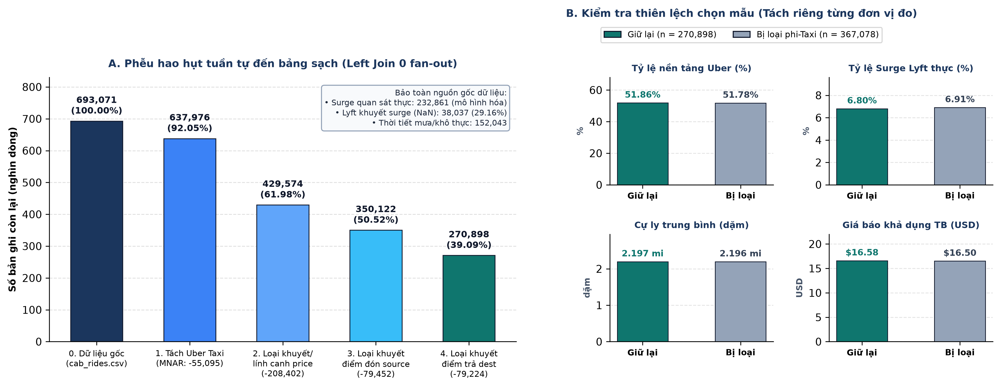{#fig-3-1 width=91% fig-align="center"}

Sau khi khử mã lính canh (-1, -100, 9999, 100000) và dấu âm (2,137 price, 3,823 distance, 75 surge), quy tắc khôi phục quy mô bậc 10 (src/clean\_raw\_data.py) học trung vị giá cơ sở hoàn toàn trên nhóm quan sát surge thực và điều chỉnh các bản ghi vượt trần vật lý (\$95 cho price; 8.0 dặm cho distance) hoặc có tỷ số so với tham chiếu vượt ngưỡng 3.55 ($10^{0.55}$) bằng cách chia $10^m$. Quy tắc dùng mốc tham chiếu cố định 2.15 dặm cho distance để chặn rò rỉ phân phối và điều chỉnh 6,337 price (4,009 dòng trong bảng master cuối = 1.48%), 11,262 distance, 7,722 surge và hạ max(rain) xuống 0.7807 inch/h (0.5469 trong master); 22,262 dòng khuyết riêng distance được giữ nguyên NaN ở Stage 2 và nội suy theo trung vị từng tuyến strictly-on-train bởi RouteDistanceImputer bên trong Pipeline (0% rò rỉ train/test). Bảng 3.3 minh họa 6 ví dụ thực tế trước/sau hiệu chỉnh. Độ nhạy ngưỡng tỷ số (kiểm tra độc lập không chia trước theo surge\_multiplier) cho thấy số dòng price bị đánh dấu giữ ổn định quanh 1.48% ở các mốc 3.0 (4,021), 3.55 (4,009 — chênh 0 dòng so với 4,009 dòng hiệu chỉnh trong pipeline chính có chia theo surge) và 4.0 (4,008); đồng thời kiểm chứng Làm sạch & Huấn luyện thuần Train-only ở Mục 4.4 xác nhận 0/46,573 giá Test thay đổi so với bản toàn cục.

```{=typst}
#block(breakable: false)[
```

| Gói dịch vụ | Tuyến đường Boston | Giá trước sửa | Trung vị tham chiếu | Hệ số chia | Giá sau sửa |
| :--- | :--- | ---: | ---: | :---: | ---: |
| Lux Black | North Station → Haymarket Square | \$165.00 | \$16.50 | ÷ 10 | \$16.50 |
| UberX | North Station → Fenway | \$95.00 | \$10.50 | ÷ 10 | \$9.50 |
| Black SUV | West End → South Station | \$2,950.00 | \$27.50 | ÷ 100 | \$29.50 |
| Shared | Financial District → Northeastern University | \$700.00 | \$7.00 | ÷ 100 | \$7.00 |
| UberX | North Station → Fenway | \$10,500.00 | \$10.50 | ÷ 1,000 | \$10.50 |
| Shared | Theatre District → North End | \$7,000.00 | \$6.00 | ÷ 1,000 | \$7.00 |

: Bảng 3.3: Ví dụ thực tế trước và sau áp dụng quy tắc khôi phục sai lệch quy mô bậc 10 {#tbl-3-3 tbl-colwidths="[14,33,14,15,11,13]"}

```{=typst}
#block(above: 0.16em, below: 0.72em)[#set par(justify: false, leading: 0.50em); #text(size: 9.4pt, style: "italic", fill: rgb("#475569"))[Nguồn: Trích xuất trực tiếp từ cab\_rides.csv qua quy trình kiểm chứng dữ liệu của nhóm.]]
]
```

::: {.content-visible unless-format="typst"}
*Nguồn: Trích xuất trực tiếp từ cab\_rides.csv qua quy trình kiểm chứng dữ liệu của nhóm.*
:::

## 3.4. Phân tích thống kê mô tả

Trên 270,898 lượt báo giá sạch, cơ cấu mẫu gồm Uber 140,477 dòng (51.86%, TB \$15.83, trung vị \$12.50) và Lyft 130,421 dòng (48.14%, TB \$17.38, trung vị \$16.50) — phản ánh thiết kế truy vấn API phân tầng đều chứ không phải thị phần thực. Giá báo toàn mẫu đạt trung bình \$16.58, trung vị \$13.50 (SD = \$9.35, IQR = \$13.50, Skewness = +1.0517); quãng đường trung bình 2.20 dặm (trung vị 2.17, miền [0.02, 7.86] dặm). Trên mẫu quan sát surge thực (n = 232,861), toàn bộ 6,280 lượt surge > 1.0x xuất hiện trên API Lyft, tương ứng tỷ lệ Surge thực của Lyft là 6.80% (6,280 / 92,384; 7 bậc từ 1.25x đến 3.00x) — cao hơn hẳn con số bị pha loãng 4.82% nếu điền mù NaN thành 1.0x. Lượng mưa trên 152,043 dòng không lỗi cảm biến chủ yếu ở mức nhẹ–vừa (Q3 = 0.00, tối đa 0.55 inch/h). Các ngoại lai hợp lệ (2,459 price > \$42.75; 2,760 distance > 5.43 mi) được giữ nguyên (Bảng 3.4).

```{=typst}
#block(breakable: false)[
```

| Biến phân tích (Đơn vị) | N hợp lệ | Mean | SD | Min | Q1 | Median | Q3 | Max |
| :--- | ---: | ---: | ---: | ---: | ---: | ---: | ---: | ---: |
| Giá báo API (price, USD) | 270,898 | 16.58 | 9.35 | 2.50 | 9.00 | 13.50 | 22.50 | 92.00 |
| Quãng đường (distance, dặm) | 248,636 | 2.20 | 1.14 | 0.02 | 1.28 | 2.17 | 2.94 | 7.86 |
| Hệ số nhân giá (surge thực, lần) | 232,861 | 1.01 | 0.09 | 1.00 | 1.00 | 1.00 | 1.00 | 3.00 |
| Nhiệt độ (temp, °F — khớp thực) | 179,280 | 39.21 | 6.52 | 19.62 | 36.28 | 40.21 | 43.67 | 55.41 |
| Lượng mưa (rain, inch/h — không sentinel) | 152,043 | 0.01 | 0.03 | 0.00 | 0.00 | 0.00 | 0.00 | 0.55 |
| Độ ẩm tương đối (humidity, 0–1) | 179,280 | 0.75 | 0.13 | 0.45 | 0.65 | 0.73 | 0.88 | 0.99 |
| Tốc độ gió (wind, mph) | 179,280 | 7.03 | 3.64 | 0.30 | 3.73 | 6.86 | 9.95 | 18.16 |

: Bảng 3.4: Thống kê mô tả các biến định lượng cốt lõi trên tập dữ liệu sạch (master\_rideshare.parquet) {#tbl-3-4 tbl-colwidths="[28,11,9,8,8,8,9,8,11]"}

```{=typst}
#block(above: 0.16em, below: 0.72em)[#set par(justify: false, leading: 0.50em); #text(size: 9.4pt, style: "italic", fill: rgb("#475569"))[Nguồn: master\_rideshare.parquet (surge trên n = 232,861 quan sát thực; mưa trên n = 152,043 không sentinel).]]
]
```

::: {.content-visible unless-format="typst"}
*Nguồn: master\_rideshare.parquet (surge trên n = 232,861 quan sát thực; mưa trên n = 152,043 không sentinel).*
:::

## 3.5. Trực quan hóa dữ liệu và Phát hiện Insight kinh doanh

Từ bộ 21 biểu đồ pipeline (và 17 biểu đồ 300 DPI chuẩn hóa đưa vào tiểu luận, đồng bộ số liệu với Dashboard 5 Tab), nhóm rút ra bốn phát hiện khám phá trọng tâm:

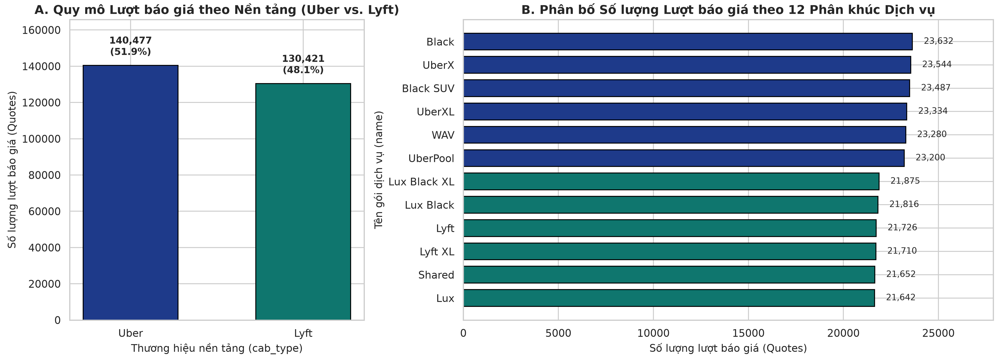{#fig-3-2 width=91% fig-align="center"}

Nhận định 3.1 (Mẫu phân tầng đều 12 gói và phân hóa giá 4 bậc): Hình 3.2 và Hình 3.3 cho thấy mẫu API truy vấn tương đối đều cho từng gói (\~22,000 lượt/gói) và tách thành 4 tầng giá rõ rệt: Đi ghép (Shared trung vị \$7.00; UberPool \$8.50), Phổ thông 4 chỗ (Lyft \$9.00; UberX & WAV \$9.50), Gia đình 6 chỗ (Lyft XL \$13.50; UberXL \$15.00) và Hạng sang (Lux \$16.50 đến Lux Black XL \$30.00). Do tỷ trọng hạng sang trong mẫu cao hơn tiêu dùng đường phố, mọi phân tích suy luận đều kiểm soát theo phân khúc.

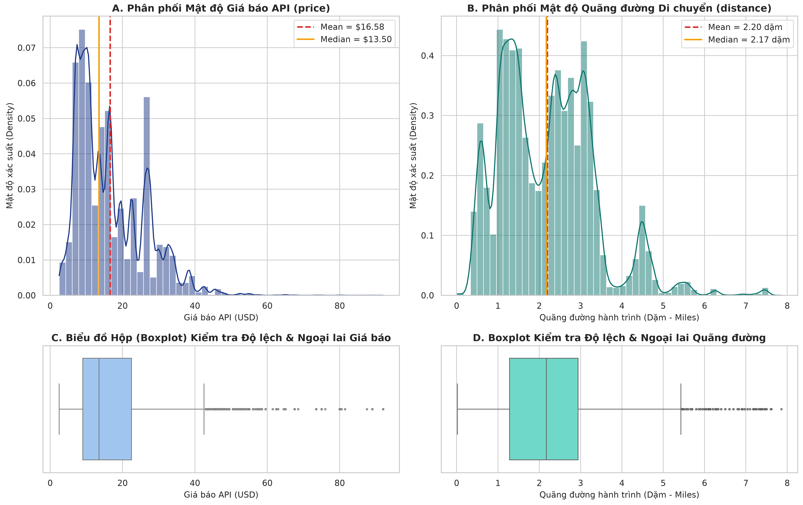{#fig-3-3 width=91% fig-align="center"}

Nhận định 3.2 (Phân bố thu thập API và tính phẳng của giá theo 24 giờ EST): Trên 208,034 bản ghi có timestamp gốc (Hình 3.4), số lượt báo giá ghi nhận chạm đáy quanh 03:00 và cao nhất lúc 18:00–19:00 EST — phản ánh mật độ truy vấn API trong mẫu. Trên thang trục tung trung thực [12, 21] USD, đường giá báo trung bình gần như nằm ngang xuyên suốt 24 giờ trên cả Lyft (\~\$17.4) lẫn Uber (\~\$15.8).

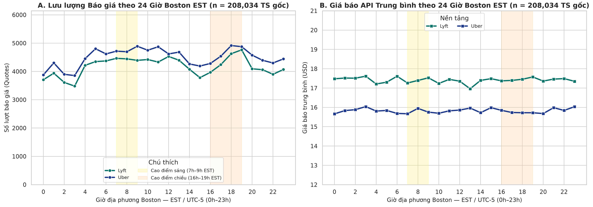{#fig-3-4 width=91% fig-align="center"}

Nhận định 3.3 (Giá báo trùng khít giữa mưa nhẹ–vừa và trời tạnh trên tập sạch sentinel): Hình 3.5 đối chiếu bản đồ nhiệt Surge Lyft trên tập quan sát thực có timestamp gốc (n = 70,971; 5 ô xám khuyết thu thập đêm Thứ Ba – rạng sáng Thứ Tư EST) và giá báo Mưa vs. Không mưa trên 152,043 dòng không lỗi cảm biến mưa: giá trung bình gần trùng khít ở cả Uber (\$15.84 vs. \$15.83) và Lyft (\$17.39 vs. \$17.41).

Nhận định 3.4 (Bất cân xứng không gian gấp 8.4 lần và tính tụ cụm của Surge Lyft): Trên đúng 92,384 lượt báo giá Lyft quan sát surge thực (tỷ lệ toàn thành phố 6.80%), sự phân hóa địa lý lộ diện mạnh hơn rõ rệt so với bản bị pha loãng: năm quận đại học – thương mại dẫn đầu gồm Back Bay (11.17%, 856 lượt), Fenway (10.57%, 812 lượt), Northeastern University (10.10%, 771 lượt), Theatre District (9.58%, 739 lượt) và Boston University (9.57%, 739 lượt) — cao gấp 8.4 lần so với North End (1.33%, 102 lượt). Trong 2,233 ô (quận × giờ) có surge (56.36%), bình quân có 2.16 lượt surge tụ cụm cùng giờ (tối đa 11 lượt), củng cố bản chất cục bộ theo điểm nóng của surge.

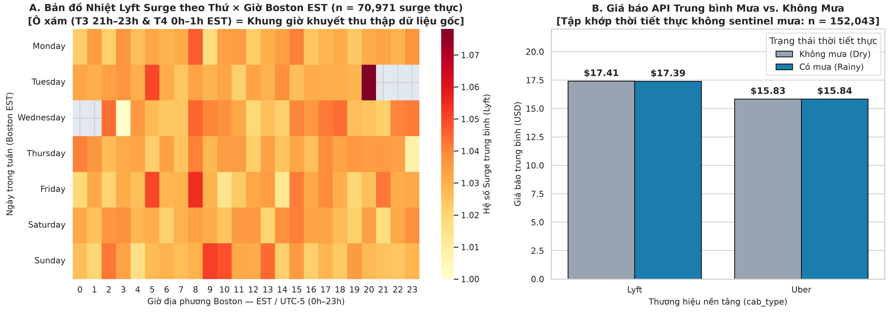{#fig-3-5 width=91% fig-align="center"}

## 3.6. Kiểm định giả thuyết thống kê, Suy luận cụm và Kiểm định tương đương TOST

Bảng 3.5 trình bày trọn bộ 13 kiểm định giả thuyết (H1a–H4c) trên bộ dữ liệu sạch chuẩn hóa kèm hiệu chỉnh đa kiểm định Holm–Bonferroni (kiểm soát FWER) và Benjamini–Hochberg (BH-FDR). Lưu ý kỹ thuật quan trọng: trong kiểm định đa biến H4c (n\_train = 95,925), việc loại đúng biến giả dư thừa của thành phần lưỡng phân K₆,₆ thứ hai (destination\_Boston University) đưa ma trận thiết kế về hạng đầy đủ 100% (0 cảnh báo suy biến). Bảng 3.6 và Hình 3.6A bổ sung kiểm định sai số chuẩn cụm hai cấp, kiểm định cụm cho H3b, độ nhạy loại trừ tuyệt đối mọi ô từng chứa sentinel mưa và Exact WCR Wild Cluster Bootstrap (B = 1,999).

| Mã | Phạm vi kiểm định | Phép kiểm định | p gốc | p\_Holm / q\_BH | p đối chứng | Hiệu ứng | Kết luận (α=5%) |
| :--- | :--- | :--- | ---: | ---: | ---: | :--- | :--- |
| H1a | Giá báo Mưa vs. Tạnh (Toàn thị trường không sentinel) | Welch t / MW-U | 0.8915 | 1.0000 / 0.9657 | 0.8321 | d = -0.00095 | Chưa đủ bằng chứng bác bỏ H0 |
| H1b | Giá báo Mưa vs. Tạnh (Riêng Uber không sentinel) | Welch t / MW-U | 0.9713 | 1.0000 / 0.9713 | 0.9003 | d = 0.00035 | Chưa đủ bằng chứng bác bỏ H0 |
| H1c | Giá báo Mưa vs. Tạnh (Riêng Lyft không sentinel) | Welch t / MW-U | 0.8345 | 1.0000 / 0.9657 | 0.9401 | d = -0.00209 | Chưa đủ bằng chứng bác bỏ H0 |
| H2a | Hệ số Surge theo 4 buổi EST (TS & surge gốc) | ANOVA / KW-H | 0.7055 | 1.0000 / 0.9657 | 0.8908 | η² = 8.0e-06 | Chưa đủ bằng chứng bác bỏ H0 |
| H2b | Hệ số Surge theo 4 buổi EST (Lyft TS & surge gốc) | ANOVA / KW-H | 0.5164 | 1.0000 / 0.9136 | 0.7542 | η² = 3.2e-05 | Chưa đủ bằng chứng bác bỏ H0 |
| H2c | Giá báo theo 4 buổi EST (Toàn mẫu TS gốc) | ANOVA / KW-H | 0.5622 | 1.0000 / 0.9136 | 0.5329 | η² = 1.0e-05 | Chưa đủ bằng chứng bác bỏ H0 |
| H3a | Ghi nhận Surge > 1.0x giữa API Lyft thực vs. Uber | Chi-square / G-test | < 0.0001 | < 0.0001 / < 0.0001 | < 0.0001 | V = 0.20527 | Bác bỏ H0 (α=5%) |
| H3b | Tần suất Surge Lyft thực theo Mưa vs. Tạnh\* | Chi-square / G-test | 0.0173 | 0.1897 / 0.0563 | 0.0161 | V = 0.01043 | Chưa đủ bằng chứng bác bỏ H0 |
| H3c | Tần suất Surge Lyft thực theo 4 buổi EST | Chi-square / G-test | 0.7666 | 1.0000 / 0.9657 | 0.7663 | V = 0.00401 | Chưa đủ bằng chứng bác bỏ H0 |
| H3d | Tần suất Surge Lyft thực giờ cao điểm EST | Chi-square / G-test | 0.4512 | 1.0000 / 0.9136 | 0.4522 | V = 0.00283 | Chưa đủ bằng chứng bác bỏ H0 |
| H4a | So sánh độ dốc & mở cửa UberX vs. Lyft (Spec A) | Wald Z (HC3: β₁ / β₀) | < 0.0001 | < 0.0001 / < 0.0001 | < 0.0001 | d\* = 3.21 mi | Bác bỏ H0 (α=5%) |
| H4b | So sánh độ dốc & mở cửa UberPool vs. Shared | Wald Z (HC3: β₁ / β₀) | 0.0172 | 0.1897 / 0.0563 | < 0.0001 | Δβ₀ = \$2.80 | Chưa đủ bằng chứng bác bỏ H0 |
| H4c | Hồi quy đa biến đồng thời 6 biến thời tiết (full rank) | Joint Wald F (HC3) | 0.3789 | 1.0000 / 0.9136 | 0.3789 | ΔR² = 4.9e-06 | Chưa đủ bằng chứng bác bỏ H0 |

: Bảng 3.5: Hệ thống 13 kiểm định giả thuyết (H1–H4) kèm hiệu chỉnh đa kiểm định Holm–Bonferroni & BH-FDR {#tbl-3-5 tbl-colwidths="[5,20,13,10,12,10,15,15]"}

```{=typst}
#block(above: 0.16em, below: 0.72em)[#set par(justify: false, leading: 0.50em); #text(size: 9.4pt, style: "italic", fill: rgb("#475569"))[Nguồn: stage5\_hypothesis\_tests.csv và kết quả hiệu chỉnh đa kiểm định của nhóm. \*H3b dưới sai số cụm xem Bảng 3.6.]]
```

::: {.content-visible unless-format="typst"}
*Nguồn: stage5\_hypothesis\_tests.csv và kết quả hiệu chỉnh đa kiểm định của nhóm. \*H3b dưới sai số cụm xem Bảng 3.6.*
:::

```{=typst}
#block(breakable: false)[
```

| Mô hình / Kiểm định mở rộng | Cỡ mẫu / Cụm | Ước lượng | 95% CI / Thống kê | p-value | Kết luận & TOST |
| :--- | :--- | ---: | ---: | ---: | :--- |
| OLS đơn biến: Mưa vs. Tạnh (cụm quận×giờ) | 152,043 (2,795 cụm) | -0.0089 (SE=0.1053) | [-0.2152, +0.1974] | p\_cl = 0.9326 | TOST ±\$0.25: p=0.0110 (Tương đương) |
| OLS đa biến (+ gói, cự ly, surge, 72 tuyến FE) | 119,903 (2,793 cụm) | +0.0021 (SE=0.0193) | [-0.0357, +0.0399] | p\_cl = 0.9119 | TOST ±\$0.10: p < 0.0001 (Tương đương chặt) |
| OLS đa biến gom cụm giờ toàn Boston (bảo thủ) | 119,903 (329 giờ) | +0.0021 (SE=0.0176) | [-0.0324, +0.0367] | p\_hr = 0.9036 | TOST ±\$0.10: p < 0.0001 (Bền vững toàn TP) |
| OLS đa biến không biến surge (mẫu mưa/khô có distance) | 139,555 (329 giờ) | -0.0357 (SE=0.0191) | [-0.0732, +0.0018] | p\_hr = 0.0622 | TOST ±\$0.10: p=0.0004 (Tương đương) |
| Độ nhạy loại mọi ô từng chứa sentinel mưa (cụm giờ) | 87,733 (325 giờ) | +0.0072 (SE=0.0206) | p\_cl = 0.7544 | p\_hr = 0.7277 | TOST ±\$0.10: p < 0.0001 (Sạch sentinel 100%) |
| Mưa lớn ≥ 0.10 in/h — Exact WCR (M\_Z, B=1,999) | N = 103,608 (2,455 cụm / 320 giờ; mưa lớn: 3,021 / 47 cụm / 8 giờ) | -0.0075 (SE=0.0527) | t = -0.157 / -0.143 | p\_w = 0.8590 / 0.8850 | Thăm dò (few treated clusters: 8 giờ, 2⁸ = 256 tổ hợp dấu) |
| H3b cụm: Xác suất Surge Lyft khi Mưa vs. Tạnh | 52,045 (329 giờ) | -0.72 pp (SE=0.41) | p\_iid = 0.0162 | p\_cl = 0.0688 / 0.0793 | Không có ý nghĩa dưới sai số cụm & Holm/BH |
| Wald F cụm 4 buổi EST (cụm quận×giờ) | 208,034 (3,980 cụm) | Max–Min = \$0.0753 | F\_cl = 0.2829 | p\_cl = 0.8378 | Chưa đủ bằng chứng bác bỏ H0 theo buổi |

: Bảng 3.6: Suy luận cụm hai cấp, Độ nhạy Sentinel mưa, Exact WCR (B = 1,999), H3b cụm và TOST {#tbl-3-6 tbl-colwidths="[25,13,15,14,15,18]"}

```{=typst}
#block(above: 0.16em, below: 0.72em)[#set par(justify: false, leading: 0.50em); #text(size: 9.4pt, style: "italic", fill: rgb("#475569"))[Nguồn: Kết quả kiểm chứng sai số chuẩn cụm và Exact WCR của nhóm (phép chiếu trực giao M\_Z đủ hệ số DOF (G/(G−1))·((N−1)/(N−k)); Cameron et al., 2008).]]
]
```

::: {.content-visible unless-format="typst"}
*Nguồn: Kết quả kiểm chứng sai số chuẩn cụm và Exact WCR của nhóm (phép chiếu trực giao M\_Z đủ hệ số DOF (G/(G−1))·((N−1)/(N−k)); Cameron et al., 2008).*
:::

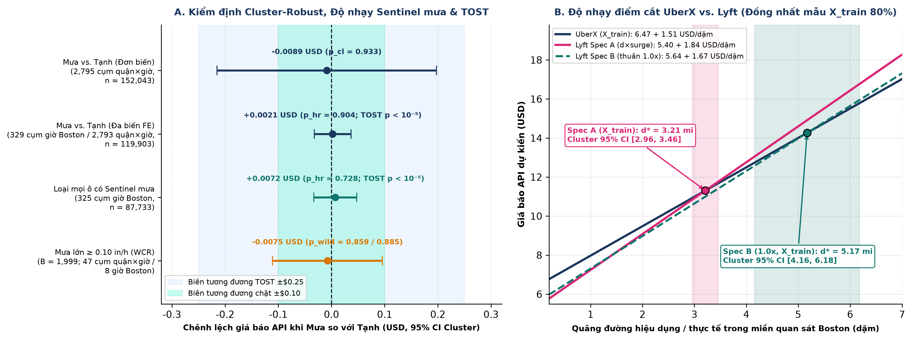{#fig-3-6 width=91% fig-align="center"}

- **Thời tiết (H1a–c, H3b, H4c và Bảng 3.6):** Khi kiểm soát gói xe, cự ly, surge thực và 72 tuyến cố định (n = 119,903), hệ số mưa là +0.0021 USD với p\_cl = 0.9119 (2,793 cụm quận × giờ) và p\_hr = 0.9036 (329 giờ toàn Boston, 95% CI [-0.0324, +0.0367]). Kiểm tra trên 139,555 lượt có cự ly hợp lệ (2,794 cụm quận × giờ / 329 giờ; không dùng biến surge) cũng cho p\_hr = 0.0622, và loại triệt để mọi ô từng chứa dù chỉ 1 bản tin sentinel mưa (n = 87,733) cho p\_hr = 0.7277. Trên mọi cấu trúc, TOST xác nhận chênh lệch nằm chặt trong biên ±\$0.10 (p\_TOST < 0.0001). Riêng H3b (xác suất Surge Lyft khi mưa: 6.22% vs. tạnh 6.94%), dù kiểm định iid ngây thơ báo p = 0.0162 (ngược chiều giả thuyết mưa làm tăng surge, Cramér's V = 0.0104), sai số chuẩn cụm đưa p lên 0.0688 (quận × giờ) và 0.0793 (giờ Boston) — đồng thời không vượt qua cả Holm lẫn BH-FDR. Lát cắt mưa lớn ≥ 0.10 in/h trên toàn mẫu hồi quy N = 103,608 (2,455 cụm / 320 giờ; nhóm treated mưa lớn gồm 3,021 lượt / 47 cụm / 8 giờ, lưu ý few treated clusters với 2⁸ = 256 tổ hợp dấu Rademacher) qua Exact WCR (B = 1,999) cho p\_wild = 0.8590 / 0.8850 (kết quả thăm dò công suất thấp).
- **Khung giờ EST (H2a–c, H3c–d):** Sau hiệu chỉnh Holm (p\_Holm = 1.0000) và Wald F cụm (3,980 cụm EST, F\_cl = 0.2829, p\_cl = 0.8378, chênh tối đa \$0.0753), chưa đủ bằng chứng bác bỏ đồng nhất giá hay Surge giữa bốn buổi cố định.
- **Bất đối xứng công bố Surge trên API (H3a):** Bác bỏ mạnh H0 sau hiệu chỉnh Holm (p\_Holm < 0.0001, V = 0.2053: Lyft thực 6.80% vs. Uber 0.00%). Kết quả phản ánh bất đối xứng cơ chế công bố API (Uber tích hợp phụ phí động ẩn trong Upfront Pricing), không kết luận Uber thiếu surge.
- **Biểu giá cắt nhau (H4a–b):** Wald HC3 bác bỏ mạnh H0 trên cặp chủ lực UberX vs. Lyft (H4a: p\_Holm < 0.0001), còn UberPool vs. Shared (H4b: p = 0.0172, p\_Holm = 0.1897) không cắt trong miền; độ nhạy giữa Đặc tả A (3.21 dặm) và Đặc tả B thuần 1.0x (5.17 dặm, Hình 3.6B) được phân tích đủ 5 cặp tại Mục 4.5.



# CHƯƠNG 4: XÂY DỰNG MÔ HÌNH VÀ ĐÁNH GIÁ HIỆU NĂNG

## 4.1. Kỹ thuật tạo lập và Lựa chọn đặc trưng (Feature Engineering)

Từ 32 cột của bảng sạch, src/features.py tạo thêm 9 đặc trưng kinh tế và chu kỳ thuần đơn dòng (tổng 41 cột), sau đó loại chặt 14 cột khỏi ma trận X (2 cột mục tiêu & rò rỉ: price, price\_per\_mile; 8 cột định danh/ngày giờ thô: id, product\_id, time\_stamp, datetime, location, route\_id, date\_hour, day\_name; và 4 cờ nguồn gốc: weather\_matched, is\_timestamp\_original, is\_surge\_original, is\_rain\_sentinel) để giữ đúng 27 đặc trưng hợp lệ trong bộ mô hình có điều kiện (và 23 đặc trưng trong thực nghiệm Ex-Ante sau khi loại thêm 4 biến phụ thuộc surge):

- **Loại trừ biến rò rỉ mục tiêu price\_per\_mile:** Đưa price\_per\_mile (= price / distance) cùng distance vào HistGBR kéo MAE và MAPE trên tập có distance thực xuống giả tạo (MAE = \$0.8030, MAPE = 6.29%), dù R² chung tụt về 0.9176 do điền trung vị toàn cục trên 3,830 dòng Test khuyết distance/price\_per\_mile; biến này bị cấm tuyệt đối.
- **Khử đa cộng tuyến cấu trúc bằng biến tâm hóa lyft\_surge\_excess:** Trên nhóm surge thực, tích thô distance\_x\_surge gây VIF(distance) = 162.04 và VIF(distance\_x\_surge) = 168.27. Chuyển sang lyft\_surge\_excess = (surge − 1.0) × is\_lyft hạ VIF(distance) xuống 1.02 và hai biến tương tác xuống 6.01 và 5.98, trong khi toàn bộ 6 biến thời tiết giữ VIF < 5 (Bảng 4.1, Hình 4.1).
- **Thiết kế EconomicInteractionPreprocessor:** Cho phép họ tuyến tính (M2–M4) ước lượng riêng hệ số chặn, độ dốc cự ly, độ cong log\_distance và phụ trội surge cho từng gói xe, giúp OLS nâng R² từ 0.9255 (M1) lên 0.9539 (M2) và hạ MAPE từ 12.81% xuống 9.33%.

```{=typst}
#block(breakable: false)[
```

| Nhóm đặc trưng | VIF Trước (Cấu hình A) | VIF Sau (Cấu hình B) | Đánh giá đa cộng tuyến |
| :--- | ---: | ---: | :--- |
| distance (Quãng đường) | 162.04 | 1.02 | Giảm mạnh từ đa cộng tuyến cấu trúc xuống ngưỡng an toàn (< 5) |
| distance\_x\_surge → distance\_x\_lyft\_surge\_excess | 168.27 | 6.01 | Khử trùng lặp tuyến tính tại vùng không surge (= 1.0x) |
| surge\_multiplier → lyft\_surge\_excess | 5.98 | 5.98 | Tách riêng phần phụ trội surge Lyft (< 10) |
| pressure (max VIF trong 6 biến thời tiết) | 2.41 | 4.81 | An toàn (< 5) sau đổi giờ sang chu kỳ sin/cos |

: Bảng 4.1: So sánh hệ số phóng đại phương sai (VIF) trước và sau tâm hóa tương tác (Tập Train) {#tbl-4-1 tbl-colwidths="[30,16,16,38]"}

```{=typst}
#block(above: 0.16em, below: 0.72em)[#set par(justify: false, leading: 0.50em); #text(size: 9.4pt, style: "italic", fill: rgb("#475569"))[Nguồn: reports/tables/stage4\_vif.csv (tính trên tập Train khớp thời tiết không sentinel & surge thực).]]
]
```

::: {.content-visible unless-format="typst"}
*Nguồn: reports/tables/stage4\_vif.csv (tính trên tập Train khớp thời tiết không sentinel & surge thực).*
:::

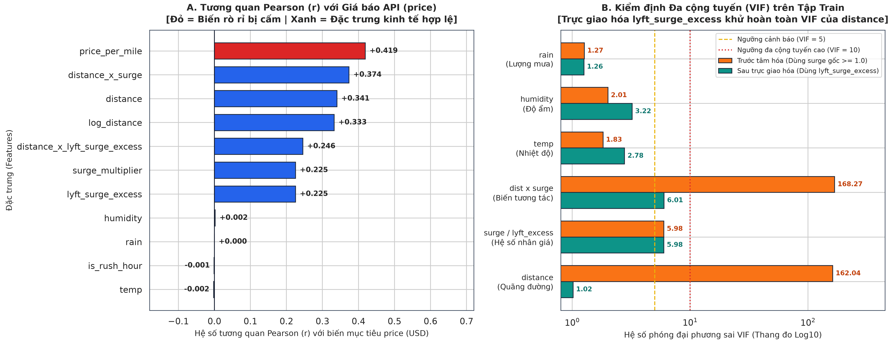{#fig-4-1 width=91% fig-align="center"}

## 4.2. Xử lý dữ liệu khuyết theo từng Pipeline và Phân chia tập Huấn luyện / Kiểm tra

Toàn bộ 3 chiến lược phân chia dữ liệu cho mô hình có điều kiện được thực hiện ĐỘC QUYỀN trên tập quan sát surge thực (is\_surge\_original == 1, n = 232,861) và tách rời hai nhánh Pipeline (Hình 4.3): (i) Nhánh tuyến tính & cây truyền thống (M1–M6) bọc SimpleImputer(strategy='median'), StandardScaler và OneHotEncoder / EconomicInteractionPreprocessor bên trong Pipeline chỉ fit() trên X\_train; (ii) Nhánh Boosting bản địa (M7 HistGradientBoosting) dùng m7\_hgb\_native truyền thẳng cả biến số chứa NaN lẫn 5 cột phân loại kiểu pandas category vào HistGradientBoostingRegressor(categorical\_features='from\_dtype'). Kiểm định độ nhạy Complete-Case trên tập Test (n = 46,573) xác nhận hiệu năng ổn định cao giữa nhóm khớp thời tiết hợp lệ (n = 26,109: M7 R² = 0.9636, MAPE = 8.11%) và nhóm không khớp thời tiết (n = 15,852: M7 R² = 0.9612, MAPE = 8.35%); 4,612 dòng còn lại của tập Test (46,573 − 26,109 − 15,852) là các lượt khớp trạm thời tiết nhưng thuộc ô lỗi cảm biến mưa (is\_rain\_sentinel = 1).

Bên cạnh Random Split 80/20 (186,288 Train / 46,573 Test; KS = 0.0035), nghiên cứu đánh giá song song trên Temporal Split EST (143,023 / 35,756 TS & surge gốc) và Route Group Split (57 tuyến Train dự báo 15 tuyến chưa gặp: 184,664 / 48,197) như trình bày tại Bảng 4.2 và Hình 4.2.

```{=typst}
#block(breakable: false)[
```

| Chiến lược phân chia | Tập Train (%) | Tập Test (%) | Giá TB Train / Test | KS stat | SMD |
| :--- | ---: | ---: | ---: | ---: | ---: |
| 1. Random Split 80/20 (Nội miền 72 tuyến, surge thực) | 186,288 (80.0%) | 46,573 (20.0%) | \$16.43 / \$16.47 | 0.0035 | +0.0049 |
| 2. Temporal Split Boston EST (TS & surge gốc 80/20) | 143,023 (80.0%) | 35,756 (20.0%) | \$16.44 / \$16.47 | 0.0039 | +0.0027 |
| 3. Route Group Split (57 tuyến Train / 15 tuyến mới) | 184,664 (79.3%) | 48,197 (20.7%) | \$16.59 / \$15.83 | 0.0464 | +0.0845 |

: Bảng 4.2: Thống kê đối chứng ba chiến lược phân chia tập Huấn luyện và Kiểm tra (mẫu surge thực n = 232,861) {#tbl-4-2 tbl-colwidths="[32,16,16,18,9,9]"}

```{=typst}
#block(above: 0.16em, below: 0.72em)[#set par(justify: false, leading: 0.50em); #text(size: 9.4pt, style: "italic", fill: rgb("#475569"))[Nguồn: Trích xuất trực tiếp từ reports/tables/stage4\_split\_summary.csv.]]
]
```

::: {.content-visible unless-format="typst"}
*Nguồn: Trích xuất trực tiếp từ reports/tables/stage4\_split\_summary.csv.*
:::

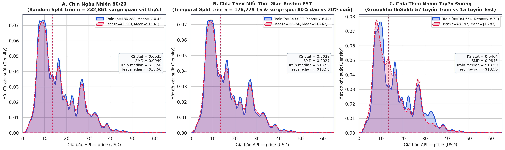{#fig-4-2 width=91% fig-align="center"}

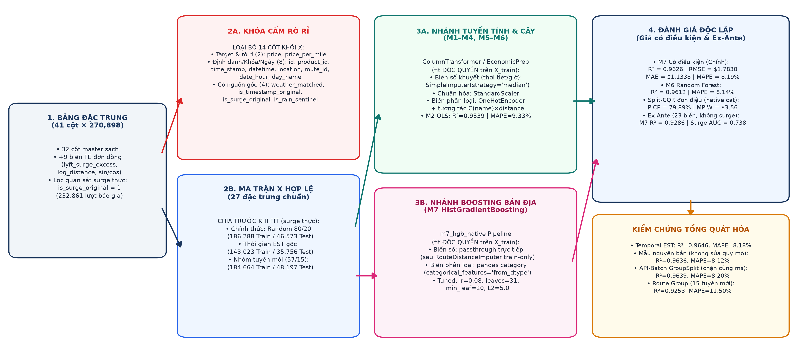{#fig-4-3 width=91% fig-align="center"}

## 4.3. Huấn luyện các mô hình Machine Learning và Tái lập siêu tham số

Mười cấu hình hồi quy có điều kiện được tinh chỉnh siêu tham số độc lập chỉ trên X\_train rồi đánh giá đồng nhất qua 5-Fold Cross-Validation trên toàn bộ 186,288 dòng trước khi kiểm tra một lần duy nhất trên tập Test (46,573 dòng). Để triệt tiêu rò rỉ tiền xử lý nội bộ giữa các fold CV, mọi bộ dò lưới đều bọc trực tiếp tiền xử lý bên trong Pipeline trên mẫu con 60,000 dòng rút độc quyền từ X\_train (src/models.py): M3 Ridge dùng GridSearchCV 5-fold (best alpha = 0.1); M4 Lasso dùng 5-fold CV độc lập từng fold với ma trận Gram (precompute=True) và warm\_start theo alpha giảm dần (best alpha = 5.6e-05, ép đúng 1/82 đặc trưng về 0, cả 6 biến thời tiết có |β| ≤ 0.0137); M5 DecisionTree dùng RandomizedSearchCV 5-fold (max\_depth = 15, min\_samples\_leaf = 15, min\_samples\_split = 10); M6 RandomForest dùng RandomizedSearchCV 3-fold (max\_depth = 20, max\_features = 0.7, min\_samples\_leaf = 5, huấn luyện cuối n\_estimators = 100, max\_samples = 0.50); và M7 HistGradientBoosting dùng RandomizedSearchCV 5-fold (learning\_rate = 0.08, max\_leaf\_nodes = 31, min\_samples\_leaf = 20, l2\_regularization = 5.0, max\_iter = 350, early\_stopping = True). Toàn bộ siêu tham số trên khớp 100% khi chạy lại mã nguồn src/models.py.

## 4.4. So sánh hiệu năng (Có điều kiện vs. Ex-Ante), Hiệu chỉnh CQR và Độ bền

Bảng 4.3 và Hình 4.4 tổng hợp kết quả 10 mô hình có điều kiện trên tập kiểm tra ngẫu nhiên (n = 46,573). Sau khi loại bỏ nhiễu điền mù surge trên Lyft, hiệu năng cải thiện mạnh trên mọi họ mô hình: (1) M7 HistGradientBoosting đạt Test R² = 0.9626, RMSE = \$1.7830, MAE = \$1.1338, MAPE = 8.19%, vượt M6 Random Forest (R² = 0.9612, RMSE = \$1.8167, MAPE = 8.14%) trên cả 5/5 fold CV với độ chênh đạt ý nghĩa thống kê rõ rệt (-0.0465 USD, paired t = -8.29, p = 0.0012, bootstrap 95% CI [-0.0562, -0.0376]), đồng thời có Overfit Gap nhỏ hơn (+0.0027 vs. +0.0082) và huấn luyện nhanh gấp 4.1 lần (1.57s vs. 6.42s), trong khi M6 vẫn nhỉnh nhẹ ở MAE/MAPE. (2) Giải mã Baseline M0b (R² = 0.9147, MAPE = 8.32%): M0b chỉ cạnh tranh trên lượt không surge (MAPE = 7.82% nhờ mất mát trung vị L1, khớp P50 Quantile MAPE = 7.73%), nhưng sụp đổ nặng trên 1,198 lượt có Surge (> 1.0x) với RMSE = \$11.14 so với M7 chỉ \$2.24 (tốt hơn 5.0 lần). (3) Họ tuyến tính tương tác (M2/M3/M4) đạt R² = 0.9539, RMSE = \$1.9802, hội tụ sát nhau do tỷ lệ n\_train/p rất lớn.

```{=typst}
#block(breakable: false)[
```

| Mô hình | CV RMSE (\$) | Test R² | Test RMSE | Test MAE | MAPE | Overfit | SMART\* |
| :--- | ---: | ---: | ---: | ---: | ---: | ---: | :---: |
| M0a: Trung vị theo Gói xe | 4.4866 ± 0.0537 | 0.7605 | \$4.5148 | \$2.9772 | 19.27% | +0.0023 | Chưa đạt |
| M0b: Bảng tra Gói xe x Tuyến | 2.6881 ± 0.0667 | 0.9147 | \$2.6944 | \$1.3075 | 8.32% | +0.0005 | ĐẠT |
| M1: Hồi quy Tuyến tính OLS Cơ bản | 2.5160 ± 0.0418 | 0.9255 | \$2.5182 | \$1.7488 | 12.81% | +0.0000 | Chưa đạt |
| M2: Hồi quy OLS Tương tác Kinh tế lượng | 1.9785 ± 0.0196 | 0.9539 | \$1.9802 | \$1.2888 | 9.33% | +0.0000 | ĐẠT |
| M2-Log: OLS Tương tác ln | 2.0378 ± 0.0167 | 0.9515 | \$2.0318 | \$1.3037 | 9.25% | -0.0003 | ĐẠT |
| M3: Hồi quy Ridge | 1.9785 ± 0.0196 | 0.9539 | \$1.9802 | \$1.2889 | 9.33% | +0.0000 | ĐẠT |
| M4: Hồi quy Lasso | 1.9786 ± 0.0197 | 0.9539 | \$1.9804 | \$1.2892 | 9.33% | +0.0000 | ĐẠT |
| M5: Cây Quyết định | 1.8760 ± 0.0252 | 0.9580 | \$1.8898 | \$1.1785 | 8.46% | +0.0061 | ĐẠT |
| M6: Rừng Ngẫu nhiên | 1.8121 ± 0.0286 | 0.9612 | \$1.8167 | \$1.1318 | 8.14% | +0.0082 | ĐẠT |
| M7: HistGradientBoosting | 1.7656 ± 0.0239 | 0.9626 | \$1.7830 | \$1.1338 | 8.19% | +0.0027 | ĐẠT |

: Bảng 4.3: So sánh hiệu năng 10 cấu hình mô hình có điều kiện trên 5-Fold CV và Tập Test (n = 46,573) {#tbl-4-3 tbl-colwidths="[25,16,9,11,11,9,9,10]"}

```{=typst}
#block(above: 0.16em, below: 0.72em)[#set par(justify: false, leading: 0.50em); #text(size: 9.4pt, style: "italic", fill: rgb("#475569"))[Nguồn: stage5\_cv\_results.csv & stage5\_test\_metrics.csv (\*ngưỡng SMART nội miền: R² ≥ 0.90, MAPE ≤ 10%).]]
]
```

::: {.content-visible unless-format="typst"}
*Nguồn: stage5\_cv\_results.csv & stage5\_test\_metrics.csv (\*ngưỡng SMART nội miền: R² ≥ 0.90, MAPE ≤ 10%).*
:::

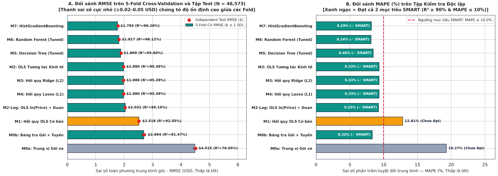{#fig-4-4 width=91% fig-align="center"}

Phân rã theo chế độ dữ liệu và thực nghiệm Ex-Ante không dùng surge (Bảng 4.4) làm sáng tỏ bản chất kinh tế của bài toán dự báo giá API: (i) Trong mô hình có điều kiện, độ chính xác trên Lyft (surge công bố: R² = 0.9794, RMSE = \$1.4370, chỉ 1/18,440 sai số > \$15 (max \$15.08, 0 > \$16, Kurtosis = 3.47) vượt trội hẳn so với Uber (surge ẩn: R² = 0.9474, RMSE = \$1.9773, chiếm 74.3% tổng SSE và 57/58 sai số > \$15 [47/47 > \$16], Kurtosis = 29.46). (ii) Khi loại bỏ toàn bộ 4 biến surge để đánh giá dự báo Ex-Ante thuần (23 biến công khai), hiệu năng M7 trên Uber hầu như giữ nguyên (RMSE = \$1.9930 vs. \$1.9773), nhưng RMSE trên toàn mẫu Lyft tăng gấp đôi lên \$3.0484 (R² = 0.9073) và sụp xuống R² = 0.4677 (RMSE = \$10.29) trên các lượt Lyft đang surge. Đáng chú ý, đánh giá mô hình Ex-Ante trên tập Holdout 38,037 dòng Lyft khuyết surge cho R² = 0.9060, RMSE = \$3.0861 — trùng khớp tới hai chữ số thập phân với Lyft Test (0.9073 / \$3.0484), cung cấp bằng chứng định lượng khẳng định tập khuyết surge thực sự mang cấu trúc \~6.8% surge ẩn chứ không phải 1.0x. (iii) Bộ phân loại Ex-Ante dự báo P(surge > 1.0) trên Lyft (n\_train = 73,944, n\_test = 18,440; tỷ lệ dương tính trên tập Test là 6.50% = 1,198/18,440 so với 6.80% toàn mẫu do dao động lấy mẫu) đạt ROC-AUC = 0.7383, PR-AUC = 0.1474, Brier = 0.05807 ở HistGB (Logistic Regression đạt 0.7033 / 0.1102). Do mất cân bằng lớp 6.50%, ngưỡng mặc định τ = 0.50 trên mô hình chuẩn không dự báo ca dương tính nào (Accuracy = 0.9350, Precision = Recall = F1 = 0.0000); khi hiệu chỉnh ngưỡng tối ưu F1 hoàn toàn trên Train 3-Fold OOF (τ\* = 0.1087), HistGB đạt Accuracy = 0.7330, Precision = 0.1285, Recall = 0.5376, F1 = 0.2074 với ma trận nhầm lẫn [TN = 12,873, FP = 4,369, FN = 554, TP = 644] (LogReg tại τ\* = 0.0962: Acc = 0.6483, P = 0.1106, R = 0.6269, F1 = 0.1880). Đối chứng class\_weight='balanced' nâng Recall nhưng giảm độ sắc nét phân tách (HistGB Balanced tại τ\* = 0.5843: ROC-AUC = 0.7293, Acc = 0.6762, P = 0.1203, R = 0.6311, F1 = 0.2021; LogReg Balanced: ROC-AUC = 0.7047, F1 = 0.1893). Mức giảm ROC-AUC khi hoán vị tập trung ở tuyến/cự ly (0.1477) và gói xe (0.1049), trong khi 7 biến thời tiết (0.0122) và khung giờ EST (0.0086) đóng góp gần như bằng không.

```{=typst}
#block(breakable: false)[
```

| Cấu hình / Lát cắt đánh giá | N đánh giá | R² | RMSE (\$) | MAPE | Nhận định cơ chế dữ liệu |
| :--- | ---: | ---: | ---: | ---: | :--- |
| Có điều kiện M7 — Toàn tập Test (surge thực) | 46,573 | 0.9626 | \$1.7830 | 8.19% | Gồm 27 đặc trưng (dùng surge công bố trên API) |
| • Chế độ Uber (surge ẩn trong Upfront Price) | 28,133 | 0.9474 | \$1.9773 | 8.15% | Chiếm 74.3% SSE & 57/58 sai số > \$15 (Kurtosis = 29.46) |
| • Chế độ Lyft (surge công bố tường minh) | 18,440 | 0.9794 | \$1.4370 | 8.25% | 1/18,440 sai số > \$15 (0 > \$16, max \$15.08, Kurtosis = 3.47) |
| Ex-Ante M7 (23 biến, KHÔNG dùng surge) — All Test | 46,573 | 0.9286 | \$2.4655 | 9.15% | Uber gần bất biến (\$1.99); Lyft tăng mạnh lên \$3.05 |
| • Ex-Ante M7 trên Lyft đang Surge (> 1.0x) | 1,198 | 0.4677 | \$10.2886 | 24.43% | Biến công khai không thể tái tạo đỉnh surge thời gian thực |
| • Ex-Ante M7 trên Holdout Lyft khuyết surge | 38,037 | 0.9060 | \$3.0861 | 10.55% | Trùng khớp sát Lyft Test (0.9073 / \$3.05) → xác nhận chứa \~6.8% surge ẩn |

: Bảng 4.4: Phân rã hiệu năng M7 theo chế độ API (Uber surge ẩn vs. Lyft công bố) và Thực nghiệm Ex-Ante (23 biến không surge) {#tbl-4-4 tbl-colwidths="[27,10,8,10,8,37]"}

```{=typst}
#block(above: 0.16em, below: 0.72em)[#set par(justify: false, leading: 0.50em); #text(size: 9.4pt, style: "italic", fill: rgb("#475569"))[Nguồn: stage5\_summary.json & stage5\_ex\_ante\_experiments.csv (HistGB Ex-Ante Surge: ROC-AUC = 0.7383, PR-AUC = 0.1474; tại τ\* = 0.1087: Acc = 0.7330, P = 0.1285, R = 0.5376, F1 = 0.2074).]]
]
```

::: {.content-visible unless-format="typst"}
*Nguồn: stage5\_summary.json & stage5\_ex\_ante\_experiments.csv (HistGB Ex-Ante Surge: ROC-AUC = 0.7383, PR-AUC = 0.1474; tại τ\* = 0.1087: Acc = 0.7330, P = 0.1285, R = 0.5376, F1 = 0.2074).*
:::

Chẩn đoán phần dư của M7 (Hình 4.5) xác nhận sai số không chệch (Mean = +\$0.0117, SD = \$1.7830, 60.42% lệch ≤ ±\$1.00 và 85.87% lệch ≤ ±\$2.00), với Kurtosis giảm quá nửa xuống còn 27.80 sau khi loại bỏ nhiễu surge giả trên Lyft — phần đuôi phải còn lại hoàn toàn thuộc cơ chế phụ phí ẩn của Uber; kiểm định Breusch–Pagan (LM = 610.62, p < 0.0001) xác nhận phương sai thay đổi theo phân khúc. Hình 4.6 làm rõ hiệu ứng mẫu số MAPE ở gói Shared (MAE thấp \$1.08 nhưng MAPE 22.28% do giá trung bình chỉ \$6.03).

Đối với khoảng bất định Quantile [P10, P90], cả mô hình GĐ6 (100% Train) lẫn Monotonic Split-CQR (85% fit / 15% cal; Romano et al., 2019) đều được nâng cấp dùng trực tiếp pandas category gốc (categorical\_features='from\_dtype') đồng nhất 100% với M7 (Bảng 4.5 và Hình 4.7). Trên bản GĐ6 100% Train, hiệu ứng dấu phẩy động ở biên bậc giá \$0.50 làm PICP chặt (78.44%; Lux Black XL 77.31%, Black SUV 76.13%) thấp hơn PICP dung sai 10⁻⁶ USD (80.28%; Lux Black XL 80.38%, Black SUV 80.62%). Khi áp dụng Monotonic Split-CQR (0/46,573 cắt ngược), độ bao phủ tổng thể đạt 79.89% (MPIW = \$3.562) và cả 12/12 gói hội tụ rất chặt quanh mục tiêu 80% trong đoạn [78.62%, 81.99%]. Đặc biệt, do 99.9989% (270,895/270,898) báo giá API trong tập sạch bị lượng tử hóa rời rạc theo bội số \$0.50, một dịch chuyển biên rất nhỏ của $\hat{q}$ cũng đủ đưa hàng loạt điểm trùng biên qua ngưỡng bao phủ (chẳng hạn Lux Black có $\hat{q}$ = -0.0015 USD làm PICP điều chỉnh -1.75 điểm phần trăm từ 82.00% xuống 80.25%, và 7/12 gói nằm sát quanh mốc danh nghĩa 80%). Cần lưu ý hai cột PICP đầu tại Bảng 4.5 (80.05% và 80.13%) là hiệu năng gốc của mô hình phân vị fit trên 85% tập Train trước khi cộng $\hat{q}$ (phân biệt với bản tham chiếu GĐ6 huấn luyện trên 100% Train ở ghi chú nguồn).

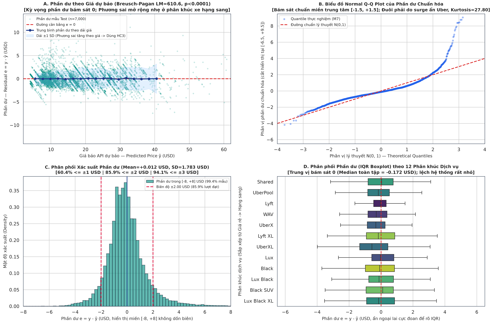{#fig-4-5 width=91% fig-align="center"}

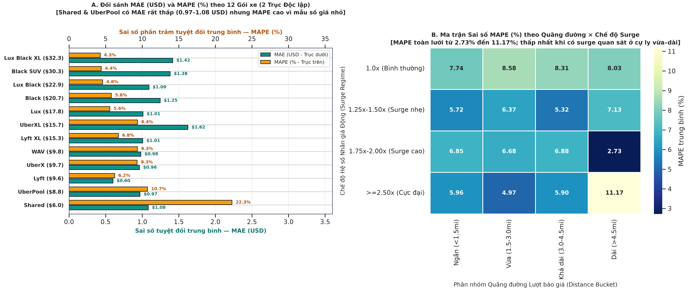{#fig-4-6 width=91% fig-align="center"}

```{=typst}
#block(breakable: false)[
```

| Hãng — Gói dịch vụ | Giá TB | PICP 85% chặt | PICP 85% (10⁻⁶) | $\hat{q}$ CQR (USD) | PICP CQR | MPIW CQR (Δ) |
| :--- | ---: | ---: | ---: | ---: | ---: | ---: |
| Lyft — Shared | \$6.03 | 80.79% | 80.79% | -0.0056 | 79.89% | \$4.060 (-\$0.012) |
| Lyft — Lyft | \$9.63 | 81.11% | 81.11% | -0.0018 | 80.10% | \$1.778 (-\$0.004) |
| Lyft — Lyft XL | \$15.32 | 80.96% | 80.96% | -0.0001 | 80.51% | \$3.266 (\$0.000) |
| Lyft — Lux | \$17.83 | 80.11% | 80.11% | +0.0013 | 81.99% | \$3.627 (+\$0.003) |
| Lyft — Lux Black | \$22.88 | 82.00% | 82.00% | -0.0015 | 80.25% | \$3.835 (-\$0.003) |
| Lyft — Lux Black XL | \$32.33 | 80.64% | 80.96% | 0.0000 | 81.86% | \$5.263 (\$0.000) |
| Uber — UberPool | \$8.77 | 79.39% | 79.39% | -0.0047 | 79.07% | \$2.886 (-\$0.009) |
| Uber — UberX | \$9.72 | 80.82% | 80.82% | 0.0000 | 79.95% | \$2.816 (\$0.000) |
| Uber — WAV | \$9.79 | 79.76% | 79.76% | -0.0001 | 78.66% | \$2.786 (\$0.000) |
| Uber — UberXL | \$15.73 | 80.01% | 80.01% | -0.0024 | 79.70% | \$4.381 (-\$0.004) |
| Uber — Black | \$20.68 | 79.27% | 79.86% | 0.0000 | 79.86% | \$4.046 (\$0.000) |
| Uber — Black SUV | \$30.31 | 77.58% | 77.58% | 0.0000 | 78.62% | \$4.114 (\$0.000) |
| Toàn tập Test (n = 46,573) | \$16.47 | 80.05% | 80.13% | 0 cắt ngược | 79.89% | \$3.562 (-\$0.003) |

: Bảng 4.5: Hiệu chỉnh Monotonic Split-CQR dùng pandas category gốc trên 12 gói dịch vụ (85%/15%, 0 cắt ngược) {#tbl-4-5 tbl-colwidths="[21,8,12,13,16,11,19]"}

```{=typst}
#block(above: 0.16em, below: 0.72em)[#set par(justify: false, leading: 0.50em); #text(size: 9.4pt, style: "italic", fill: rgb("#475569"))[Nguồn: Kết quả hiệu chỉnh Monotonic Split-CQR của nhóm (n\_fit = 158,344, n\_cal = 27,944, n\_test = 46,573, pandas category gốc; 2 cột PICP đầu thuộc mô hình 85% Fit trước CQR, $hat(q)$ chuẩn 4 chữ số thập phân). Tham chiếu GĐ6 100% Train: PICP chặt 78.44% / tol 10⁻⁶ = 80.28%, MPIW = \$3.51.]]
]
```

::: {.content-visible unless-format="typst"}
*Nguồn: Kết quả hiệu chỉnh Monotonic Split-CQR của nhóm (n\_fit = 158,344, n\_cal = 27,944, n\_test = 46,573, pandas category gốc; 2 cột PICP đầu thuộc mô hình 85% Fit trước CQR, $\hat{q}$ chuẩn 4 chữ số thập phân). Tham chiếu GĐ6 100% Train: PICP chặt 78.44% / tol 10⁻⁶ = 80.28%, MPIW = \$3.51.*
:::

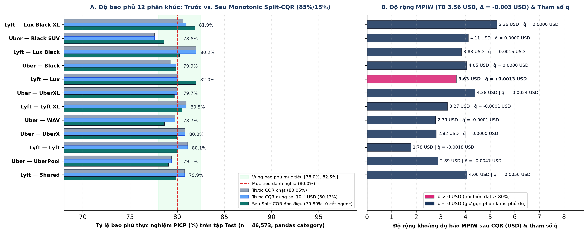{#fig-4-7 width=91% fig-align="center"}

Bảng 4.6 tổng hợp sáu kịch bản kiểm định độ bền: M7 ổn định cao trên Temporal Split EST (R² = 0.9646, MAPE = 8.18%), tập Test hoàn toàn nguyên bản 88.85% (R² = 0.9637, MAPE = 8.16%; khi đồng thời huấn luyện và kiểm tra thuần nguyên bản: R² = 0.9636, MAPE = 8.12%), làm sạch & huấn luyện thuần Train-only (0/46,573 giá Test đổi, M7 R² = 0.9630, RMSE = \$1.7746; trên tập nguyên bản: R² = 0.9639) và API-Batch GroupShuffleSplit chặn 29.29% trùng phiên mili-giây (M7 R² = 0.9639, RMSE = \$1.7608). Đáng chú ý, trên Route Group Split (15 tuyến hoàn toàn mới), M7 đạt R² = 0.9253 và MAPE = 11.50% (vượt ngưỡng 10% do 15 tuyến mới không được rò rỉ trung vị cự ly khi nội suy strictly-on-train; M6 = 11.09%, M2 = 12.03%),  xác nhận mô hình vẫn suy giảm rõ khi rời mạng lưới 57 tuyến huấn luyện và cần hiệu chuẩn khi mở rộng tuyến mới; khi loại bỏ hoàn toàn điền khuyết cự ly từ 15 tuyến Test trong quy trình Strict Train-Only trên Route Group Split, M7 đạt R² = 0.9379 / MAPE = 10.67% toàn mẫu (riêng tập nguyên bản không khuyết cự ly: R² = 0.9538, MAPE = 9.37%). Sáu thí nghiệm phá vỡ MB1–MB6 tại Bảng 4.7 tiếp tục xác minh vai trò cơ chế của từng lựa chọn thiết kế.

```{=typst}
#block(breakable: false)[
```

| Kịch bản kiểm định độ bền | Train / Test (n) | M7 HistGBR (R² / RMSE / MAPE) | M2 OLS / Ghi chú đối chứng |
| :--- | ---: | ---: | ---: |
| 1. Chia theo thời gian thực Boston EST (TS & surge gốc) | 143,023 / 35,756 | 0.9646 / \$1.7422 / 8.18% | M2: 0.9560 / \$1.9421 / 9.22% |
| 2. Chia theo 15 tuyến đường chưa gặp (Route Group) | 184,664 / 48,197 | 0.9253 / \$2.4197 / 11.50% | M2: 0.9312 / \$2.3223 / 12.03% |
| 3. Kiểm tra trên 88.85% dòng hoàn toàn nguyên bản | 186,288 / 41,376 | 0.9637 / \$1.7601 / 8.16% | M2: 0.9563 / \$1.9292 / 9.23% |
| 4. Huấn luyện & Kiểm tra thuần nguyên bản (không sửa) | 165,526 / 41,376 | 0.9636 / \$1.7607 / 8.12% | M2: 0.9564 / \$1.9270 / 9.16% |
| 5. Làm sạch & huấn luyện thuần Train-only (Full Refit)\* | 186,288 / 46,573 | 0.9630 / \$1.7746 / 8.13% | M2: 0.9570 / \$1.9121 / 9.10% (0 price đổi) |
| 6. GroupShuffleSplit phiên API batch (chặn 29.29% trùng ms) | 186,420 / 46,441 | 0.9639 / \$1.7608 / 8.20% | M2: 0.9538 / \$1.9928 / 9.32% |

: Bảng 4.6: Kiểm định độ bền M7 và M2 qua 6 kịch bản (Thời gian EST, Tuyến mới, Nguyên bản, Train-only & API Batch) {#tbl-4-6 tbl-colwidths="[31,17,26,26]"}

```{=typst}
#block(above: 0.16em, below: 0.72em)[#set par(justify: false, leading: 0.50em); #text(size: 9.4pt, style: "italic", fill: rgb("#475569"))[Nguồn: stage5\_robustness.csv và kiểm chứng độ bền mở rộng của nhóm (\*Train-only Full Refit: trên tập Test nguyên bản M7 đạt R² = 0.9639, RMSE = \$1.7554).]]
]
```

::: {.content-visible unless-format="typst"}
*Nguồn: stage5\_robustness.csv và kiểm chứng độ bền mở rộng của nhóm (\*Train-only Full Refit: trên tập Test nguyên bản M7 đạt R² = 0.9639, RMSE = \$1.7554).*
:::

```{=typst}
#block(breakable: false)[
```

| Mã | Thao tác phá vỡ (Mutation) | Chuẩn (R²/MAPE) | Sau phá vỡ | Bài học khoa học rút ra |
| :--- | :--- | ---: | ---: | :--- |
| MB1 | Xóa tương tác C(name)\*distance & C(name)\*log\_distance (Chuyển từ M2 về M1) | 0.9539 / 9.33% | 0.9255 / 12.81% | MAPE tăng vọt từ 9.33% lên 12.81% (+3.48%): chứng minh mỗi phân khúc xe có đơn giá mỗi dặm riêng biệt. |
| MB2 | Tăng siêu tham số phạt Ridge alpha từ mức tối ưu lên alpha = 100,000 | 0.9539 / 9.33% | 0.6438 / 36.52% | Hệ số hồi quy bị ép co mạnh về 0 gây Underfitting nặng (R2 tụt từ 0.9539 xuống 0.6438, RMSE tăng lên \$5.51). |
| MB3 | Bỏ giới hạn độ sâu cây quyết định (max\_depth=None, min\_samples\_leaf=1) | 0.9580 / 8.46% | 0.9340 / 9.99% | Cây học thuộc lòng nhiễu tập Train (Train R2=0.9911, RMSE=\$0.87) nhưng suy giảm nặng trên tập Test (Test R2=0.9340, RMSE=\$2.37). |
| MB4 | Xóa toàn bộ biến surge\_multiplier (đánh giá riêng trên nhóm chuyến Lyft có surge > 1.0) | 0.9748 / 6.17% | 0.4677 / 24.43% | Trên các chuyến có Surge, bỏ biến surge làm RMSE vọt từ \$2.24 lên \$10.29 và R2 sụp đổ từ 0.9748 xuống 0.4677. |
| MB5 | Thay OneHotEncoder bằng OrdinalEncoder/LabelEncoder cho biến danh mục trong OLS | 0.9255 / 12.81% | 0.5206 / 38.21% | Gán thứ tự số học giả tạo (0, 1, 2...11) cho tên gói xe làm R2 của OLS sụp đổ từ 0.9255 xuống chỉ còn 0.5206 (MAPE tăng lên 38.21%). |
| MB6 | Đổi tham số phân chia test\_size từ 0.20 (80/20) sang 0.40 (60/40) | 0.9626 / 8.19% | 0.9628 / 8.26% | Nhờ quy mô dữ liệu lớn (N\_obs=232,861), hiệu năng M7 cực kỳ ổn định: R2=0.9628 vs 0.9626, MAPE=8.26% vs 8.19%. |

: Bảng 4.7: Tổng hợp 6 thí nghiệm phá vỡ có kiểm soát (Mutate & Break MB1–MB6) kiểm chứng cơ chế mô hình {#tbl-4-7 tbl-colwidths="[6,26,15,14,39]"}

```{=typst}
#block(above: 0.16em, below: 0.72em)[#set par(justify: false, leading: 0.50em); #text(size: 9.4pt, style: "italic", fill: rgb("#475569"))[Nguồn: Trích xuất trực tiếp từ reports/tables/stage5\_mutate\_break.csv.]]
]
```

::: {.content-visible unless-format="typst"}
*Nguồn: Trích xuất trực tiếp từ reports/tables/stage5\_mutate\_break.csv.*
:::

## 4.5. Phân tích độ quan trọng của đặc trưng và Diễn giải mô hình (XAI)

Về đối sánh biểu giá cạnh tranh (Bảng 4.8 và Hình 4.8), nghiên cứu ước lượng song song Đặc tả A (Price = β₀ + β₁ · (d × surge)) và Đặc tả B (thuần không surge = 1.0x, Price = β₀ + β₁ · d) trên cùng tập huấn luyện X\_train có surge quan sát thực (n = 186,288) kèm 95% CI cụm phương pháp Delta. Việc loại bỏ 38,037 lượt Lyft khuyết surge tạo ra một phát hiện đảo chiều quan trọng cần báo cáo trung thực ở phân khúc gia đình 6 chỗ: (1) Ở cặp Phổ thông 4 chỗ (UberX vs. Lyft), quy luật cắt nhau vẫn giữ vững qua cả hai đặc tả — điểm cắt dịch từ 3.21 dặm (CI\_cl [2.96, 3.46]) ở Đặc tả A lên 5.17 dặm (CI\_cl [4.16, 6.18]; toàn mẫu không surge: 4.99 mi) ở Đặc tả B. (2) Ở cặp Gia đình 6 chỗ (UberXL vs. Lyft XL), dù Đặc tả A cắt tại 3.75 dặm (CI\_cl [3.36, 4.14]), nhưng ở Đặc tả B thuần không surge điểm giao toán học dịch hẳn ra ngoài miền quan sát tại d\* = 8.31 dặm (CI\_cl [4.98, 11.65]; toàn mẫu không surge: 8.75 dặm > 7.86 dặm). Điều này chứng tỏ khi không có surge, Lyft XL rẻ hơn UberXL trên TOÀN BỘ miền Boston [0.02, 7.86] dặm; giao điểm 3.75 dặm ở Đặc tả A hoàn toàn do phụ phí surge của Lyft đẩy dốc hiệu dụng lên. (3) Kiểm tra độ nhạy trên miền giá sàn (d ≥ 1.0 mi, loại bỏ vùng phẳng giá tối thiểu) cho thấy điểm cắt UberX–Lyft nằm tại 4.53 mi (CI\_cl [3.88, 5.18]) còn UberXL–Lyft XL tiến sát biên cực đại nội đô (7.12 mi, CI\_cl [4.90, 9.35] bao trùm mốc 7.86 mi). Ở hạng sang Sedan (Black vs. Lux Black), giao điểm 0.41 mi ở Đặc tả A biến mất trên cả Đặc tả B (-0.42 mi) lẫn miền d ≥ 1.0 mi (-0.45 mi) — xác nhận Uber Black rẻ hơn toàn miền khi không surge. Tương tự, ở cặp SUV hạng sang (Black SUV vs. Lux Black XL), dù giao điểm toàn miền nằm tại 0.85–1.17 mi, kiểm định trên miền d ≥ 1.0 mi kéo điểm cắt xuống 0.605 mi < 1.0 mi (CI\_cl [0.35, 0.86], ngoài miền d ≥ 1.0 mi), chứng tỏ trên toàn bộ các chặng từ 1.0 dặm trở lên Uber Black SUV rẻ hơn Lux Black XL; cặp đi ghép không cắt (Shared luôn rẻ hơn).

```{=typst}
#block(breakable: false)[
```

| Phân khúc | Biểu giá Uber (Đặc tả A) | Biểu giá Lyft (Đặc tả A) | Đặc tả A (d×surge, CI cụm) | Đặc tả B (thuần 1.0x, X\_train) |
| :--- | :--- | :--- | :--- | :--- |
| 1. Đi ghép | UberPool: \$6.14 + \$1.19/mi | Shared: \$3.34 + \$1.24/mi | Không cắt trong [0.02, 7.86] mi | Không cắt (Shared luôn rẻ hơn) |
| 2. Phổ thông 4 chỗ | UberX: \$6.47 + \$1.51/mi | Lyft: \$5.40 + \$1.84/mi | 3.21 mi (CI\_cl [2.96, 3.46]) | 5.17 mi (CI\_cl [4.16, 6.18]) |
| 3. Gia đình 6 chỗ | UberXL: \$9.19 + \$2.96/mi | Lyft XL: \$7.49 + \$3.41/mi | 3.75 mi (CI\_cl [3.36, 4.14]) | Không cắt (8.31 mi > 7.86; Lyft XL rẻ hơn toàn miền) |
| 4. Hạng sang Sedan | Black: \$12.23 + \$3.77/mi | Lux Black: \$11.74 + \$4.96/mi | 0.41 mi (CI\_cl [0.26, 0.55]) | Không cắt (-0.42 mi; Uber Black luôn rẻ hơn) |
| 5. Hạng sang SUV | Black SUV: \$22.63 + \$3.47/mi | Lux Black XL: \$20.73 + \$5.09/mi | 1.17 mi (CI\_cl [1.08, 1.26]) | 0.85 mi (CI\_cl [0.70, 1.01]; d ≥ 1.0 mi: 0.605 mi < 1.0 → Black SUV rẻ hơn) |
| Độc lập Uber (hỗ trợ xe lăn) | WAV: \$6.44 + \$1.51/mi | — | Không ghép cặp chéo | Tách riêng đối chứng |
| Độc lập Lyft (Premium Sedan) | — | Lux: \$8.52 + \$4.05/mi | Không ghép cặp chéo | Tách riêng đối chứng |

: Bảng 4.8: Đối sánh song đặc tả 5 cặp biểu giá đối xứng Uber vs. Lyft trên X\_train (n = 186,288) kèm 95% CI cụm {#tbl-4-8 tbl-colwidths="[15,21,21,21,22]"}

```{=typst}
#block(above: 0.16em, below: 0.72em)[#set par(justify: false, leading: 0.50em); #text(size: 9.4pt, style: "italic", fill: rgb("#475569"))[Nguồn: stage6\_tier\_tariffs.csv và ước lượng song đặc tả của nhóm (Delta-method Cluster 95% CI; kiểm tra d ≥ 1.0 mi: UberX 4.53 mi, Black SUV 0.605 mi \< 1.0 mi; WAV/Lux tách riêng).]]
]
```

::: {.content-visible unless-format="typst"}
*Nguồn: stage6\_tier\_tariffs.csv và ước lượng song đặc tả của nhóm (Delta-method Cluster 95% CI; kiểm tra d ≥ 1.0 mi: UberX 4.53 mi, Black SUV 0.605 mi < 1.0 mi; WAV/Lux tách riêng).*
:::

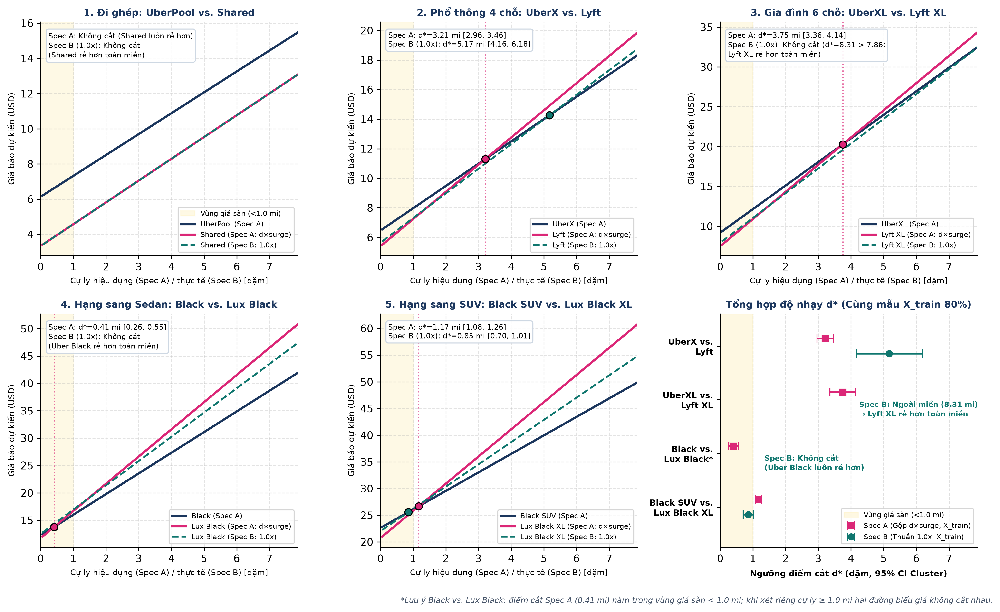{#fig-4-8 width=91% fig-align="center"}

Về tầm quan trọng đặc trưng (Bảng 4.9 và Hình 4.9), Grouped Permutation Importance gộp toàn bộ 6 cột cự ly–surge thành một cụm chống đa cộng tuyến (6 cụm rời phủ đúng 27/27 cột X\_test). Kết quả đồng thuận chặt giữa hai họ mô hình: Phân khúc dịch vụ name (M7: +\$9.9529, 69.23%; M2: +\$9.8510, 70.94%), Cụm Cự ly & Surge (M7: +\$3.3602, 23.37%; M2: +\$3.5775, 25.76%) — tổng hai cụm chi phối 92.60% ở M7 và 96.70% ở M2; Tuyến không gian chiếm 7.29% vs. 3.30%; còn toàn bộ 7 biến Thời tiết và 9 biến Thời gian EST chỉ đạt tổng 0.02% ở M7 (0.01% + 0.01%) và 0.00% ở M2 (trên riêng mẫu khớp thời tiết sạch sentinel, 7 biến thời tiết có ΔRMSE = +0.0032 USD ≈ 0). Đối chiếu với PDP/ICE (Hình 4.10) cho thấy rõ vùng phẳng giá sàn < 1.0 dặm và hiện tượng bão hòa nhánh cây ở vùng hiếm surge ≥ 2.50x.

```{=typst}
#block(breakable: false)[
```

| Cụm ngữ nghĩa | Cột | Các đặc trưng hoán vị đồng thời | M7 ΔRMSE | Tỷ trọng M7 | M2 ΔRMSE | Tỷ trọng M2 |
| :--- | :---: | :--- | ---: | ---: | ---: | ---: |
| 1. Phân khúc dịch vụ (name) | 1 | name | +\$9.9529 | 69.23% | +\$9.8510 | 70.94% |
| 2. Cụm Cự ly & Surge gộp (chống đa cộng tuyến) | 6 | distance, log\_distance, surge\_multiplier, lyft\_surge\_excess, distance\_x\_surge, distance\_x\_lyft\_surge\_excess | +\$3.3602 | 23.37% | +\$3.5775 | 25.76% |
| 3. Tuyến không gian (source, destination) | 2 | source, destination | +\$1.0479 | 7.29% | +\$0.4582 | 3.30% |
| 4. Hãng xe (cab\_type, is\_lyft) | 2 | cab\_type, is\_lyft | +\$0.0132 | 0.09% | \$0.0000 | 0.00% |
| 5. Toàn bộ 7 biến Thời tiết | 7 | temp, rain, humidity, wind, clouds, pressure, is\_raining | +\$0.0014 | 0.01% | -\$0.0002 | 0.00% |
| 6. Toàn bộ 9 biến Thời gian Boston EST | 9 | hour, day\_of\_week, is\_weekend, is\_rush\_hour, time\_of\_day, hour\_sin, hour\_cos, dow\_sin, dow\_cos | +\$0.0009 | 0.01% | -\$0.0002 | 0.00% |

: Bảng 4.9: Grouped Permutation Importance chống đa cộng tuyến (6 cụm rời = 27/27 cột X\_test, n = 15,000 × 8 lần lặp) {#tbl-4-9 tbl-colwidths="[22,5,31,11,10,11,10]"}

```{=typst}
#block(above: 0.16em, below: 0.72em)[#set par(justify: false, leading: 0.50em); #text(size: 9.4pt, style: "italic", fill: rgb("#475569"))[Nguồn: Tính toán trực tiếp từ best\_model.joblib & m2\_interaction\_ols.joblib trên X\_test (n = 15,000 × 8 lần lặp).]]
]
```

::: {.content-visible unless-format="typst"}
*Nguồn: Tính toán trực tiếp từ best\_model.joblib & m2\_interaction\_ols.joblib trên X\_test (n = 15,000 × 8 lần lặp).*
:::

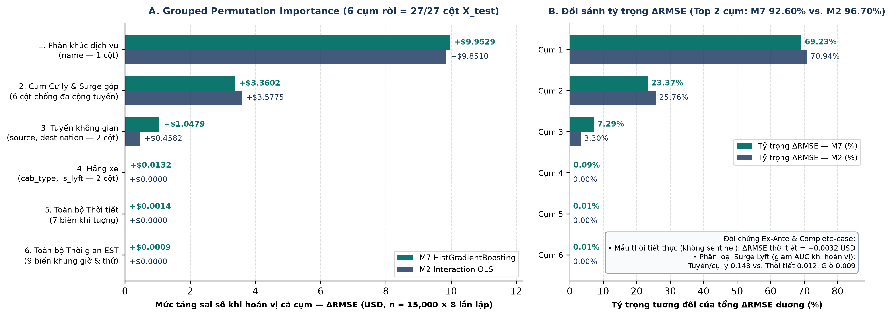{#fig-4-9 width=85% fig-align="center"}

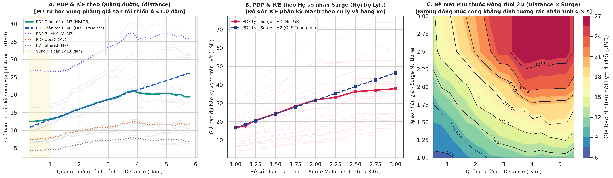{#fig-4-10 width=85% fig-align="center"}

## 4.6. Thảo luận kết quả thực nghiệm

Tổng hợp Chương 3–4 cho thấy bức tranh nhất quán: giá báo API Boston trong 24 ngày cuối thu ôn hòa không biến động cơ học theo mưa nhẹ–vừa hay khung giờ cố định, mà do phân khúc dịch vụ (69.23% ΔRMSE), cụm cự ly–surge (23.37% ΔRMSE) và điểm nóng không gian chi phối (5 quận dẫn đầu Surge Lyft 9.57%–11.17%, gấp 7.2–8.4 lần North End 1.33%), phù hợp tính vi mô theo tiểu khu của Chen et al. (2015). Chênh lệch lớn giữa dự báo có điều kiện Lyft (R² = 0.9794, chỉ 1 lỗi > \$15, 0 > \$16) với Uber (R² = 0.9474, 57 lỗi > \$15) và Ex-Ante Lyft khi surge (R² = 0.4677) khẳng định phần khó đoán nhất nằm ở mất cân bằng cung–cầu tức thời ngoài dữ liệu khí tượng hay đồng hồ công khai.



# CHƯƠNG 5: KHUYẾN NGHỊ QUẢN TRỊ VÀ KẾT LUẬN

## 5.1. Mô phỏng Trần Surge Cap dưới Ràng buộc Cung và Khuyến nghị phân tầng

Mô phỏng phản thực tế có điều kiện (Conditional Counterfactual Scenario Analysis — KHÔNG phải ước lượng nhân quả thực địa) được thực hiện độc quyền trên 92,384 lượt báo giá Lyft quan sát surge thực (tổng giá trị cơ sở = \$1,603,696.20 API Quote Proxy, KHÔNG phải doanh thu kế toán). Trong src/simulation.py, mỗi khi hạ surge\_multiplier về ngưỡng trần, hệ thống tính lại đồng bộ cả 4 biến phụ thuộc surge trước khi gọi predict() trên M7 và M2, đồng thời đối chứng với chuẩn số học P × (cap / surge). Khác với cách cộng trừ tuyến tính gây phi lý, mô hình áp dụng chặt nguyên tắc bên ngắn Q\_realized = min(Q\_D, Q\_S) với độ co giãn cung tài xế theo mức giảm giá (ε\_S $\in \{0.30, 0.60\}$; q\_S = clip(1 + ε\_S · Δp/p, sàn, 1.0)) trên lượt bị cắt: mọi cầu tăng thêm theo co giãn (Cohen et al., 2016; ε = −0.50) vượt quá Q\_S trở thành dư cầu không phục vụ Σ max(0, Q\_D − Q\_realized), bảo đảm tính đơn điệu Proxy(ε\_S=0.60) < Proxy(ε\_S=0.30) < Proxy(tĩnh 0%) < Cận trên dư cung (Bảng 5.1, Hình 5.1).

```{=typst}
#block(breakable: false)[
```

| Trần | Lượt cắt | Giảm giá M7 | M2 OLS | Chuẩn số học | Proxy tĩnh | Cung ε\_S=0.3 / 0.6\* | Cận trên ε=−0.5 |
| :---: | ---: | ---: | ---: | ---: | ---: | ---: | ---: |
| 3.00x | 0 | \$0.00 (0.00%) | \$0.00 | \$0.00 (0.00%) | 0.000% | 0.000% / 0.000% | 0.000% |
| 2.00x | 53 | \$5.53 (-18.84%) | \$5.88 | \$6.20 (-20.25%) | -0.018% | -0.023% / -0.027% | -0.011% |
| 1.75x | 704 | \$4.61 (-11.64%) | \$5.14 | \$5.28 (-13.83%) | -0.203% | -0.255% / -0.307% | -0.116% |
| 1.50x | 1,437 | \$7.33 (-19.32%) | \$7.26 | \$7.45 (-20.09%) | -0.657% | -0.810% / -0.963% | -0.401% |
| 1.25x | 2,949 | \$8.06 (-22.82%) | \$8.23 | \$8.46 (-24.83%) | -1.482% | -1.800% / -2.117% | -0.953% |
| 1.00x | 6,280 | \$8.44 (-27.51%) | \$8.50 | \$8.78 (-29.33%) | -3.304% | -3.951% / -4.599% | -2.225% |

: Bảng 5.1: Mô phỏng 6 kịch bản Trần Surge Cap dưới ràng buộc cung Q = min(Q\_D, Q\_S) trên 92,384 lượt Lyft thực {#tbl-5-1 tbl-colwidths="[7,9,16,8,16,10,20,14]"}

```{=typst}
#block(above: 0.16em, below: 0.72em)[#set par(justify: false, leading: 0.50em); #text(size: 9.4pt, style: "italic", fill: rgb("#475569"))[Nguồn: stage6\_surge\_cap\_simulation.csv và mô phỏng ràng buộc cung của nhóm (\*Q\_realized = min(Q\_D, Q\_S) với q\_S = clip(1 + ε\_S·Δp/p); cột cuối là cận trên khi dư cung, Cohen et al., 2016).]]
]
```

::: {.content-visible unless-format="typst"}
*Nguồn: stage6\_surge\_cap\_simulation.csv và mô phỏng ràng buộc cung của nhóm (\*Q\_realized = min(Q\_D, Q\_S) với q\_S = clip(1 + ε\_S·Δp/p); cột cuối là cận trên khi dư cung, Cohen et al., 2016).*
:::

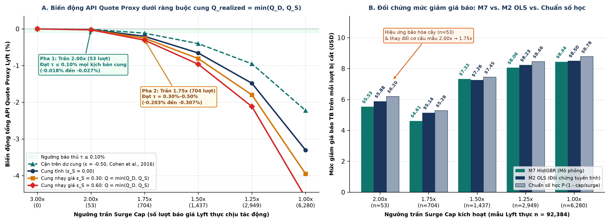{#fig-5-1 width=91% fig-align="center"}

Bài toán tối ưu có ràng buộc (tối đa số lượt được bảo vệ sao cho |ΔProxy| ≤ τ) trên mẫu Lyft quan sát thực cho thấy sự phân tầng chính sách rõ rệt thay vì cố giữ một ngưỡng duy nhất: (1) Dưới khẩu vị rủi ro bảo thủ τ = 0.05% hoặc τ = 0.10%, CHỈ duy nhất Trần 2.00x (53 lượt surge 2.50x–3.00x; giảm giá báo M7 \$5.53 tức 18.84%, M2 \$5.88, chuẩn số học \$6.20) đạt chuẩn trên MỌI kịch bản cung (tĩnh -0.018%, cung nhạy giá ε\_S = 0.30 -0.023%, ε\_S = 0.60 -0.027%; OOS Test-only: -0.028% đến -0.041%). (2) Trần 1.75x (704 lượt, giảm giá báo \$4.61 tức 11.64%) tạo biến động Proxy -0.203% (tĩnh), -0.255% (cung ε\_S = 0.30) và -0.307% (cung ε\_S = 0.60; OOS Test-only: -0.211% đến -0.318%) — vượt ngưỡng 0.10% và chỉ đạt yêu cầu khi doanh nghiệp chấp nhận biên rủi ro mở rộng τ = 0.30% (tĩnh/cung ε\_S = 0.30) hoặc τ = 0.50% (cả cung ε\_S = 0.60). Về cơ chế mô hình, mức giảm giá báo tại Trần 2.00x của HistGB M7 (\$5.53) thấp hơn biên trên M2 OLS (\$5.88) và cận số học (\$6.20) do hiện tượng ngoại suy phẳng ở vùng đuôi hiếm n = 53 của mô hình cây (min\_samples\_leaf = 20 gom chung các đỉnh 2.50x–3.00x vào cùng lá), nhưng cả ba nhánh đều nằm gọn trong τ ≤ 0.10%. Ngoài ra, ε\_S $\in \{0.30, 0.60\}$ là tham số kịch bản ngoại sinh (không ước lượng nội sinh từ cung tài xế) và chưa lượng hóa hiệu ứng lan tỏa không gian (spillover) hay tài xế chạy rỗng sang quận lân cận ('Wild Goose Chase'; Castillo et al., 2017) — vì vậy đề tài đề xuất lộ trình hai nấc: áp trần bảo thủ 2.00x trước ở Pha 1 và chỉ mở rộng sang 1.75x sau thử nghiệm thực địa Pha 2 có ngưỡng dừng ETA.

Hệ thống khuyến nghị được phân tách minh bạch theo ba tầng bằng chứng:

- **Tầng 1 — Trực tiếp từ bằng chứng thực nghiệm trong mẫu:** (i) Trên 72 tuyến Boston khi không có surge, hành khách ưu tiên chi phí chọn Lyft Shared cho đi ghép (rẻ hơn UberPool toàn miền), chọn Lyft cho chặng phổ thông ngắn (< 3.21 mi ở Đặc tả A / < 5.17 mi ở Đặc tả B thuần 1.0x) và UberX cho chặng dài hơn (lưu ý trung thực rằng nhóm chuyến vượt 5.17 mi chỉ chiếm 1.7% ở Đặc tả B và vượt 3.21 mi chiếm 14.8% ở Đặc tả A); chọn Lyft XL trên toàn miền [0.02, 7.86] mi khi không surge ở hạng 6 chỗ; và chọn Uber Black (toàn miền không surge) hoặc Black SUV (toàn miền d ≥ 1.0 mi vì điểm cắt d ≥ 1.0 mi chỉ 0.605 mi < 1.0 mi) ở hạng sang. (ii) Đội kỹ thuật dự báo giá không cần ưu tiên biến khí tượng gộp theo giờ hay lịch buổi, mà tập trung bổ sung duration, mật độ tài xế thời gian thực và đóng gói Monotonic Split-CQR (pandas category) vào mô hình sản phẩm.
- **Tầng 2 — Suy luận quản trị có điều kiện từ mô phỏng:** Lyft có thể áp dụng Trần 2.00x như bước cắt đỉnh cực đoan ít rủi ro nhất (τ ≤ 0.10%), đồng thời dùng Trần 1.75x làm ứng viên thử nghiệm Switchback A/B tại 5 quận điểm nóng dẫn đầu (Back Bay 11.17%, Fenway 10.57%, Northeastern University 10.10%, Theatre District 9.58%, Boston University 9.57%) nhằm đo trực tiếp ETA và độ co giãn cung tài xế. Uber nên tập trung định vị lợi thế giá ở phân khúc hạng sang (Black toàn miền & Black SUV từ d ≥ 1.0 mi) thay vì chỉ dựa vào đuôi cự ly dài UberX (chỉ 1.7% lượt > 5.17 mi khi không surge và 14.8% > 3.21 mi), đồng thời rà soát giá mở cửa \$6.14 của UberPool so với \$3.34 của Lyft Shared.
- **Tầng 3 — Giả thuyết kinh doanh cần kiểm chứng thực địa (chưa chứng minh trực tiếp trong dữ liệu):** Đề xuất gói hội viên Price-Lock Pass 1.50x đòi hỏi khảo sát riêng về mức sẵn lòng chi trả (WTP) và rủi ro lựa chọn bất lợi; gợi ý hành khách chờ 5–10 phút khi gặp surge theo Chen et al. (2015) cần xác minh bằng chuỗi thời gian độ phân giải phút.

## 5.2. Lộ trình triển khai và Phân tích công suất thử nghiệm Switchback (Triggered vs. ITT)

Một sai lầm thống kê phổ biến khi thiết kế thử nghiệm Switchback cho chính sách trần surge là tính cỡ mẫu theo phân tích toàn mẫu (Intention-to-Treat — ITT). Do tần suất kích hoạt thực trên Lyft rất thấp (toàn 12 quận: 0.758% lượt có surge > 1.75x và 0.056% có surge > 2.00x), một tác động thực 2.0 pp trên tập chịu cắt bị pha loãng xuống chỉ còn 0.0152 pp (12 quận) hoặc 0.0293 pp (5 điểm nóng) trên toàn mẫu, đòi hỏi tới 170.7 triệu lượt/nhánh (45.7 triệu ở 5 điểm nóng) — hoàn toàn bất khả thi. Do đó, thử nghiệm thực địa bắt buộc đánh giá trên tập kích hoạt (Triggered / Exposed-Only Analysis) với hệ số hiệu ứng thiết kế cụm phụ thuộc quy mô lưu lượng DEFF\_k× = 1 + (k·m₀ − 1)·ICC (ICC = 0.05, α = 5%, power = 80%). Khi lưu lượng sản xuất tăng k $\in \{25\times, 50\times\}$ so với tốc độ thu thập API 1×, cỡ cụm kích hoạt m\_k tăng tuyến tính làm DEFF giãn mạnh: với Trần 1.75x trên toàn 12 quận (m₀ = 1.34, 29.89 lượt/ngày; DEFF\_1x = 1.017 → DEFF\_25x = 2.627 → DEFF\_50x = 4.304), phát hiện MDE = 5.0 pp cần 8,248 lượt (11.0 ngày ở 25×; 9.0 ngày ở 50×), MDE = 3.0 pp cần 22,912 lượt (30.7 ngày ở 25×; 25.1 ngày ở 50×), còn MDE = 2.0 pp đòi hỏi 51,550 lượt (69.0 ngày ở 25×; 56.5 ngày ở 50×). Nếu khu trú tại 5 quận điểm nóng (gom 80.30% lượt kích hoạt toàn TP nhưng chỉ chạm 41.5% tổng lượng chuyến; tỷ lệ kích hoạt tăng gấp đôi lên 1.466%, DEFF\_25x = 2.648, DEFF\_50x = 4.346), MDE = 5.0 pp và 3.0 pp khả thi trong 13.9–38.5 ngày ở 25× (11.4–31.6 ngày ở 50×), còn MDE = 2.0 pp cần 86.6 / 71.1 ngày (> 2 tháng). Riêng Trần 2.00x quá hiếm nên ngay ở MDE = 5.0 pp vẫn cần 128.1 / 101.2 ngày (12 quận) hay 142.8 / 112.9 ngày (5 điểm nóng), phù hợp giám sát an toàn Pha 1 hơn là A/B hẹp (cắt 53 đỉnh cực đoan để bảo vệ niềm tin thương hiệu và tuân thủ quy định minh bạch của Sở Tiện ích Công cộng Massachusetts — DPU TNC mà không cần chi phí truyền thông lớn). Bảng 5.2 đồng thời gắn căn cứ vận hành rõ cho các ngưỡng dừng (SLA < 150 ms; ETA > 15% hoặc hủy > 2 pp phòng Wild Goose Chase; giám sát chuyển nền tảng đa ứng dụng driver multi-homing sang Uber khi Uber giữ phụ phí ẩn không trần; công bằng không gian |bias| ≤ \$0.12 < 1/4 bậc làm tròn \$0.50).

```{=typst}
#block(breakable: false)[
```

| Giai đoạn triển khai | Đơn vị phụ trách | Hạng mục kỹ thuật & Nghiệp vụ trọng tâm | Tiêu chí nghiệm thu & Quy tắc dừng |
| :--- | :--- | :--- | :--- |
| Pha 1 (Tháng 1–2): Shadow Mode & Trần Bảo thủ 2.00x | Data Engineering & Pricing Ops | Chạy song song M7 + M2 (và đối chứng Ex-Ante) trên Dashboard 5 Tab ở Shadow Mode; đóng gói bộ 3 mô hình Quantile Monotonic Split-CQR (pandas category) vào models/; kích hoạt thử nghiệm an toàn mức trần 2.00x (53 lượt cực đoan, đạt τ ≤ 0.10% ở mọi kịch bản cung). | Độ trễ API < 150 ms (ngưỡng SLA báo giá thời gian thực); 18/18 chốt kiểm toán dữ liệu PASS; PICP CQR $\in$ [78%, 83%] trên 12 gói, 0 cắt ngược; theo dõi ETA ở mức surge 2.5x–3.0x. |
| Pha 2 (Tháng 3–4): Triggered Switchback A/B cho Trần 1.75x | Marketplace Economics & Product | Thử nghiệm Switchback trên tập kích hoạt (Triggered Analysis, KHÔNG dùng ITT do pha loãng xuống 0.0152–0.0293 pp) tại 5 quận điểm nóng (Back Bay, Fenway, Northeastern University, Theatre District, Boston University; gom 80.30% lượt kích hoạt toàn TP, tỷ lệ kích hoạt 1.466%, DEFF\_25x = 2.648 / DEFF\_50x = 4.346) hoặc toàn 12 quận (DEFF\_25x = 2.627). Phát hiện MDE = 3.0 pp cần 23,096 lượt (\~38.5 ngày ở 25×; 31.6 ngày ở 50×; toàn 12 quận: 30.7 / 25.1 ngày); MDE = 5.0 pp chỉ cần \~13.9 / 11.4 ngày. | Đo tỷ lệ hoàn thành chuyến, ETA và tỷ lệ tài xế nhận cuốc trên tập kích hoạt; dừng sớm ngay nếu ETA tăng > 15% hoặc hủy do thiếu xe tăng > 2 pp (ngưỡng phòng chống Wild Goose Chase; Castillo et al., 2017; Hall et al., 2015). |
| Pha 3 (Tháng 5–6): Đánh giá Nhân quả & Đạo đức AI | Vận hành & AI Governance | Chỉ quyết định mở rộng trần 1.75x (chấp nhận τ = 0.30%–0.50%) nếu Pha 2 chứng minh không gây thiếu cung tài xế; tái huấn luyện bổ sung dữ liệu duration, mật độ xe và mùa đông Boston; duy trì kiểm toán công bằng 12 quận. | Duy trì MAPE nội miền ≤ 9.0%, công bằng không gian 12 quận \|bias\| ≤ \$0.12 (\~1.33× hiện trạng \$0.0900 và < 1/4 bậc làm tròn \$0.50 của API). |

: Bảng 5.2: Lộ trình triển khai 3 pha (6 tháng) tích hợp Triggered Switchback Power Analysis và quy tắc dừng ETA {#tbl-5-2 tbl-colwidths="[19,16,39,26]"}

```{=typst}
#block(above: 0.16em, below: 0.72em)[#set par(justify: false, leading: 0.50em); #text(size: 9.4pt, style: "italic", fill: rgb("#475569"))[Nguồn: Đề xuất triển khai & Triggered Switchback Power Analysis (α = 5%, power = 80%, ICC = 0.05) của nhóm thực hiện.]]
]
```

::: {.content-visible unless-format="typst"}
*Nguồn: Đề xuất triển khai & Triggered Switchback Power Analysis (α = 5%, power = 80%, ICC = 0.05) của nhóm thực hiện.*
:::

## 5.3. Hạn chế của nghiên cứu và Đạo đức dữ liệu (Kiểm toán công bằng 12 quận)

Nghiên cứu công khai minh bạch bảy giới hạn khách quan của dữ liệu, phương pháp và sản phẩm:

- **Bản chất báo giá API & cơ cấu mẫu phân tầng:** Dữ liệu là giá báo trước trên API (API Fare Quotes) truy vấn tương đối đều qua 12 gói và 72 tuyến, không phản ánh tỷ lệ chốt chuyến, nhu cầu thực, thị phần hay doanh thu kế toán.
- **Khuyết thu thập gốc & thiên lệch bỏ sót biến (OVB):** Thiếu 23.21% timestamp gốc, 29.16% surge Lyft, 6 ngày tháng 12/2018 và 5 khung giờ đêm EST; thiếu thời lượng chuyến thực (duration), kẹt xe và mật độ tài xế — gây OVB trong β₁ và tạo trần độ chính xác \~4% phương sai chưa giải thích.
- **Bất đối xứng công bố Surge & ranh giới Ex-Ante:** API Uber trả cố định surge\_multiplier = 1.00 dù áp phụ phí ẩn trong Upfront Pricing (tạo 57/58 sai số > \$15 và 47/47 > \$16 trên M7), còn dự báo Ex-Ante thuần không thể tái tạo các đỉnh surge thời gian thực (R² = 0.4677 trên Lyft > 1.0x).
- **Phạm vi thời tiết cuối thu & công suất mưa lớn thấp:** Dữ liệu chỉ bao phủ 24 ngày cuối thu ôn hòa (max rain 0.55 in/h trong bảng sạch, chưa gồm bão tuyết mùa đông Boston) và chỉ ghi nhận đúng 8 khung giờ mưa lớn ≥ 0.10 in/h toàn thành phố — giới hạn công suất thống kê cho cực trị khí tượng.
- **Khôi phục bậc 10 heuristic & ranh giới tuyến mới:** Quy tắc log10 toàn cục (mốc 2.15 mi cố định cho distance) không làm lạm phát giá Test (Strict Train-Only Full Refit cho 0/46,573 giá Test đổi, M7 R² = 0.9630); và khi khử hoàn toàn rò rỉ nội suy cự ly bằng RouteDistanceImputer trong Pipeline, hiệu năng giảm rõ khi dự báo trên 15 tuyến mới (M7 MAPE = 11.50%, M6 = 11.09%, M2 = 12.03%).
- **Giới hạn mô phỏng phi nhân quả & mật độ kích hoạt Switchback:** Mô phỏng Surge Cap không thay thế được ước lượng nhân quả và phụ thuộc tham số suy giảm cung giả định; thử nghiệm Switchback đòi hỏi quy mô lưu lượng sản xuất thực (≥ 25× tốc độ thu thập API) mới đạt công suất trong khung 2 tháng.
- **Đóng gói khoảng phân vị sống trên Dashboard:** Thư mục models/ hiện lưu M7 và M2, chưa đóng gói 3 tệp .joblib của bộ Quantile đã hiệu chỉnh Monotonic Split-CQR nên Tab 5A đang hiển thị dải tham chiếu ±MPIW/2 cấp phân khúc kèm nhãn minh bạch; cần tích hợp bộ 3 tệp CQR ở Pha 1 triển khai.

Về Đạo đức AI và Kiểm toán Công bằng Không gian (Spatial Fairness Audit): Để kiểm tra rủi ro thiên vị thuật toán theo địa bàn trên 12 quận Boston, nhóm đo lường phần dư có dấu (actual − predicted) và sai số của M7 trên tập kiểm tra (n = 46,573). Kết quả xác nhận mô hình gần như không có thiên lệch hệ thống theo địa lý: độ lệch trung bình có dấu cực đại chỉ ở mức |bias| ≤ \$0.0900 (dao động từ -0.0218 USD tại West End đến +0.0900 USD tại Financial District), và MAPE cả 12/12 quận đều nằm gọn dưới ngưỡng 9% trong khoảng [7.33%, 8.98%] (thấp nhất West End, cao nhất Northeastern University). Tuy nhiên, nhóm cảnh báo rủi ro thiên lệch phủ sóng địa lý (Geographic Coverage Bias): 12 quận trong bộ dữ liệu tập trung tại lõi trung tâm/đại học và chưa bao phủ các khu dân cư ngoại vi thu nhập thấp hơn (như Roxbury, Dorchester, Mattapan), nên cần tái kiểm toán công bằng toàn thành phố và theo dõi thu nhập ròng giờ đỉnh của tài xế trước khi mở rộng. Về quyền riêng tư, mô hình dùng ẩn danh cấp quận; khi triển khai GPS thực cần gom cụm lưới lục giác H3 đạt k-anonymity, xóa tọa độ gốc sau 30 ngày và duy trì kiểm thử Human-in-the-Loop.

## 5.4. Hướng phát triển trong tương lai và Kết luận chung

Bốn hướng phát triển tiếp theo gồm: (1) Tích hợp thời lượng chuyến thực (duration), mật độ kẹt xe và lịch sự kiện Boston nhằm nâng độ chính xác Ex-Ante và giảm OVB; (2) Mở rộng chuỗi quan sát 4 mùa (gồm bão tuyết) ở độ phân giải phút; (3) Đóng gói bộ 3 mô hình Split-CQR vào models/ cho Tab 5A; và (4) Xây dựng mô hình cân bằng hai phía gắn Switchback A/B để ước lượng trực tiếp độ co giãn cung tài xế nội sinh.

Kết luận chung: Qua quy trình Khoa học Dữ liệu khép kín trên 270,898 báo giá API (232,861 surge thực; 152,043 khí tượng sạch cảm biến), các kiểm định cụm (2,795 quận × giờ, 329 giờ), Exact WCR (B = 1,999) và TOST khẳng định mưa/khung giờ không lệch giá vượt ±\$0.10; cấu trúc giá do gói xe (69.23% ΔRMSE), cự ly–surge (23.37%) và 5 điểm nóng Lyft (11.17%–9.57%) chi phối. M7 đạt R² = 0.9626, RMSE = \$1.7830, MAPE = 8.19% (Ex-Ante R² = 0.9286), Split-CQR đạt PICP 78.62%–81.99% (0 cắt ngược), và mô phỏng bên ngắn xác lập lộ trình 2 nấc (Pha 1 trần 2.00x; Pha 2 Triggered Switchback 1.75x).



# TÀI LIỆU THAM KHẢO {.unnumbered}

```{=typst}
#[
#set par(hanging-indent: 1.27cm, justify: false, leading: 0.70em, spacing: 1.20em)
#set text(size: 12pt)

Benjamini, Y., & Hochberg, Y. (1995). Controlling the false discovery rate: A practical and powerful approach to multiple testing. #emph[Journal of the Royal Statistical Society: Series B (Methodological), 57];(1), 289–300. #box(link("https://doi.org/10.1111/j.2517-6161.1995.tb02031.x")[#text(hyphenate: false)[https://doi.org/10.1111/j.2517-6161.1995.tb02031.x]])

Breiman, L. (2001). Random forests. #emph[Machine Learning, 45];(1), 5–32. #box(link("https://doi.org/10.1023/A:1010933404324")[#text(hyphenate: false)[https://doi.org/10.1023/A:1010933404324]])

brllrb. (2019). #emph[Uber and Lyft dataset Boston, MA]; \[Data set\]. Kaggle. #link("https://www.kaggle.com/datasets/brllrb/uber-and-lyft-dataset-boston-ma")[#text(hyphenate: false)[#box[https://www.kaggle.com/];#sym.zws;#box[datasets/];#sym.zws;#box[brllrb/];#sym.zws;#box[uber-and-lyft-dataset-boston-ma];]]

Cachon, G. P., Daniels, K. M., & Lobel, R. (2017). The role of surge pricing on a service platform with self-scheduling capacity. #emph[Manufacturing & Service Operations Management, 19];(3), 368–384. #box(link("https://doi.org/10.1287/msom.2017.0618")[#text(hyphenate: false)[https://doi.org/10.1287/msom.2017.0618]])

Cameron, A. C., Gelbach, J. B., & Miller, D. L. (2008). Bootstrap-based improvements for inference with clustered errors. #emph[The Review of Economics and Statistics, 90];(3), 414–427. #box(link("https://doi.org/10.1162/rest.90.3.414")[#text(hyphenate: false)[https://doi.org/10.1162/rest.90.3.414]])

Castillo, J. C., Knoepfle, D., & Weyl, E. G. (2017). Surge pricing solves the wild goose chase. In #emph[Proceedings of the 2017 ACM Conference on Economics and Computation (EC 2017)]; (pp. 241–242). Association for Computing Machinery. #box(link("https://doi.org/10.1145/3033274.3085098")[#text(hyphenate: false)[https://doi.org/10.1145/3033274.3085098]])

Chapman, P., Clinton, J., Kerber, R., Khabaza, T., Reinartz, T., Shearer, C., & Wirth, R. (2000). #emph[CRISP-DM 1.0: Step-by-step data mining guide];. SPSS Inc.

Chen, L., Mislove, A., & Wilson, C. (2015). Peeking beneath the hood of Uber. In #emph[Proceedings of the 2015 Internet Measurement Conference (IMC 2015)]; (pp. 495–508). Association for Computing Machinery. #box(link("https://doi.org/10.1145/2815675.2815681")[#text(hyphenate: false)[https://doi.org/10.1145/2815675.2815681]])

Cohen, P., Hahn, R., Hall, J., Levitt, S., & Metcalfe, R. (2016). #emph[Using big data to estimate consumer surplus: The case of Uber]; (NBER Working Paper No. 22627). National Bureau of Economic Research. #box(link("https://doi.org/10.3386/w22627")[#text(hyphenate: false)[https://doi.org/10.3386/w22627]])

Duan, N. (1983). Smearing estimate: A nonparametric retransformation method. #emph[Journal of the American Statistical Association, 78];(383), 605–610. #box(link("https://doi.org/10.1080/01621459.1983.10478017")[#text(hyphenate: false)[https://doi.org/10.1080/01621459.1983.10478017]])

Friedman, J. H. (2001). Greedy function approximation: A gradient boosting machine. #emph[The Annals of Statistics, 29];(5), 1189–1232. #box(link("https://doi.org/10.1214/aos/1013203451")[#text(hyphenate: false)[https://doi.org/10.1214/aos/1013203451]])

Hall, J., Kendrick, C., & Nosko, C. (2015). #emph[The effects of Uber's surge pricing: A case study]; \[Working paper\]. University of Chicago Booth School of Business. #link("http://economicsforlife.ca/wp-content/uploads/2015/10/effects_of_ubers_surge_pricing.pdf")[#text(hyphenate: false)[#box[http://economicsforlife.ca/];#sym.zws;#box[wp-content/];#sym.zws;#box[uploads/];#sym.zws;#box[2015/];#sym.zws;#box[10/];#sym.zws;#box[effects\_of\_ubers\_surge\_pricing.pdf];]]

Holm, S. (1979). A simple sequentially rejective multiple test procedure. #emph[Scandinavian Journal of Statistics, 6];(2), 65–70. #box(link("https://www.jstor.org/stable/4615733")[#text(hyphenate: false)[https://www.jstor.org/stable/4615733]])

Ke, G., Meng, Q., Finley, T., Wang, T., Chen, W., Ma, W., Ye, Q., & Liu, T.-Y. (2017). LightGBM: A highly efficient gradient boosting decision tree. #emph[Advances in Neural Information Processing Systems, 30];, 3146–3154. #link("https://proceedings.neurips.cc/paper/2017/hash/6449f44a102fde848669bdd9eb6b76fa-Abstract.html")[#text(hyphenate: false)[#box[https://proceedings.neurips.cc/];#sym.zws;#box[paper/];#sym.zws;#box[2017/];#sym.zws;#box[hash/];#sym.zws;#box[6449f44a102fde848669bdd9eb6b76fa-Abstract.html];]]

Koenker, R., & Bassett, G., Jr. (1978). Regression quantiles. #emph[Econometrica, 46];(1), 33–50. #box(link("https://doi.org/10.2307/1913643")[#text(hyphenate: false)[https://doi.org/10.2307/1913643]])

Lakens, D. (2017). Equivalence tests: A practical primer for #emph[t]; tests, correlations, and meta-analyses. #emph[Social Psychological and Personality Science, 8];(4), 355–362. #box(link("https://doi.org/10.1177/1948550617697177")[#text(hyphenate: false)[https://doi.org/10.1177/1948550617697177]])

MacKinnon, J. G., & White, H. (1985). Some heteroskedasticity-consistent covariance matrix estimators with improved finite sample properties. #emph[Journal of Econometrics, 29];(3), 305–325. #box(link("https://doi.org/10.1016/0304-4076(85)90158-7")[#text(hyphenate: false)[https://doi.org/10.1016/0304-4076(85)90158-7]])

McKinney, W. (2010). Data structures for statistical computing in Python. In S. van der Walt & J. Millman (Eds.), #emph[Proceedings of the 9th Python in Science Conference (SciPy 2010)]; (pp. 56–61). SciPy. #box(link("https://doi.org/10.25080/Majora-92bf1922-00a")[#text(hyphenate: false)[https://doi.org/10.25080/Majora-92bf1922-00a]])

Pedregosa, F., Varoquaux, G., Gramfort, A., Michel, V., Thirion, B., Grisel, O., Blondel, M., Prettenhofer, P., Weiss, R., Dubourg, V., Vanderplas, J., Passos, A., Cournapeau, D., Brucher, M., Perrot, M., & Duchesnay, É. (2011). Scikit-learn: Machine learning in Python. #emph[Journal of Machine Learning Research, 12];(85), 2825–2830. #box(link("https://jmlr.org/papers/v12/pedregosa11a.html")[#text(hyphenate: false)[https://jmlr.org/papers/v12/pedregosa11a.html]])

Rochet, J.-C., & Tirole, J. (2003). Platform competition in two-sided markets. #emph[Journal of the European Economic Association, 1];(4), 990–1029. #box(link("https://doi.org/10.1162/154247603322493212")[#text(hyphenate: false)[https://doi.org/10.1162/154247603322493212]])

Romano, Y., Patterson, E., & Candès, E. J. (2019). Conformalized quantile regression. #emph[Advances in Neural Information Processing Systems, 32];, 3538–3548. #link("https://proceedings.neurips.cc/paper/2019/hash/5103c3584b063c431bd1268e9b5e76fb-Abstract.html")[#text(hyphenate: false)[#box[https://proceedings.neurips.cc/];#sym.zws;#box[paper/];#sym.zws;#box[2019/];#sym.zws;#box[hash/];#sym.zws;#box[5103c3584b063c431bd1268e9b5e76fb-Abstract.html];]]

Schuirmann, D. J. (1987). A comparison of the two one-sided tests procedure and the power approach for assessing the equivalence of average bioavailability. #emph[Journal of Pharmacokinetics and Biopharmaceutics, 15];(6), 657–680. #box(link("https://doi.org/10.1007/BF01068419")[#text(hyphenate: false)[https://doi.org/10.1007/BF01068419]])

Seabold, S., & Perktold, J. (2010). Statsmodels: Econometric and statistical modeling with Python. In S. van der Walt & J. Millman (Eds.), #emph[Proceedings of the 9th Python in Science Conference (SciPy 2010)]; (pp. 92–96). SciPy. #box(link("https://doi.org/10.25080/Majora-92bf1922-011")[#text(hyphenate: false)[https://doi.org/10.25080/Majora-92bf1922-011]])

]
```

::: {.content-visible unless-format="typst"}
::: {.apa-ref}
Benjamini, Y., & Hochberg, Y. (1995). Controlling the false discovery rate: A practical and powerful approach to multiple testing. *Journal of the Royal Statistical Society: Series B (Methodological), 57*(1), 289–300. https://doi.org/10.1111/j.2517-6161.1995.tb02031.x

Breiman, L. (2001). Random forests. *Machine Learning, 45*(1), 5–32. https://doi.org/10.1023/A:1010933404324

brllrb. (2019). *Uber and Lyft dataset Boston, MA* [Data set]. Kaggle. https://www.kaggle.com/datasets/brllrb/uber-and-lyft-dataset-boston-ma

Cachon, G. P., Daniels, K. M., & Lobel, R. (2017). The role of surge pricing on a service platform with self-scheduling capacity. *Manufacturing & Service Operations Management, 19*(3), 368–384. https://doi.org/10.1287/msom.2017.0618

Cameron, A. C., Gelbach, J. B., & Miller, D. L. (2008). Bootstrap-based improvements for inference with clustered errors. *The Review of Economics and Statistics, 90*(3), 414–427. https://doi.org/10.1162/rest.90.3.414

Castillo, J. C., Knoepfle, D., & Weyl, E. G. (2017). Surge pricing solves the wild goose chase. In *Proceedings of the 2017 ACM Conference on Economics and Computation (EC 2017)* (pp. 241–242). Association for Computing Machinery. https://doi.org/10.1145/3033274.3085098

Chapman, P., Clinton, J., Kerber, R., Khabaza, T., Reinartz, T., Shearer, C., & Wirth, R. (2000). *CRISP-DM 1.0: Step-by-step data mining guide*. SPSS Inc.

Chen, L., Mislove, A., & Wilson, C. (2015). Peeking beneath the hood of Uber. In *Proceedings of the 2015 Internet Measurement Conference (IMC 2015)* (pp. 495–508). Association for Computing Machinery. https://doi.org/10.1145/2815675.2815681

Cohen, P., Hahn, R., Hall, J., Levitt, S., & Metcalfe, R. (2016). *Using big data to estimate consumer surplus: The case of Uber* (NBER Working Paper No. 22627). National Bureau of Economic Research. https://doi.org/10.3386/w22627

Duan, N. (1983). Smearing estimate: A nonparametric retransformation method. *Journal of the American Statistical Association, 78*(383), 605–610. https://doi.org/10.1080/01621459.1983.10478017

Friedman, J. H. (2001). Greedy function approximation: A gradient boosting machine. *The Annals of Statistics, 29*(5), 1189–1232. https://doi.org/10.1214/aos/1013203451

Hall, J., Kendrick, C., & Nosko, C. (2015). *The effects of Uber's surge pricing: A case study* [Working paper]. University of Chicago Booth School of Business. http://economicsforlife.ca/wp-content/uploads/2015/10/effects\_of\_ubers\_surge\_pricing.pdf

Holm, S. (1979). A simple sequentially rejective multiple test procedure. *Scandinavian Journal of Statistics, 6*(2), 65–70. https://www.jstor.org/stable/4615733

Ke, G., Meng, Q., Finley, T., Wang, T., Chen, W., Ma, W., Ye, Q., & Liu, T.-Y. (2017). LightGBM: A highly efficient gradient boosting decision tree. *Advances in Neural Information Processing Systems, 30*, 3146–3154. https://proceedings.neurips.cc/paper/2017/hash/6449f44a102fde848669bdd9eb6b76fa-Abstract.html

Koenker, R., & Bassett, G., Jr. (1978). Regression quantiles. *Econometrica, 46*(1), 33–50. https://doi.org/10.2307/1913643

Lakens, D. (2017). Equivalence tests: A practical primer for *t* tests, correlations, and meta-analyses. *Social Psychological and Personality Science, 8*(4), 355–362. https://doi.org/10.1177/1948550617697177

MacKinnon, J. G., & White, H. (1985). Some heteroskedasticity-consistent covariance matrix estimators with improved finite sample properties. *Journal of Econometrics, 29*(3), 305–325. https://doi.org/10.1016/0304-4076(85)90158-7

McKinney, W. (2010). Data structures for statistical computing in Python. In S. van der Walt & J. Millman (Eds.), *Proceedings of the 9th Python in Science Conference (SciPy 2010)* (pp. 56–61). SciPy. https://doi.org/10.25080/Majora-92bf1922-00a

Pedregosa, F., Varoquaux, G., Gramfort, A., Michel, V., Thirion, B., Grisel, O., Blondel, M., Prettenhofer, P., Weiss, R., Dubourg, V., Vanderplas, J., Passos, A., Cournapeau, D., Brucher, M., Perrot, M., & Duchesnay, É. (2011). Scikit-learn: Machine learning in Python. *Journal of Machine Learning Research, 12*(85), 2825–2830. https://jmlr.org/papers/v12/pedregosa11a.html

Rochet, J.-C., & Tirole, J. (2003). Platform competition in two-sided markets. *Journal of the European Economic Association, 1*(4), 990–1029. https://doi.org/10.1162/154247603322493212

Romano, Y., Patterson, E., & Candès, E. J. (2019). Conformalized quantile regression. *Advances in Neural Information Processing Systems, 32*, 3538–3548. https://proceedings.neurips.cc/paper/2019/hash/5103c3584b063c431bd1268e9b5e76fb-Abstract.html

Schuirmann, D. J. (1987). A comparison of the two one-sided tests procedure and the power approach for assessing the equivalence of average bioavailability. *Journal of Pharmacokinetics and Biopharmaceutics, 15*(6), 657–680. https://doi.org/10.1007/BF01068419

Seabold, S., & Perktold, J. (2010). Statsmodels: Econometric and statistical modeling with Python. In S. van der Walt & J. Millman (Eds.), *Proceedings of the 9th Python in Science Conference (SciPy 2010)* (pp. 92–96). SciPy. https://doi.org/10.25080/Majora-92bf1922-011

:::
:::



# PHỤ LỤC A: MÃ NGUỒN PYTHON CHUẨN PEP 8 VÀ KIẾN TRÚC HỆ THỐNG {.unnumbered}

Toàn bộ 100% mã nguồn Python chuẩn PEP 8 (ruff check 0 lỗi ở ngưỡng ≤ 79 ký tự trên toàn bộ 46 tệp .py và 4 notebook .ipynb; gồm 11,159 dòng lõi pipeline main.py + 11 module src/, tách độc lập 13,441 dòng ở 5 script xuất bản–kiểm chứng scripts/, kèm Dashboard 5 Tab và 9 tệp pytest) được bàn giao nguyên vẹn trong gói nộp bài TieuLuan\_PRJ-EXT-01\_Nhom02/. Để tuân thủ chặt giới hạn tối đa 45 trang nội dung ngoài 2 trang bìa (bao gồm mở đầu, 5 chương chính, TLTK và Phụ lục A–B), Phụ lục A trình bày sơ đồ kiến trúc đầy đủ, bảng chỉ mục toàn bộ module kèm số dòng đo động, toàn văn nguyên bản main.py & src/config.py và bốn trích đoạn thuật toán lõi đối soát trực tiếp với mã nguồn thực thi.

## A.1. Sơ đồ kiến trúc kho mã nguồn và sản phẩm bàn giao {.unnumbered .unlisted}

```text
TieuLuan_PRJ-EXT-01_Nhom02/
├── main.py                # CLI toàn trình --stage clean..evaluate (143 dòng)
├── pyproject.toml         # Cấu hình ruff PEP 8 nghiêm ngặt (<= 79 ký tự, gồm notebooks/)
├── requirements.txt       # Python >=3.11 (kiểm chứng 3.11.9 & 3.14.4) + pillow + pymupdf
├── nhật ký làm việc.md    # Nhật ký P-D-M-V nhóm (24 phiên: 11 + 11 + 2)
├── data/                  # raw/ (read-only SHA-256) & processed/ (15.97 MiB Parquet)
├── src/                   # 11 module lõi pipeline ML/EDA thuần (11,016 dòng, Bảng A.1)
├── scripts/               # 5 script xuất bản, biểu đồ & kiểm toán (13,441 dòng)
├── dashboard/             # Dashboard 5 Tab (Streamlit + Offline HTML, 18/18, 9 tệp pytest)
├── models/                # best_model.joblib (M7), m2_interaction_ols.joblib
├── notebooks/             # 4 Notebook chạy sống PASS (03 -> 06, 0 lỗi ruff PEP 8)
└── reports/               # 21 ảnh GĐ3–6, 17 ảnh luận văn 300 DPI, QMD/PDF/DOCX
```

| Module / Thư mục | Chức năng chính trong quy trình Khoa học Dữ liệu |
| :--- | :--- |
| main.py (143 dòng) | CLI điều phối toàn trình (\-\-stage clean..evaluate / all); in toàn văn tại A.2. |
| src/config.py (159 dòng) | Đường dẫn pathlib, hằng số & 14 cột cấm FORBIDDEN\_IN\_X; in toàn văn tại A.3. |
| src/clean\_raw\_data.py (659 dòng) | Làm sạch 7 tầng cab\_rides & weather: bảo toàn surge gốc, khôi phục bậc 10 & cờ sentinel mưa. |
| src/stage3\_pipeline\_and\_audit.py (1,532 dòng) | Chuẩn hóa Boston EST, Left Join 0 fan-out, ép 8/8 category & xuất ảnh EDA. |
| src/features.py (2,362 dòng) | Tạo 9 biến đơn dòng (41 cột), phân tích VIF, 3 chiến lược chia & 4 Pipeline tiền xử lý. |
| src/stats\_tests.py (873 dòng) | 13 kiểm định H1–H4, OLS HC3 12 gói và Joint Wald H4c ma trận hạng đầy đủ. |
| src/models.py (471 dòng) | 10 mô hình (M0a–M7), GridSearchCV/CV Pipeline (precompute=True cho Lasso) & siêu tham số. |
| src/stage5\_modeling.py (2,079 dòng) | 5-Fold CV, độ bền, MB1–MB6, phân rã Uber/Lyft và Ex-Ante (23 biến + Surge Classifier). |
| src/evaluation.py (437 dòng) | Chẩn đoán phần dư (JB, BP), sai số đa chiều & Quantile [P10, P90] dùng pandas category. |
| src/interpretation.py (468 dòng) | Biểu giá 12 gói, 5 cặp đối xứng + 2 độc lập, Permutation XAI rời 27/27 cột & PDP/ICE. |
| src/simulation.py (373 dòng) | Mô phỏng Surge Cap bên ngắn Q\_realized = min(Q\_D, Q\_S) với khẳng định đơn điệu chặt. |
| src/stage6\_evaluation.py (1,603 dòng) | Tổng hợp GĐ6, vẽ fig15–fig21 và xuất stage6\_summary.json. |
| scripts/thesis\_v5\_verification.py (2,571 dòng) | Kiểm chứng hợp nhất: Cluster SE, TOST, Exact WCR, Split-CQR, Train-Only, Switchback & I/O. |
| scripts/prepare\_thesis\_figures.py (1,708 dòng) | Xuất đồng bộ 17 biểu đồ 300 DPI chuẩn tiểu luận từ JSON/CSV kết quả. |
| scripts/thesis\_content.py & build\_final\_thesis.py (8,429 dòng) | Nạp số liệu động, dựng .qmd chuẩn UFM, xuất PDF trực tiếp qua Quarto/Typst & đồng bộ .docx. |
| scripts/check\_thesis\_audit.py (733 dòng) | Cổng kiểm toán tự động PDF/QMD động theo JSON (bố cục, giãn đoạn 6pt, nguồn Quarto, APA 7th). |
| dashboard/\* & notebooks/\* | Dashboard 5 Tab + HTML offline + kiểm toán 18/18 + 40 ca pytest + 4 notebook PEP 8. |

: Bảng A.1: Chỉ mục đầy đủ toàn bộ module Python trong kho mã nguồn dự án PRJ-EXT-01 {#tbl-a-1 tbl-colwidths="[32,68]"}

```{=typst}
#block(above: 0.16em, below: 0.72em)[#set par(justify: false, leading: 0.50em); #text(size: 9.4pt, style: "italic", fill: rgb("#475569"))[Nguồn: Rà soát trực tiếp cấu trúc và đếm dòng động trên kho mã nguồn nộp bài (ruff PEP 8 ≤ 79 ký tự: 0 lỗi trên toàn bộ .py & .ipynb).]]
```

::: {.content-visible unless-format="typst"}
*Nguồn: Rà soát trực tiếp cấu trúc và đếm dòng động trên kho mã nguồn nộp bài (ruff PEP 8 ≤ 79 ký tự: 0 lỗi trên toàn bộ .py & .ipynb).*
:::

## A.2. Toàn văn mã nguồn điều phối toàn trình `main.py` (100% nguyên bản chuẩn PEP 8) {.unnumbered .unlisted}

```python
"""
Script: main.py
Mục đích: Điểm vào CLI duy nhất (Unified Pipeline Entrypoint) điều phối toàn bộ
quy trình Khoa học Dữ liệu
theo chuẩn CRISP-DM của đề tài PRJ-EXT-01 (Uber & Lyft Boston Dynamic Pricing):
  - --stage clean    : Làm sạch dữ liệu thô (cab_rides.csv, weather.csv).
  - --stage eda      : Ghép nối đa bảng không fan-out, kiểm toán & trực quan
    hóa EDA (Giai đoạn 3).
  - --stage features : Kỹ thuật tạo đặc trưng, kiểm toán rò rỉ, VIF & đóng gói
    Pipeline (Giai đoạn 4).
  - --stage model    : Kiểm định giả thuyết thống kê & huấn luyện đa mô hình
    học máy (Giai đoạn 5).
  - --stage evaluate : Chẩn đoán phần dư, diễn giải mô hình & mô phỏng chính
    sách Surge Cap (Giai đoạn 6).
  - --stage all      : Thực thi thông suốt từ đầu đến cuối.

Hỗ trợ trực tiếp thử nghiệm phản chứng Mutate & Break qua tham số:
  python main.py --stage features --test-size 0.30

Tác giả: Trần Thanh Huy (MSSV: 2521001060) & Lê Huy Thắng (MSSV: 2521001092) —
Nhóm 02 — Lớp 25DDS01
"""

from __future__ import annotations

import argparse
import logging
import sys
from pathlib import Path

BASE_DIR = Path(__file__).resolve().parent
SRC_DIR = BASE_DIR / "src"
if str(SRC_DIR) not in sys.path:
    sys.path.insert(0, str(SRC_DIR))

from config import PROCESSED_DIR, RANDOM_STATE, TEST_SIZE, ensure_directories  # noqa: E402

logging.basicConfig(
    level=logging.INFO, format="%(asctime)s - %(levelname)s - %(message)s"
)
logger = logging.getLogger("main_pipeline")


def parse_args() -> argparse.Namespace:
    """Phân tích tham số dòng lệnh cho pipeline PRJ-EXT-01."""
    parser = argparse.ArgumentParser(
        description=(
            "CLI điều phối toàn trình dự án PRJ-EXT-01 (Uber & Lyft Dynamic "
            "Pricing)."
        )
    )
    parser.add_argument(
        "--stage",
        type=str,
        default="features",
        choices=["clean", "eda", "features", "model", "evaluate", "all"],
        help="Giai đoạn cần thực thi (mặc định: features).",
    )
    parser.add_argument(
        "--test-size",
        type=float,
        default=TEST_SIZE,
        help=(
            "Tỷ lệ tập kiểm tra Test Set (mặc định: 0.20, dùng cho thử "
            "nghiệm Mutate & Break)."
        ),
    )
    parser.add_argument(
        "--random-state",
        type=int,
        default=RANDOM_STATE,
        help="Hạt giống ngẫu nhiên đảm bảo tính tái lập (mặc định: 42).",
    )
    return parser.parse_args()


def main() -> int:
    """Điều phối chạy từng giai đoạn hoặc toàn trình CRISP-DM."""
    args = parse_args()
    ensure_directories()

    stage = args.stage
    logger.info(
        f"Khởi chạy Pipeline PRJ-EXT-01 | stage='{stage}' | "
        f"test_size={args.test_size} | random_state={args.random_state}"
    )

    if stage == "clean":
        from clean_raw_data import clean_cab_rides, clean_weather

        clean_cab = clean_cab_rides()
        clean_wea = clean_weather()
        clean_cab.to_parquet(
            PROCESSED_DIR / "cab_rides_cleaned.parquet", index=False
        )
        clean_wea.to_csv(PROCESSED_DIR / "weather_cleaned.csv", index=False)
        logger.info("Hoàn tất giai đoạn CLEAN.")

    if stage in ("eda", "all"):
        import subprocess

        # stage3_pipeline_and_audit.py gọi trực tiếp clean_cab_rides() &
        # clean_weather() nên --stage all chỉ làm sạch đúng 1 lần.
        res = subprocess.run(
            [sys.executable, str(SRC_DIR / "stage3_pipeline_and_audit.py")],
            cwd=str(BASE_DIR),
            check=True,
        )
        if res.returncode == 0:
            logger.info("Hoàn tất giai đoạn CLEAN + EDA (Stage 3).")

    if stage in ("features", "all"):
        from features import run_stage4

        summary_s4 = run_stage4(
            test_size=args.test_size, random_state=args.random_state
        )
        m1 = summary_s4["pipeline_and_leakage_verification"]["m1_basic_ols"]
        m2 = summary_s4["pipeline_and_leakage_verification"][
            "m2_interaction_ols"
        ]
        logger.info(
            f"Hoàn tất giai đoạn FEATURES (Stage 4) | "
            f"OLS cơ bản (M1): R2={m1['r2']}, MAPE={m1['mape_pct']}% -> "
            f"OLS tương tác (M2): R2={m2['r2']}, MAPE={m2['mape_pct']}%"
        )

    if stage in ("model", "all"):
        from stage5_modeling import run_stage5

        run_stage5(test_size=args.test_size, random_state=args.random_state)

    if stage in ("evaluate", "all"):
        from stage6_evaluation import run_stage6

        run_stage6(test_size=args.test_size, random_state=args.random_state)

    logger.info("Pipeline kết thúc thành công (Exit code = 0).")
    return 0


if __name__ == "__main__":
    raise SystemExit(main())
```

## A.3. Toàn văn mã nguồn cấu hình đường dẫn & kiểm soát rò rỉ `src/config.py` (100% nguyên bản chuẩn PEP 8) {.unnumbered .unlisted}

```python
"""
Module: config.py
Mục đích: Quản lý tập trung toàn bộ đường dẫn tương đối, siêu tham số toàn cục
(RANDOM_STATE, TEST_SIZE)
và phân loại vai trò của từng cột dữ liệu nhằm ngăn chặn triệt để rò rỉ dữ liệu
(Data Leakage)
và lỗi đường dẫn tuyệt đối cứng (Hardcoded Paths).

Đề tài: PRJ-EXT-01 — Phân tích Biểu hiện Định giá Động và Dự báo Giá báo API
(Uber & Lyft Boston)
Nhóm thực hiện: Nhóm 02 — Trần Thanh Huy (2521001060) & Lê Huy Thắng
(2521001092) — Lớp 25DDS01
"""

from pathlib import Path

# =============================================================================
# 1. CẤU HÌNH ĐƯỜNG DẪN TƯƠNG ĐỐI CHUẨN (TUYỆT ĐỐI KHÔNG DÙNG HARDCODED PATH)
# =============================================================================
BASE_DIR: Path = Path(__file__).resolve().parent.parent

DATA_DIR: Path = BASE_DIR / "data"
RAW_DIR: Path = DATA_DIR / "raw"
PROCESSED_DIR: Path = DATA_DIR / "processed"

REPORTS_DIR: Path = BASE_DIR / "reports"
TABLES_DIR: Path = REPORTS_DIR / "tables"
RESULTS_DIR: Path = REPORTS_DIR / "results"
FIGURES_DIR: Path = REPORTS_DIR / "figures"
FIG_STAGE3_DIR: Path = FIGURES_DIR / "stage3"
FIG_STAGE4_DIR: Path = FIGURES_DIR / "stage4"
FIG_STAGE5_DIR: Path = FIGURES_DIR / "stage5"
FIG_STAGE6_DIR: Path = FIGURES_DIR / "stage6"

MODELS_DIR: Path = BASE_DIR / "models"
NOTEBOOKS_DIR: Path = BASE_DIR / "notebooks"

# Đường dẫn các tệp dữ liệu chính
RAW_CAB_PATH: Path = RAW_DIR / "cab_rides.csv"
MASTER_PARQUET_PATH: Path = PROCESSED_DIR / "master_rideshare.parquet"

# =============================================================================
# 2. THAM SỐ TÁI LẬP THỰC NGHIỆM (REPRODUCIBILITY CONSTANTS)
# =============================================================================
RANDOM_STATE: int = 42
TEST_SIZE: float = 0.20
CV_FOLDS: int = 5
TUNING_SUBSAMPLE_SIZE: int = 60_000

# =============================================================================
# 3. PHÂN LOẠI VAI TRÒ CỘT DỮ LIỆU & KIỂM SOÁT RÒ RỈ (FEATURE GOVERNANCE)
# =============================================================================
TARGET_COL: str = "price"

# Các cột định danh & khóa ghép nối thời gian/không gian (Không đưa vào X)
ID_AND_KEY_COLS: list[str] = [
    "id",
    "time_stamp",
    "datetime",
    "date_hour",
    "location",
]

# Các cột dư thừa hoàn toàn (Ánh xạ 1-1 với cột khác đã có trong X)
REDUNDANT_COLS: list[str] = [
    "product_id",  # Ánh xạ tất định 1-1 với (cab_type, name)
    "day_name",  # Ánh xạ tất định 1-1 với day_of_week
]

# Các cột RÒ RỈ DỮ LIỆU MỤC TIÊU (Target Leakage - CẤM TUYỆT ĐỐI đưa vào X)
LEAKAGE_COLS: list[str] = [
    "price_per_mile",  # Tính trực tiếp từ biến mục tiêu: price / distance
]

# Các cột cờ kiểm toán nguồn gốc dữ liệu (Provenance Flags - dùng để lọc kiểm
# định/mô hình, không đưa vào X)
PROVENANCE_FLAG_COLS: list[str] = [
    # 1 = mốc thời gian gốc hợp lệ, 0 = thiếu trong dữ liệu thô (không ffill)
    "is_timestamp_original",
    # 1 = khớp bản tin thời tiết thực tại (source, date_hour) trên timestamp
    # gốc
    "weather_matched",
    # 1 = Lyft quan sát thực surge hoặc Uber API cố định 1.0x, 0 = Lyft khuyết
    # surge (giữ NaN)
    "is_surge_original",
    # 1 = toàn bộ bản tin mưa tại ô (source, date_hour) khớp là mã lính canh
    # (giữ rain=NaN)
    "is_rain_sentinel",
]

# Tập hợp toàn bộ các cột bị cấm xuất hiện trong ma trận đặc trưng X
FORBIDDEN_IN_X: set[str] = set(
    [TARGET_COL]
    + ID_AND_KEY_COLS
    + REDUNDANT_COLS
    + LEAKAGE_COLS
    + PROVENANCE_FLAG_COLS
)

# Các đặc trưng định lượng cơ sở (có sẵn tại thời điểm đặt xe)
BASE_NUM_FEATURES: list[str] = [
    "distance",
    "surge_multiplier",
    "temp",
    "clouds",
    "pressure",
    "rain",
    "humidity",
    "wind",
    "hour",
    "day_of_week",
    "is_weekend",
    "is_rush_hour",
    "is_raining",
]

# Các đặc trưng phân loại cơ sở (có sẵn tại thời điểm đặt xe)
BASE_CAT_FEATURES: list[str] = [
    "cab_type",
    "name",
    "source",
    "destination",
    "time_of_day",
]

# Các đặc trưng kỹ thuật tạo mới ở Giai đoạn 4 (Không sử dụng biến mục tiêu
# price)
ENGINEERED_NUM_FEATURES: list[str] = [
    # Tương tác vật lý - định giá động: distance * surge_multiplier
    "distance_x_surge",
    "log_distance",  # Đường cong phi tuyến cự ly ngắn: ln(1 + distance)
    "is_lyft",  # Chỉ báo nền tảng có surge động: 1 nếu Lyft, 0 nếu Uber
    # Phần phụ trội hệ số nhân giá của Lyft: (surge_multiplier - 1.0) * is_lyft
    "lyft_surge_excess",
    # Quãng đường phụ trội do surge trên nền tảng Lyft
    "distance_x_lyft_surge_excess",
    "hour_sin",  # Mã hóa chu kỳ 24 giờ: sin(2*pi*hour/24)
    "hour_cos",  # Mã hóa chu kỳ 24 giờ: cos(2*pi*hour/24)
    "dow_sin",  # Mã hóa chu kỳ 7 ngày: sin(2*pi*day_of_week/7)
    "dow_cos",  # Mã hóa chu kỳ 7 ngày: cos(2*pi*day_of_week/7)
]


def ensure_directories() -> None:
    """
    Đảm bảo toàn bộ cấu trúc thư mục đầu ra tồn tại trước khi chạy pipeline.
    """
    for folder in [
        PROCESSED_DIR,
        TABLES_DIR,
        RESULTS_DIR,
        FIG_STAGE3_DIR,
        FIG_STAGE4_DIR,
        FIG_STAGE5_DIR,
        FIG_STAGE6_DIR,
        MODELS_DIR,
        NOTEBOOKS_DIR,
    ]:
        folder.mkdir(parents=True, exist_ok=True)
```

## A.4. Bốn trích đoạn thuật toán cốt lõi khớp 100% mã nguồn thực thi (Bảo toàn Surge, Khí tượng EST, Surge Cap & Monotonic Split-CQR) {.unnumbered .unlisted}

```python
# Trích đoạn 1 — Bảo toàn nguồn gốc surge_multiplier (không fillna(1.0) mù trên Lyft)
# Nguồn: src/clean_raw_data.py (hàm clean_cab_rides)
df.loc[(df["surge_multiplier"] < 1.0) | (df["surge_multiplier"] > 3.0),
       "surge_multiplier"] = np.nan
df.loc[df["cab_type"] == "Uber", "surge_multiplier"] = 1.0
df["is_surge_original"] = df["surge_multiplier"].notna().astype(np.int8)

# Trích đoạn 2 — Chuẩn hóa EST & Tách cờ is_rain_sentinel khi ghép thời tiết
# Nguồn: src/stage3_pipeline_and_audit.py (hàm step3_merge_and_eda)
cab_df["datetime"] = (
    pd.to_datetime(cab_df["time_stamp"].astype("float64"), unit="ms", utc=True)
    .dt.tz_convert("America/New_York")
    .dt.tz_localize(None)
)
master_df["weather_matched"] = (
    (master_df["is_timestamp_original"] == 1) & master_df["location"].notna()
).astype(np.int8)
master_df["is_rain_sentinel"] = np.where(
    (master_df["weather_matched"] == 1) & master_df["rain"].isna(),
    1,
    0,
).astype(np.int8)
master_df["is_raining"] = np.where(
    (master_df["weather_matched"] == 1) & master_df["rain"].notna(),
    (master_df["rain"] > 0.0).astype(np.float32),
    np.nan,
).astype(np.float32)

# Trích đoạn 3 — Mô phỏng Surge Cap theo nguyên tắc bên ngắn Q_realized = min(Q_D, Q_S)
# Nguồn: src/simulation.py (hàm _compute_demand_and_supply_metrics)
q_demand_mid = 1.0 + (-0.50) * rel_p
q_supply_mod = np.where(
    affected_mask, np.clip(1.0 + 0.30 * rel_p, 0.50, 1.0), 1.0
)
q_supply_sev = np.where(
    affected_mask, np.clip(1.0 + 0.60 * rel_p, 0.40, 1.0), 1.0
)
q_realized_drop5 = np.where(
    affected_mask, np.minimum(q_demand_mid, q_supply_mod), 1.0
)
q_realized_drop10 = np.where(
    affected_mask, np.minimum(q_demand_mid, q_supply_sev), 1.0
)
unfulfilled_5 = float(
    np.sum(
        np.where(
            affected_mask,
            np.maximum(0.0, q_demand_mid - q_realized_drop5),
            0.0,
        )
    )
)
if n_affected > 0:
    assert drop10_pct < drop5_pct < static_pct

# Trích đoạn 4 — Monotonic Split-CQR dùng pandas category gốc (0 cắt phân vị ngược)
# Nguồn: scripts/thesis_v5_verification.py (hàm compute_model_diagnostics_cqr_and_xai)
cal_lo = np.minimum(m10.predict(X_cal), m50.predict(X_cal))
cal_hi = np.maximum(m90.predict(X_cal), m50.predict(X_cal))
cal_scores = np.maximum(cal_lo - y_cal, y_cal - cal_hi)
level = min(1.0, np.ceil((1.0 - alpha) * (n_t + 1)) / n_t)
q_map[tier] = float(np.quantile(s_t, level, method="higher"))
raw_cqr_lo = np.clip(te_lo - adj, 2.5, None)
raw_cqr_hi = te_hi + adj
mid = 0.5 * (raw_cqr_lo + raw_cqr_hi)
cqr_lo = np.where(raw_cqr_lo <= raw_cqr_hi, raw_cqr_lo, mid)
cqr_hi = np.where(raw_cqr_lo <= raw_cqr_hi, raw_cqr_hi, mid)
```



# PHỤ LỤC B: HỒ SƠ KIỂM TOÁN VÀ NHẬT KÝ P-D-M-V {.unnumbered}

Nhật ký làm việc nhóm tại ./nhật ký làm việc.md ghi nhận 24 phiên P-D-M-V (669 dòng, 17,178 từ) từ 01/10/2026 đến 28/11/2026 với phân công tổng thể 50/50 (11 phiên độc lập Trần Thanh Huy, 11 phiên độc lập Lê Huy Thắng và 2 phiên đồng nghiệm thu; xem quy chiếu mã kiểm toán tại Bảng B.1 và tóm tắt tiến độ tại Bảng B.2).

```{=typst}
#block(breakable: false)[
```

| Mã kiểm toán | Nội dung hạng mục đã rà soát và xử lý trong mã nguồn & tiểu luận |
| :---: | :--- |
| CRIT-01 | Chặn nhãn mưa giả trên 91,618 dòng không khớp thời tiết (giữ NaN, cờ weather\_matched). |
| CRIT-02 | Chuẩn hóa America/New\_York (EST) và cấm .ffill() trên 62,864 dòng khuyết timestamp. |
| CRIT-03 | Bỏ fillna(1.0) mù trên 38,037 dòng Lyft khuyết surge (giữ NaN + is\_surge\_original; Surge thực 6.80%). |
| H4 / Weather | Khôi phục bậc 10 & điền khuyết khí tượng theo trung vị cùng giờ toàn Boston; tách cờ is\_rain\_sentinel. |
| C2 / C3 / H3 | Ràng buộc cung Q\_realized = min(Q\_D, Q\_S); đối chứng Ex-Ante (23 biến + Surge Classifier); Triggered Power Analysis. |
| HIGH-01..03 | Grouped XAI 6 cụm = 27/27 cột; khóa miền [0.02, 7.86] mi Spec A/B; chuẩn hóa nhãn API Quote Proxy. |
| GAP-MODEL-01 | Monotonic Split-CQR dùng pandas category gốc (78.62%–81.99%, 0 cắt ngược). |

: Bảng B.1: Quy chiếu các mã kiểm toán nội bộ trong hồ sơ kỹ thuật sang biện pháp xử lý học thuật {#tbl-b-1 tbl-colwidths="[19,81]"}

```{=typst}
#block(above: 0.16em, below: 0.72em)[#set par(justify: false, leading: 0.50em); #text(size: 9.4pt, style: "italic", fill: rgb("#475569"))[Nguồn: src/clean\_raw\_data.py, src/simulation.py và hệ thống kiểm chứng thống kê hợp nhất (scripts/).]]
]
```

::: {.content-visible unless-format="typst"}
*Nguồn: src/clean\_raw\_data.py, src/simulation.py và hệ thống kiểm chứng thống kê hợp nhất (scripts/).*
:::

```{=typst}
#block(breakable: false)[
```

| Nhóm phiên | Thời gian | Thành quả kiểm chứng và Quyết định kỹ thuật cốt lõi |
| :---: | :---: | :--- |
| Phiên 1–7 | 01/10–22/10/2026 | Xác lập PRJ-EXT-01, thử nghiệm Epoch 1, phát hiện 7 tầng nhiễu và quy hoạch tái lập. |
| Phiên 8–12 | 08/11–19/11/2026 | Pipeline GĐ3–GĐ6, xử lý CRIT-01/02 & HIGH-01..03, kiểm chứng 4/4 Notebook PASS. |
| Phiên 13–16 | 21/11–22/11/2026 | Dashboard 5 Tab + HTML Offline, kiểm thử pytest, xuất bản bản đầu Word/PDF (Cluster SE, WCR, TOST, CQR). |
| Phiên 17–24 | 23/11–28/11/2026 | Chuẩn hóa dữ liệu & kiểm chứng hợp nhất (CRIT-03/H4, Ex-Ante, Q\_realized, 17 hình 300 DPI), tách scripts/, PEP 8 ≤ 79, khắc phục triệt để rò rỉ distance trong Pipeline (RouteDistanceImputer), SMART & ≤ 45 trang ngoài bìa, kiểm toán toàn diện theo rubric projects.pdf & tái lập đóng gói. |

: Bảng B.2: Tóm tắt tiến độ các nhóm phiên làm việc P-D-M-V (01/10/2026 – 28/11/2026) {#tbl-b-2 tbl-colwidths="[14,19,67]"}

```{=typst}
#block(above: 0.16em, below: 0.72em)[#set par(justify: false, leading: 0.50em); #text(size: 9.4pt, style: "italic", fill: rgb("#475569"))[Nguồn: Trích xuất từ ./nhật ký làm việc.md.]]
]
```

::: {.content-visible unless-format="typst"}
*Nguồn: Trích xuất từ ./nhật ký làm việc.md.*
:::

## B.3. Trích đoạn mục tiêu Phiên 12 (Biên bản P-D-M-V, bảng đối soát & SHA-256 từ `./nhật ký làm việc.md`) {.unnumbered .unlisted}

```{=typst}
#block(
  fill: rgb("#F8FAFC"),
  stroke: 0.55pt + rgb("#CBD5E1"),
  width: 100%,
  inset: 7pt,
  radius: 2.5pt,
  breakable: true,
)[
  #set par(justify: false, leading: 0.48em, spacing: 0.56em)
  #set text(size: 8.3pt, fill: rgb("#0F172A"))
  #block(below: 0.45em)[#text(size: 9.2pt, weight: "bold", fill: ufm-navy)[\[2026-11-19 10:17\] - Phiên 12: Khắc Phục Toàn Diện Final Audit Lần 1 & Lần 2 (#text(font: mono-stack, size: 7.2pt)[CRIT-01];, #text(font: mono-stack, size: 7.2pt)[CRIT-02];, #text(font: mono-stack, size: 7.2pt)[HIGH-01..03];, #text(font: mono-stack, size: 7.2pt)[MED-01..04];, #text(font: mono-stack, size: 7.2pt)[LOW-01];)]]
  #pad(left: 0.00cm)[• #strong[Thành viên phụ trách chính:]; #strong[Trần Thanh Huy]; (MSSV: #text(font: mono-stack, size: 7.2pt)[2521001060];)]
  #pad(left: 0.00cm)[• #strong[Giai đoạn:]; Kiểm định độc lập & Khắc phục toàn diện (#emph[Final Audit Round 1 → Remediation → Final Audit Round 2];) trước khi khởi công Dashboard & Tiểu luận.]
  #pad(left: 0.00cm)[• #strong[Môi trường:]; Windows 64-bit | #text(font: mono-stack, size: 7.2pt)[Python 3.14.4]; (#text(font: mono-stack, size: 7.2pt)[pandas 3.0.3];, #text(font: mono-stack, size: 7.2pt)[numpy 2.5.0];, #text(font: mono-stack, size: 7.2pt)[scipy 1.18.1];, #text(font: mono-stack, size: 7.2pt)[statsmodels 0.15.0];, #text(font: mono-stack, size: 7.2pt)[scikit-learn 1.9.1];, #text(font: mono-stack, size: 7.2pt)[quarto typst];).]
  #pad(left: 0.00cm)[• #strong[Mục tiêu phiên:];]
  #pad(left: 0.45cm)[– Sao lưu toàn trạng trước sửa (#text(font: mono-stack, size: 7.2pt)[92]; tệp vào #text(font: mono-stack, size: 7.2pt)[archive/backup\_pre\_audit\_fix\_20261119/];) và khóa kiểm chứng toàn vẹn dữ liệu gốc #text(font: mono-stack, size: 7.2pt)[data/raw/]; bằng hàm băm #text(font: mono-stack, size: 7.2pt)[SHA-256];.]
  #pad(left: 0.45cm)[– Xử lý triệt để toàn bộ #strong[10 nhóm lỗi kiểm toán]; (#text(font: mono-stack, size: 7.2pt)[CRIT-01];, #text(font: mono-stack, size: 7.2pt)[CRIT-02];, #text(font: mono-stack, size: 7.2pt)[HIGH-01];, #text(font: mono-stack, size: 7.2pt)[HIGH-02];, #text(font: mono-stack, size: 7.2pt)[HIGH-03];, #text(font: mono-stack, size: 7.2pt)[MED-01];, #text(font: mono-stack, size: 7.2pt)[MED-02];, #text(font: mono-stack, size: 7.2pt)[MED-03];, #text(font: mono-stack, size: 7.2pt)[MED-04];, #text(font: mono-stack, size: 7.2pt)[LOW-01];) phát hiện ở #emph[Final Audit Lần 1];.]
  #pad(left: 0.45cm)[– Tái thực thi toàn bộ pipeline #text(font: mono-stack, size: 7.2pt)[Stage 3 → Stage 4 → Stage 5 → Stage 6];, kiểm chứng chạy sống #text(font: mono-stack, size: 7.2pt)[4/4]; Notebook (#text(font: mono-stack, size: 7.2pt)[03];–#text(font: mono-stack, size: 7.2pt)[06];), duyệt trực quan toàn bộ #text(font: mono-stack, size: 7.2pt)[13]; biểu đồ PNG đã chỉnh sửa và lập báo cáo nghiệm thu #text(font: mono-stack, size: 7.2pt)[reports/Nhat\_Ky\_Khac\_Phuc\_Va\_Final\_Audit\_Lan\_2.md];.]
  #pad(left: 0.00cm)[• #strong[Tương tác Prompt & Quyết định kỹ thuật (P-D-M-V):];]
  #pad(left: 0.45cm)[– #emph[Prompt chiến lược đã thực thi:]; "Thực hiện sao lưu an toàn, khắc phục đồng bộ toàn bộ nhóm lỗi Critical/High/Medium/Low từ báo cáo Final Audit Lần 1, chạy lại toàn bộ pipeline GĐ3–GĐ6, kiểm chứng lại từng tệp PNG và Notebook, sau đó thực hiện Final Audit Lần 2 độc lập."]
  #pad(left: 0.45cm)[– #emph[Bảo vệ dữ liệu gốc (SHA-256 #text(font: mono-stack, size: 7.2pt)[MATCH = True]; 100%):];]
  #pad(left: 0.90cm)[▪ #text(font: mono-stack, size: 7.2pt)[data/raw/cab\_rides.csv];: #text(font: mono-stack, size: 7.2pt)[3987E0532C06E3D23B62E9F5C483BAC70A9331DE5BB593BA80C75E0A961ACA9A]; (không đổi 1 bit).]
  #pad(left: 0.90cm)[▪ #text(font: mono-stack, size: 7.2pt)[data/raw/weather.csv];: #text(font: mono-stack, size: 7.2pt)[F6253513970DEACE50C198EF71ED05FFA31B83F10893CC9FB078A2B7FF34125F]; (không đổi 1 bit).]
  #pad(left: 0.00cm)[• #strong[Nội dung đã hoàn thành:];]
  #pad(left: 0.45cm)[– #strong[Bảng Đối soát Trước vs. Sau Khắc phục (Chi tiết tại #text(font: mono-stack, size: 7.2pt)[reports/Nhat\_Ky\_Khac\_Phuc\_Va\_Final\_Audit\_Lan\_2.md];):];]
  #v(0.2em)
  #[
    #show table: set text(size: 7.4pt)
    #set table(inset: (x: 3.5pt, y: 2.5pt))
    #set figure.caption(position: top)
    #figure(kind: "quarto-float-tbl", supplement: none, caption: [Bảng B.3: Đối soát trước và sau khắc phục các mã kiểm toán (trích xuất nguyên văn Phiên 12)])[
      #table(columns: (11%, 23%, 27%, 31%, 8%),
        table.header([Mã lỗi], [Tệp mã nguồn đã sửa], [Hiện trạng Trước sửa (Audit Lần 1)], [Kết quả Sau sửa & Kiểm chứng (Audit Lần 2)], [Trạng thái]),
        [#strong[#text(font: mono-stack, size: 7.2pt)[CRIT-01];];], [#text(font: mono-stack, size: 7.2pt)[src/#sym.zws;stage3\_#sym.zws;pipeline\_#sym.zws;and\_#sym.zws;audit.py];, #text(font: mono-stack, size: 7.2pt)[src/#sym.zws;config.py];, #text(font: mono-stack, size: 7.2pt)[src/#sym.zws;features.py];, #text(font: mono-stack, size: 7.2pt)[src/#sym.zws;stats\_#sym.zws;tests.py];], [#text(font: mono-stack, size: 7.2pt)[fillna(mean)]; trên cột #text(font: mono-stack, size: 7.2pt)[rain]; làm #text(font: mono-stack, size: 7.2pt)[37,536]; dòng mất khớp thời tiết bị gắn nhãn #emph["Có mưa"]; (#text(font: mono-stack, size: 7.2pt)[n\_#sym.zws;rain = 69,348];, rò rỉ xuyên Train/Test).], [Tách cờ #text(font: mono-stack, size: 7.2pt)[weather\_#sym.zws;matched == 1]; (#text(font: mono-stack, size: 7.2pt)[n = 179,280];, #text(font: mono-stack, size: 7.2pt)[86.18%]; TS gốc), #text(font: mono-stack, size: 7.2pt)[0]; nhãn mưa giả trên #text(font: mono-stack, size: 7.2pt)[91,618]; dòng mất khớp; #text(font: mono-stack, size: 7.2pt)[H1a]; sạch: Mưa #text(font: mono-stack, size: 7.2pt)[\$16.5859]; vs Tạnh #text(font: mono-stack, size: 7.2pt)[\$16.5902]; (#text(font: mono-stack, size: 7.2pt)[p = 0.9467];, #text(font: mono-stack, size: 7.2pt)[d = -0.00046];), #text(font: mono-stack, size: 7.2pt)[H4c]; #text(font: mono-stack, size: 7.2pt)[ΔR² = 0.0000016]; (#text(font: mono-stack, size: 7.2pt)[p = 0.8344];).], [#strong[ĐẠT];],
        [#strong[#text(font: mono-stack, size: 7.2pt)[CRIT-02];];], [#text(font: mono-stack, size: 7.2pt)[src/#sym.zws;clean\_#sym.zws;raw\_#sym.zws;data.py];, #text(font: mono-stack, size: 7.2pt)[src/#sym.zws;stage3\_#sym.zws;pipeline\_#sym.zws;and\_#sym.zws;audit.py];, #text(font: mono-stack, size: 7.2pt)[src/#sym.zws;features.py];, #text(font: mono-stack, size: 7.2pt)[src/#sym.zws;stats\_#sym.zws;tests.py];], [#text(font: mono-stack, size: 7.2pt)[time\_#sym.zws;stamp]; ở múi giờ UTC (lệch #text(font: mono-stack, size: 7.2pt)[+5h]; so với Boston EST) và dùng #text(font: mono-stack, size: 7.2pt)[.ffill().bfill()]; điền giả #text(font: mono-stack, size: 7.2pt)[62,864]; dòng thiếu TS (#text(font: mono-stack, size: 7.2pt)[23.21%];).], [Chuyển chuẩn #text(font: mono-stack, size: 7.2pt)[America/#sym.zws;New\_#sym.zws;York]; (EST), giữ #text(font: mono-stack, size: 7.2pt)[pd.NA]; + cờ #text(font: mono-stack, size: 7.2pt)[is\_#sym.zws;timestamp\_#sym.zws;original == 1]; (#text(font: mono-stack, size: 7.2pt)[n = 208,034];), #text(font: mono-stack, size: 7.2pt)[0]; dòng #text(font: mono-stack, size: 7.2pt)[ffill];; khôi phục đúng đáy lưu lượng #text(font: mono-stack, size: 7.2pt)[03:00]; & đỉnh #text(font: mono-stack, size: 7.2pt)[19:00]; EST; #text(font: mono-stack, size: 7.2pt)[Temporal EST]; #text(font: mono-stack, size: 7.2pt)[M7 R² = 0.9546, RMSE = \$1.9945];.], [#strong[ĐẠT];],
        [#strong[#text(font: mono-stack, size: 7.2pt)[HIGH-01];];], [#text(font: mono-stack, size: 7.2pt)[src/#sym.zws;interpretation.py];, #text(font: mono-stack, size: 7.2pt)[src/#sym.zws;stage6\_#sym.zws;evaluation.py];], [Permutation liệt kê #text(font: mono-stack, size: 7.2pt)[5]; cột ảo, thiếu #text(font: mono-stack, size: 7.2pt)[3]; cột thực (#text(font: mono-stack, size: 7.2pt)[is\_#sym.zws;raining];, #text(font: mono-stack, size: 7.2pt)[dow\_#sym.zws;sin];, #text(font: mono-stack, size: 7.2pt)[dow\_#sym.zws;cos];) và đếm trùng biến tương tác ở 2 nhóm.], [Phân hoạch rời đúng #strong[#text(font: mono-stack, size: 7.2pt)[14]; nhóm = #text(font: mono-stack, size: 7.2pt)[27/#sym.zws;27]; cột thực #text(font: mono-stack, size: 7.2pt)[X\_#sym.zws;test];]; (#text(font: mono-stack, size: 7.2pt)[assert]; tự động): #text(font: mono-stack, size: 7.2pt)[name]; #text(font: mono-stack, size: 7.2pt)[71.62%]; + #text(font: mono-stack, size: 7.2pt)[distance × surge]; #text(font: mono-stack, size: 7.2pt)[24.26%]; = #text(font: mono-stack, size: 7.2pt)[95.88%];; 8 nhóm thời tiết/giờ = #text(font: mono-stack, size: 7.2pt)[0.01%];.], [#strong[ĐẠT];],
        [#strong[#text(font: mono-stack, size: 7.2pt)[HIGH-02];];], [#text(font: mono-stack, size: 7.2pt)[src/#sym.zws;stats\_#sym.zws;tests.py];, #text(font: mono-stack, size: 7.2pt)[src/#sym.zws;interpretation.py];, #text(font: mono-stack, size: 7.2pt)[src/#sym.zws;stage3\_#sym.zws;pipeline\_#sym.zws;and\_#sym.zws;audit.py];], [Ngoại suy điểm cắt #text(font: mono-stack, size: 7.2pt)[UberPool vs. Shared]; tại #text(font: mono-stack, size: 7.2pt)[37.61]; dặm (ngoài miền #text(font: mono-stack, size: 7.2pt)[7.86]; mi); ghép khập khiễng #text(font: mono-stack, size: 7.2pt)[WAV vs Lyft];.], [Khóa miền #text(font: mono-stack, size: 7.2pt)[\[0.02, 7.86\]]; dặm (#text(font: mono-stack, size: 7.2pt)[0]; lần xuất hiện #text(font: mono-stack, size: 7.2pt)[37.61]; trong báo cáo); thống nhất #text(font: mono-stack, size: 7.2pt)[5]; cặp đối xứng (#text(font: mono-stack, size: 7.2pt)[UberX/#sym.zws;Lyft 3.10];, #text(font: mono-stack, size: 7.2pt)[XL 3.75];, #text(font: mono-stack, size: 7.2pt)[Black 0.23];, #text(font: mono-stack, size: 7.2pt)[Black SUV 1.08]; mi) & tách riêng #text(font: mono-stack, size: 7.2pt)[WAV];, #text(font: mono-stack, size: 7.2pt)[Lux];.], [#strong[ĐẠT];],
        [#strong[#text(font: mono-stack, size: 7.2pt)[HIGH-03];];], [#text(font: mono-stack, size: 7.2pt)[src/#sym.zws;simulation.py];, #text(font: mono-stack, size: 7.2pt)[src/#sym.zws;stage6\_#sym.zws;evaluation.py];, #text(font: mono-stack, size: 7.2pt)[src/#sym.zws;build\_#sym.zws;stage6\_#sym.zws;deliverables.py];], [Đồng nhất #text(font: mono-stack, size: 7.2pt)[\$2,267,293.70]; với "doanh thu thực", thiếu đối chứng #text(font: mono-stack, size: 7.2pt)[M2 OLS]; tại #text(font: mono-stack, size: 7.2pt)[Cap 2.00x];, #text(font: mono-stack, size: 7.2pt)[KN5]; nêu #text(font: mono-stack, size: 7.2pt)[12%–22%]; thiếu phép tính.], [Chuẩn hóa thuật ngữ #strong[#text(font: mono-stack, size: 7.2pt)[API Quote Proxy];];, thêm cột #text(font: mono-stack, size: 7.2pt)[M2 OLS]; (#text(font: mono-stack, size: 7.2pt)[Cap 2.00x];: #text(font: mono-stack, size: 7.2pt)[M7 \$5.20]; vs #text(font: mono-stack, size: 7.2pt)[M2 \$5.77];; #text(font: mono-stack, size: 7.2pt)[Cap 1.75x];: #text(font: mono-stack, size: 7.2pt)[\$4.60]; vs #text(font: mono-stack, size: 7.2pt)[\$5.02];, #text(font: mono-stack, size: 7.2pt)[-0.081%];), bổ sung #text(font: mono-stack, size: 7.2pt)[3]; giả định kinh tế & gỡ bỏ #text(font: mono-stack, size: 7.2pt)[12%–22%];.], [#strong[ĐẠT];],
        [#strong[#text(font: mono-stack, size: 7.2pt)[MED-01..04];]; & #strong[#text(font: mono-stack, size: 7.2pt)[LOW-01];];], [#text(font: mono-stack, size: 7.2pt)[src/#sym.zws;clean\_#sym.zws;raw\_#sym.zws;data.py];, #text(font: mono-stack, size: 7.2pt)[src/#sym.zws;features.py];, #text(font: mono-stack, size: 7.2pt)[src/#sym.zws;models.py];, #text(font: mono-stack, size: 7.2pt)[src/#sym.zws;build\_#sym.zws;stage3..6\_#sym.zws;deliverables.py];], [#text(font: mono-stack, size: 7.2pt)[max(rain) = 1.000];, thiếu đơn vị đo 39 biến, lỗi hiển thị trên #text(font: mono-stack, size: 7.2pt)[13]; PNG (#text(font: mono-stack, size: 7.2pt)[np.clip]; tạo đỉnh giả, trục đôi, che chữ), hardcode chuỗi kết luận.], [#text(font: mono-stack, size: 7.2pt)[max(rain) = 0.7807]; in/h; xuất #text(font: mono-stack, size: 7.2pt)[data\_#sym.zws;dictionary\_#sym.zws;complete.csv]; đủ #text(font: mono-stack, size: 7.2pt)[39/#sym.zws;39]; cột có #text(font: mono-stack, size: 7.2pt)[unit];; sửa & kiểm tra mắt #text(font: mono-stack, size: 7.2pt)[13/#sym.zws;13]; PNG; #text(font: mono-stack, size: 7.2pt)[4/#sym.zws;4]; Notebook chạy sống #text(font: mono-stack, size: 7.2pt)[PASS];; #text(font: mono-stack, size: 7.2pt)[0]; số liệu cũ trong #text(font: mono-stack, size: 7.2pt)[Giai\_#sym.zws;Doan\_#sym.zws;3..6\*.md];.], [#strong[ĐẠT];],
      )
    ]
    #block(above: 0.14em, below: 0.25em)[#set par(justify: false, leading: 0.45em); #text(size: 7.8pt, style: "italic", fill: rgb("#475569"))[Nguồn: Trích xuất nguyên văn Phiên 12 từ ./nhật ký làm việc.md.]]
  ]
  #v(0.2em)
  #pad(left: 0.00cm)[• #strong[Kết quả kiểm định độc lập Final Audit Lần 2 (Mốc #text(font: mono-stack, size: 7.2pt)[v3]; ngày #text(font: mono-stack, size: 7.2pt)[19/11];):];]
  #pad(left: 0.45cm)[– Toàn bộ #strong[#text(font: mono-stack, size: 7.2pt)[9/9]; hạng mục]; chuyển trạng thái sang #strong[#text(font: mono-stack, size: 7.2pt)[ĐẠT]; (#text(font: mono-stack, size: 7.2pt)[READY];)];.]
  #pad(left: 0.45cm)[– #text(font: mono-stack, size: 7.2pt)[master\_rideshare.parquet]; nâng chuẩn lên #text(font: mono-stack, size: 7.2pt)[270,898 × 30]; (#text(font: mono-stack, size: 7.2pt)[41.04 MB]; RAM); hiệu năng tập Test #text(font: mono-stack, size: 7.2pt)[n = 54,180]; giữ nguyên vững chắc sau khi loại rò rỉ: #text(font: mono-stack, size: 7.2pt)[M7]; (#text(font: mono-stack, size: 7.2pt)[R² = 0.9531, RMSE = \$2.0213, MAE = \$1.1934, MAPE = 8.55%];), #text(font: mono-stack, size: 7.2pt)[M2]; (#text(font: mono-stack, size: 7.2pt)[R² = 0.9456, RMSE = \$2.1755, MAPE = 9.46%];), #text(font: mono-stack, size: 7.2pt)[Quantile \[P10, P90\]]; (#text(font: mono-stack, size: 7.2pt)[PICP = 79.20%, MPIW = \$3.48];).]
  #pad(left: 0.45cm)[– Đã kiểm chứng và khóa đồng bộ toàn bộ mã nguồn, dữ liệu sạch, báo cáo và mô hình sau khắc phục Final Audit Round 2.]
  #pad(left: 0.45cm)[– #emph[Kinh nghiệm bóc tách code & Mutate/Break:]; Tách cờ #text(font: mono-stack, size: 7.2pt)[weather\_matched == 1]; (#text(font: mono-stack, size: 7.2pt)[CRIT-01];) loại bỏ #text(font: mono-stack, size: 7.2pt)[37,536]; nhãn mưa giả (#text(font: mono-stack, size: 7.2pt)[H1a p = 0.9467];); giữ #text(font: mono-stack, size: 7.2pt)[pd.NA]; + #text(font: mono-stack, size: 7.2pt)[is\_timestamp\_original]; (#text(font: mono-stack, size: 7.2pt)[CRIT-02];) khôi phục đúng đáy #text(font: mono-stack, size: 7.2pt)[03:00]; và đỉnh #text(font: mono-stack, size: 7.2pt)[19:00]; EST; phân hoạch rời #text(font: mono-stack, size: 7.2pt)[14]; nhóm = #text(font: mono-stack, size: 7.2pt)[27/27]; cột thực (#text(font: mono-stack, size: 7.2pt)[HIGH-01];).]
  #pad(left: 0.45cm)[– #emph[Quyết định kiến trúc:]; Khóa miền ngoại suy #text(font: mono-stack, size: 7.2pt)[\[0.02, 7.86\]]; dặm (#text(font: mono-stack, size: 7.2pt)[HIGH-02];), chuẩn hóa thuật ngữ #text(font: mono-stack, size: 7.2pt)[API Quote Proxy]; kèm đối chứng #text(font: mono-stack, size: 7.2pt)[M2 OLS]; (#text(font: mono-stack, size: 7.2pt)[HIGH-03];) và lưu bản sao toàn trạng trước sửa vào #text(font: mono-stack, size: 7.2pt)[archive/backup\_pre\_audit\_fix\_20261119/];.]
  #pad(left: 0.00cm)[• #strong[Tồn đọng & Bước tiếp theo:];]
  #pad(left: 0.45cm)[– Khởi động kế hoạch xây dựng #strong[Dashboard Phân tích Tương tác (#text(font: mono-stack, size: 7.2pt)[Python + Streamlit + Plotly];) + Báo cáo HTML Offline]; theo quy trình 7 giai đoạn (bắt đầu từ GĐ0 ở Phiên 13).]
  #pad(left: 0.00cm)[• #strong[Liên kết mã nguồn cốt lõi (bản báo cáo nội bộ #text(font: mono-stack, size: 7.2pt)[reports/Nhat\_Ky\_Khac\_Phuc\_Va\_Final\_Audit\_Lan\_2.md]; lưu ngoài gói #text(font: mono-stack, size: 7.2pt)[.zip];):]; #text(font: mono-stack, size: 7.2pt)[src/stage3\_pipeline\_and\_audit.py]; · #text(font: mono-stack, size: 7.2pt)[src/interpretation.py]; · #text(font: mono-stack, size: 7.2pt)[src/simulation.py]; · #text(font: mono-stack, size: 7.2pt)[data/processed/master\_rideshare.parquet];]
]
```

::: {.content-visible unless-format="typst"}
## [2026-11-19 10:17] - Phiên 12: Khắc Phục Toàn Diện Final Audit Lần 1 & Lần 2 (`CRIT-01`, `CRIT-02`, `HIGH-01..03`, `MED-01..04`, `LOW-01`)

- **Thành viên phụ trách chính:** **Trần Thanh Huy** (MSSV: `2521001060`)
- **Giai đoạn:** Kiểm định độc lập & Khắc phục toàn diện (*Final Audit Round 1 → Remediation → Final Audit Round 2*) trước khi khởi công Dashboard & Tiểu luận.
- **Môi trường:** Windows 64-bit | `Python 3.14.4` (`pandas 3.0.3`, `numpy 2.5.0`, `scipy 1.18.1`, `statsmodels 0.15.0`, `scikit-learn 1.9.1`, `quarto typst`).
- **Mục tiêu phiên:**
  - Sao lưu toàn trạng trước sửa (`92` tệp vào `archive/backup_pre_audit_fix_20261119/`) và khóa kiểm chứng toàn vẹn dữ liệu gốc `data/raw/` bằng hàm băm `SHA-256`.
  - Xử lý triệt để toàn bộ **10 nhóm lỗi kiểm toán** (`CRIT-01`, `CRIT-02`, `HIGH-01`, `HIGH-02`, `HIGH-03`, `MED-01`, `MED-02`, `MED-03`, `MED-04`, `LOW-01`) phát hiện ở *Final Audit Lần 1*.
  - Tái thực thi toàn bộ pipeline `Stage 3 → Stage 4 → Stage 5 → Stage 6`, kiểm chứng chạy sống `4/4` Notebook (`03`–`06`), duyệt trực quan toàn bộ `13` biểu đồ PNG đã chỉnh sửa và lập báo cáo nghiệm thu `reports/Nhat_Ky_Khac_Phuc_Va_Final_Audit_Lan_2.md`.
- **Tương tác Prompt & Quyết định kỹ thuật (P-D-M-V):**
  - *Prompt chiến lược đã thực thi:* "Thực hiện sao lưu an toàn, khắc phục đồng bộ toàn bộ nhóm lỗi Critical/High/Medium/Low từ báo cáo Final Audit Lần 1, chạy lại toàn bộ pipeline GĐ3–GĐ6, kiểm chứng lại từng tệp PNG và Notebook, sau đó thực hiện Final Audit Lần 2 độc lập."
  - *Bảo vệ dữ liệu gốc (SHA-256 `MATCH = True` 100%):*
    * `data/raw/cab_rides.csv`: `3987E0532C06E3D23B62E9F5C483BAC70A9331DE5BB593BA80C75E0A961ACA9A` (không đổi 1 bit).
    * `data/raw/weather.csv`: `F6253513970DEACE50C198EF71ED05FFA31B83F10893CC9FB078A2B7FF34125F` (không đổi 1 bit).
- **Nội dung đã hoàn thành:**
  - **Bảng Đối soát Trước vs. Sau Khắc phục (Chi tiết tại `reports/Nhat_Ky_Khac_Phuc_Va_Final_Audit_Lan_2.md`):**

| Mã lỗi                          | Tệp mã nguồn đã sửa                                                                                  | Hiện trạng Trước sửa (Audit Lần 1)                                                                                                             | Kết quả Sau sửa & Kiểm chứng (Audit Lần 2)                                                                                                                                                                                           | Trạng thái |
| ------------------------------- | ---------------------------------------------------------------------------------------------------- | ---------------------------------------------------------------------------------------------------------------------------------------------- | ------------------------------------------------------------------------------------------------------------------------------------------------------------------------------------------------------------------------------------ | ---------- |
| **`CRIT-01`**                   | `src/stage3_pipeline_and_audit.py`, `src/config.py`, `src/features.py`, `src/stats_tests.py`         | `fillna(mean)` trên cột `rain` làm `37,536` dòng mất khớp thời tiết bị gắn nhãn *"Có mưa"* (`n_rain = 69,348`, rò rỉ xuyên Train/Test).        | Tách cờ `weather_matched == 1` (`n = 179,280`, `86.18%` TS gốc), `0` nhãn mưa giả trên `91,618` dòng mất khớp; `H1a` sạch: Mưa `$16.5859` vs Tạnh `$16.5902` (`p = 0.9467`, `d = -0.00046`), `H4c` `ΔR² = 0.0000016` (`p = 0.8344`). | **ĐẠT**    |
| **`CRIT-02`**                   | `src/clean_raw_data.py`, `src/stage3_pipeline_and_audit.py`, `src/features.py`, `src/stats_tests.py` | `time_stamp` ở múi giờ UTC (lệch `+5h` so với Boston EST) và dùng `.ffill().bfill()` điền giả `62,864` dòng thiếu TS (`23.21%`).               | Chuyển chuẩn `America/New_York` (EST), giữ `pd.NA` + cờ `is_timestamp_original == 1` (`n = 208,034`), `0` dòng `ffill`; khôi phục đúng đáy lưu lượng `03:00` & đỉnh `19:00` EST; `Temporal EST` `M7 R² = 0.9546, RMSE = $1.9945`.    | **ĐẠT**    |
| **`HIGH-01`**                   | `src/interpretation.py`, `src/stage6_evaluation.py`                                                  | Permutation liệt kê `5` cột ảo, thiếu `3` cột thực (`is_raining`, `dow_sin`, `dow_cos`) và đếm trùng biến tương tác ở 2 nhóm.                  | Phân hoạch rời đúng **`14` nhóm = `27/27` cột thực `X_test`** (`assert` tự động): `name` `71.62%` + `distance × surge` `24.26%` = `95.88%`; 8 nhóm thời tiết/giờ = `0.01%`.                                                          | **ĐẠT**    |
| **`HIGH-02`**                   | `src/stats_tests.py`, `src/interpretation.py`, `src/stage3_pipeline_and_audit.py`                    | Ngoại suy điểm cắt `UberPool vs. Shared` tại `37.61` dặm (ngoài miền `7.86` mi); ghép khập khiễng `WAV vs Lyft`.                               | Khóa miền `[0.02, 7.86]` dặm (`0` lần xuất hiện `37.61` trong báo cáo); thống nhất `5` cặp đối xứng (`UberX/Lyft 3.10`, `XL 3.75`, `Black 0.23`, `Black SUV 1.08` mi) & tách riêng `WAV`, `Lux`.                                     | **ĐẠT**    |
| **`HIGH-03`**                   | `src/simulation.py`, `src/stage6_evaluation.py`, `src/build_stage6_deliverables.py`                  | Đồng nhất `$2,267,293.70` với "doanh thu thực", thiếu đối chứng `M2 OLS` tại `Cap 2.00x`, `KN5` nêu `12%–22%` thiếu phép tính.                 | Chuẩn hóa thuật ngữ **`API Quote Proxy`**, thêm cột `M2 OLS` (`Cap 2.00x`: `M7 $5.20` vs `M2 $5.77`; `Cap 1.75x`: `$4.60` vs `$5.02`, `-0.081%`), bổ sung `3` giả định kinh tế & gỡ bỏ `12%–22%`.                                    | **ĐẠT**    |
| **`MED-01..04`** & **`LOW-01`** | `src/clean_raw_data.py`, `src/features.py`, `src/models.py`, `src/build_stage3..6_deliverables.py`   | `max(rain) = 1.000`, thiếu đơn vị đo 39 biến, lỗi hiển thị trên `13` PNG (`np.clip` tạo đỉnh giả, trục đôi, che chữ), hardcode chuỗi kết luận. | `max(rain) = 0.7807` in/h; xuất `data_dictionary_complete.csv` đủ `39/39` cột có `unit`; sửa & kiểm tra mắt `13/13` PNG; `4/4` Notebook chạy sống `PASS`; `0` số liệu cũ trong `Giai_Doan_3..6*.md`.                                 | **ĐẠT**    |

- **Kết quả kiểm định độc lập Final Audit Lần 2 (Mốc `v3` ngày `19/11`):**
  - Toàn bộ **`9/9` hạng mục** chuyển trạng thái sang **`ĐẠT` (`READY`)**.
  - `master_rideshare.parquet` nâng chuẩn lên `270,898 × 30` (`41.04 MB` RAM); hiệu năng tập Test `n = 54,180` giữ nguyên vững chắc sau khi loại rò rỉ: `M7` (`R² = 0.9531, RMSE = $2.0213, MAE = $1.1934, MAPE = 8.55%`), `M2` (`R² = 0.9456, RMSE = $2.1755, MAPE = 9.46%`), `Quantile [P10, P90]` (`PICP = 79.20%, MPIW = $3.48`).
  - Đã kiểm chứng và khóa đồng bộ toàn bộ mã nguồn, dữ liệu sạch, báo cáo và mô hình sau khắc phục Final Audit Round 2.
  - *Kinh nghiệm bóc tách code & Mutate/Break:* Tách cờ `weather_matched == 1` (`CRIT-01`) loại bỏ `37,536` nhãn mưa giả (`H1a p = 0.9467`); giữ `pd.NA` + `is_timestamp_original` (`CRIT-02`) khôi phục đúng đáy `03:00` và đỉnh `19:00` EST; phân hoạch rời `14` nhóm = `27/27` cột thực (`HIGH-01`).
  - *Quyết định kiến trúc:* Khóa miền ngoại suy `[0.02, 7.86]` dặm (`HIGH-02`), chuẩn hóa thuật ngữ `API Quote Proxy` kèm đối chứng `M2 OLS` (`HIGH-03`) và lưu bản sao toàn trạng trước sửa vào `archive/backup_pre_audit_fix_20261119/`.
- **Tồn đọng & Bước tiếp theo:**
  - Khởi động kế hoạch xây dựng **Dashboard Phân tích Tương tác (`Python + Streamlit + Plotly`) + Báo cáo HTML Offline** theo quy trình 7 giai đoạn (bắt đầu từ GĐ0 ở Phiên 13).
- **Liên kết mã nguồn cốt lõi (bản báo cáo nội bộ `reports/Nhat_Ky_Khac_Phuc_Va_Final_Audit_Lan_2.md` lưu ngoài gói `.zip`):** [src/stage3_pipeline_and_audit.py](src/stage3_pipeline_and_audit.py) · [src/interpretation.py](src/interpretation.py) · [src/simulation.py](src/simulation.py) · [data/processed/master_rideshare.parquet](data/processed/master_rideshare.parquet)
:::
